# tvOS Launcher (`v2.1.5`)

> 🇹🇷 **Türkçe dokümantasyon ve kurulum rehberi için:** **[README_TR.md (Türkçe)](README_TR.md)**  
> 📦 **Download Latest APK (`v2.1.5`):** **[GitHub Releases](https://github.com/techgenius1/tvOS-Launcher/releases/latest)**

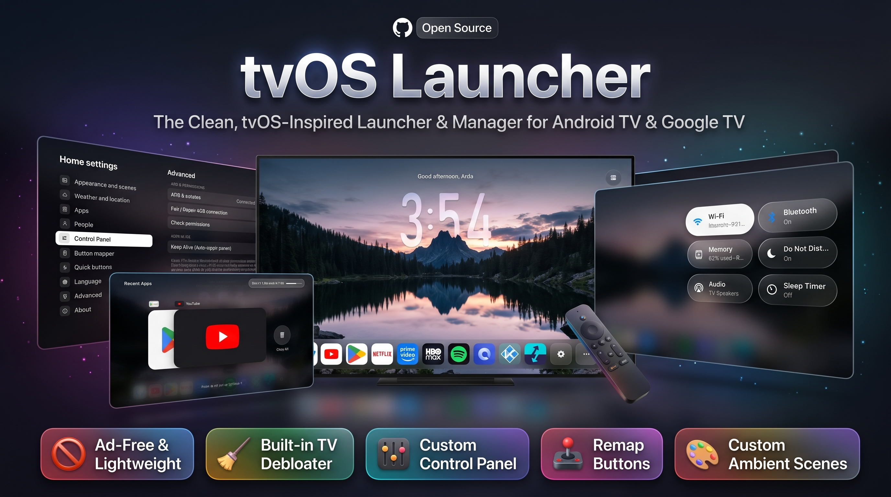

A fast, lightweight, tvOS 26 & macOS–inspired home screen for Android TV & Google TV — built in pure Java with zero third-party runtime dependencies (**~30 MB private RAM / ~38 MB total PSS, `0.0%` background CPU**). Designed to stay buttery-smooth even on 1 GB RAM TV boxes while bringing a **resizable Liquid Glass Dock (`50%–150%`)**, rotating **Night Scenes**, **Default Home Dashboard widgets**, **Custom Wallpapers (`Single/Multi, Folder Shuffle & Reddit Wallpapers`)**, a **Built-In Lock Screen / Idle Screensaver**, an **App Icon Changer & Interactive Icon Editor**, **Automatic GitHub App Updates**, a **built-in PC-free CleanYourTV Debloater (341 TV models + Manual System App Debloater + Stock Launcher Disabler)**, a **Customizable Glass Control Panel (`Quick Settings`) overlay with Extended Weather**, a **Recent Apps Switcher**, **multi-tap (`1x / 2x / 3x`) Remote Button Remapping + Send Key Code + Home Button Fix**, a **Universal 3-Mode Volume Button Hold Fix (Standard, HY320 Projector, Onn TV Box)**, **Caffeine Mode**, and **Dual-Mode Secure Local ADB Setup (Self-Repair & Volume Hold Fix without keeping port 5555 open)** to any Android TV.

---

## ✨ Highlights & Features

- **Default Home Dashboard (4 Customizable Widgets)**
  - When no app is focused, or when hovering over apps or non-app elements without Continue Watching items, displays a customizable row of 4 horizontal Liquid Glass widget tiles:
    - 🕌 **Prayer Times**: Daily schedule (Fajr, Sunrise, Dhuhr, Asr, Maghrib, Isha), live countdown to the next prayer, and 10 calculation methods (Diyanet, MWL, ISNA, Egypt, Makkah, Karachi, Tehran, Jafari, Gulf, France).
    - ⚽ **Football Matches**: Today's and upcoming fixtures, live match scores, favorite team tracking, and league schedules.
    - 🎬 **Most Watched (Çok İzlenenler)**: Popular and trending movies and TV series across top streaming platforms powered by JustWatch, synced with your UI language by default with custom multi-country selection.
    - ⛅ **Weather**: Current temperature, condition, location name, and today's forecast.
  - Fully available and configurable on both **Night Scenes** and **Classic Appearance**.
  - Toggle each widget individually and configure whether to show widgets whenever the currently selected app has no Continue Watching content.

- **Dual Appearance Modes (`Night Scenes` & `Classic`)**
  - **Night Scenes**: Layered foreground/background depth scenes (*Night*, *Golden Hour*, *Waterline*, *Fog*, *Rainforest Dawn*) or custom wallpapers with a giant glass clock (*iPhone Duo*, *iPhone Rounded*, *Tall Glass*), personalized greeting, date, live weather, and a macOS-inspired dynamically resizing **Liquid Glass Dock (`50%` to `150%`)** with floating app name callouts.
  - **Classic Appearance**: Clean app grid with an Apple tvOS–styled centered glass dock, squircle app cards, symmetrical edge spacing, and built-in photography or ambient backdrops.
  - **Big Clock for Classic Appearance**: Brings the authentic iOS/tvOS-style big glass clock, greeting, date, and top-right weather shortcut to Classic mode by default (disabling the top mini-clock), with configurable **Clock Alignment (`Left / Center / Right`)**.
  - **Dynamic & Custom Wallpaper Clock Alignment**: Dynamic alignment for default night scenes that adapts per wallpaper, plus independent Left / Center / Right alignment for custom wallpapers. Digits feature authentic Liquid Glass shading matching the dock with adaptive background luminance sampling.

- **Expanded Custom Wallpaper Engine**
  - **Single & Multi-Wallpaper**: Unlimited wallpaper selection from internal storage or USB drives (no 5-wallpaper limit).
  - **Folder Shuffle**: Automatically cycles through all wallpapers in any chosen folder.
  - **Reddit Wallpapers**: Pull high-resolution wallpapers directly from selected subreddits (e.g. `wallpapers`, `EarthPorn`) with customizable auto-change intervals and an instant "Next Wallpaper" skip action.

- **Universal Continue Watching for All Media Apps**
  - Supports all installed media apps (YouTube, SmartTube, Netflix, Prime Video, Disney+, Apple TV+, Tivimate, HBO Max, Stremio, Nuvio, etc.) using Android TV `TvContract` EPG / Watch Next content provider, `MediaSessionManager` active session tracking, and notification listeners.
  - **Dock-Linked Focused App Filtering**: The shelf only displays content for the media app currently focused on the dock.
  - **Integrated Stremio & Nuvio Dock Popups**: Popups directly above dock tiles with local caching, QR code sign-in, and multi-profile switching.
  - **Instant App Switching (No Re-Animation)**: Switching between two apps that both have Continue Watching content swaps the row instantly without re-animating.
  - **Direct Deep Links**: Clicking any Continue Watching card launches directly into the exact video/episode.

- **Standalone TV Inputs Overlay Panel**
  - Instant input switching overlay with glass UI styling, assignable via Button Mapper (e.g. single/double tap TV Input key) or accessible from the Control Panel and Home Dock.
  - Allows switching HDMI inputs seamlessly even after disabling Google TV / Android TV stock launchers.

- **Caffeine Mode (`Settings → Advanced`)**
  - Denies Android's idle mode and prevents Android TV's automatic Ambient Mode / screensaver from turning on, keeping your TV awake and preventing it from going to sleep during long sessions or presentations.

- **Universal Glass Control Panel (`Quick Settings`) Overlay**
  - Accessible from the home screen or over **any running app** via Button Mapper with selectable background modes:
    - **Blurry**: Real-time content blur behind the panel.
    - **Transparent**: Keeps live video cleanly playing behind the panel with an edge scrim.
  - **Extended Weather Panel**: Bottom weather tile spanning 4 columns showing current and tomorrow's forecast (clicking opens the full 5-day weather view).
  - Includes tiles for **Wi-Fi**, **Bluetooth**, **RAM / Recent Apps**, **Do Not Disturb**, **Audio / Sound**, **Sleep Timer**, **Ambient Mode**, **Power / Screen Off**, **Inputs**, **Button Mapper**, **Settings**, and **Search**.

- **Recent Apps Switcher Overlay & RAM Cleaner**
  - Open from any app via a mapped remote button or by tapping the **RAM** tile in the Control Panel.
  - Displays live memory usage (`RAM used / total`), horizontal app cards, **DPAD UP** to force-stop/dismiss individual apps, and a **Close All** button.

- **Multi-Tap Remote Button Mapper & 3-Mode Volume Button Hold Fix**
  - Crash-safe Accessibility Service that intercepts any remote button with independent actions for **Single Tap (1x)**, **Double Tap (2x)**, and **Triple Tap (3x)**, plus **Send Key Code** for any standard media/system key.
  - **Fix Home Button**: Optional Accessibility-powered Home key interception for TVs (such as TCL and Philips) where firmware ignores the standard default launcher.
  - **Universal Volume Button Hold Fix**:
    - **Mode 1 (Standard — Default)**: Smooth volume repeat (`320ms` delay, `85ms` repeat) and instant stopping (`<= 45ms`) on Android 9–14 TVs.
    - **Mode 2 (HY320 / Projector)**: Binder dump watcher with IR pulse-burst handling tailored for Magcubic HY320 and Android 9–12 projectors.
    - **Mode 3 (Onn TV Box)**: Optimized repeat speed and instant release handling specifically tuned for Onn Google TV streaming boxes.
    - Works across both **Secure Mode (ADB Off)** and **Persistent ADB Mode**.

- **CleanYourTV (Beta) — Built-In PC-Free Android TV Debloater (`Settings → Advanced`)**
  - Runs **[CleanYourTV](https://github.com/Gathin23/cleanyourtv)** debloat profiles directly on your TV over Local ADB — **no PC required**.
  - **341 Bundled TV & Box Profiles**: Covers *TCL, Sony, Xiaomi, Hisense, Philips, Skyworth, OnePlus, Realme, Nvidia Shield, Motorola, Toshiba, Sharp, Onn, Chromecast with Google TV*, and more.
  - **Smart OEM Model Detection & ADB Package Similarity Scanner**: Automatically identifies exact or similar models from hardware properties or scans installed vendor packages with weighted scoring.
  - **One-Tap Stock Launcher Disabler & Manual Debloater**: Disable stock launchers (*Google TV Home / LauncherX, Android TV Home / Leanback, TCL, Philips, Xiaomi, Sony*) with safety confirmations and one-tap restore.
  - **MiBluetooth Protection**: Protects Bluetooth remote services from accidental debloating.
  - **Ad-blocking Private DNS (`dns.adguard-dns.com`)** toggle.

- **Settings Backup & Restore (`Settings → System / About / Quick & Home`)**
  - Full backup of launcher preferences, dock order, custom app names, custom icons, button remapping, and scene settings to `Download/tvos-launcher-settings.json`.
  - Built-in directory picker to restore settings from internal storage or external USB drives with one click.

- **App Icon Changer & Interactive Icon Editor (`JPG / PNG / ICO`)**
  - Hold **OK** on any app to pick any `.jpg`, `.jpeg`, `.png`, or Windows `.ico` file from internal storage or USB drives.
  - Built-in **App Icon Editor** with rounded-square preview, 14 background colors, zoom, and positioning.
  - Custom App Renaming, **Other Apps (`...`)** multi-row folder, and **Hidden Apps** vault.

- **Fast 60 FPS Dimming App Launch Animation**
  - Ultra-smooth dim-to-black transition maintaining rock-solid 60 FPS performance without stutter even on entry-level chipsets.

- **Automatic & Manual GitHub Updates (`Settings → Updates`)**
  - Checks GitHub Releases for new versions with in-app changelog view and automatic installation.
  - Crash-safe Local ADB installer in Persistent Mode and Android Package Installer in Secure Mode.

- **Dual-Mode Secure Local ADB Setup**
  - **Secure Mode (Default & Recommended)**: Grants permissions once and immediately closes network ADB (`adb_enabled = 0`) so port `5555` is never left open on your LAN. Self-repair and Volume Hold Fix run 100% in-process.
  - **Persistent ADB Mode**: Keeps network ADB open for runtime debloating with a one-tap toggle in Settings.

- **16 Supported Languages**
  - Fully localized across **English, Turkish, Azerbaijani (Azərbaycan dili), Swedish, Hindi, Spanish, French, German, Italian, Russian, Portuguese, Arabic, Japanese, Chinese, Korean (한국어), and Hebrew (עברית)**.
  - Hebrew mirrors Settings, the setup wizard, dialogs and the Presentation web page right-to-left, and adds a Hebrew on-screen search keyboard.

- **Multi-User Profiles & Live Weather**
  - Up to 3 profiles, each with its own app order, hidden apps, and Continue Watching list.
  - Free 5-day weather forecast via Open-Meteo, MET Norway, or wttr.in (no API key required).

- **Ultra-Lightweight & Fast (Android 7.0 – Android 14+)**
  - Pure Android SDK Java with zero third-party runtime dependencies. ~30 MB private RAM, 0.0% background CPU, and hardware-accelerated animations across all Android TV & Google TV versions.

---

- **Dual Appearance Modes (`Night Scenes` & `Classic`) + Custom Wallpapers**
  - **Night Scenes**: Layered foreground/background depth scenes (*Night*, *Golden Hour*, *Waterline*, *Fog*, *Rainforest Dawn*, plus up to **5 Custom Wallpapers** with configurable **Clock Position: Left / Center / Right**) with a giant glass clock (*iPhone Duo*, *iPhone Rounded*, *Tall Glass*), personalized greeting, date, live weather, and a macOS-inspired dynamically resizing **Liquid Glass Dock (`50%` to `150%`)** with floating app name callouts.
  - **App Icon Changer & Interactive Icon Editor (`JPG / PNG / ICO`)**:
    - Hold **OK** on any app in the dock or grid and choose **Change app icon** to pick any `.jpg`, `.jpeg`, `.png`, or Windows `.ico` file from internal storage or USB drives.
    - Includes a built-in **App Icon Editor** with a live rounded-square preview, **14 background color options** (including auto edge-color sampling), **Zoom In / Out**, and **Left / Right / Up / Down** positioning.
  - **Custom App Renaming, Other Apps & Hidden Apps Vault**:
    - Hold **OK** on any app in the dock to **Rename**, **Change app icon**, **Move**, **Move to Other Apps**, **Hide**, view **App Info**, **Uninstall**, or **Reset Layout**.
    - **Move to Other Apps**: Removes the app from the first dock row while keeping it one click away inside the **Other apps (`...`)** button in the dock (auto-hidden when empty, with multi-row Up/Down navigation when expanded).
    - **Hidden Apps (`Settings → Apps → Hidden apps`)**: Completely hides the app from both the main dock and Other Apps. Inside **Settings → Apps → Hidden apps**, press **OK** on a hidden app to launch it directly, or **Hold OK** to restore it back to the Home Screen.
  - **Classic**: Clean 6-column app banner grid with an Apple tvOS–styled centered glass dock, larger squircle app cards, symmetrical edge spacing, smooth row animations, built-in photography, ambient color backdrops, or your own **Custom Wallpaper**, and an optional Top Shelf.

- **Multi-User Profiles & Live Weather**
  - Up to 3 profiles, each with its own app order, hidden apps, and Continue Watching list.
  - Free 5-day weather forecast via Open-Meteo, MET Norway, or wttr.in (no API key required).

- **Ultra-Lightweight, Fast & Legacy Android TV Ready (Android 7.0 – Android 14+)**
  - Pure Android SDK Java — no Gradle, no Kotlin runtime, no AndroidX bloat. Instant zoom-in app launches, hardware-accelerated focus animations, and full compatibility from Android 7.0 / 8.0 up to Android 14 TV firmwares.

---

## 📸 Screenshots

### Home Screen, Control Panel & Recent Apps Switcher

| Night Scenes Home & macOS Glass Dock | Glass Control Panel Overlay |
| :---: | :---: |
| 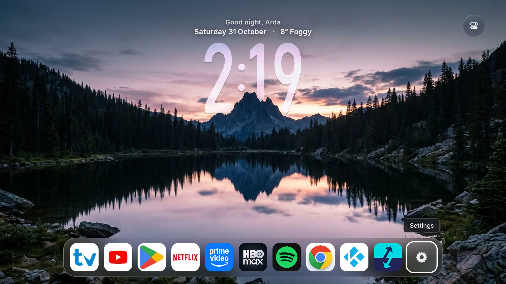 | 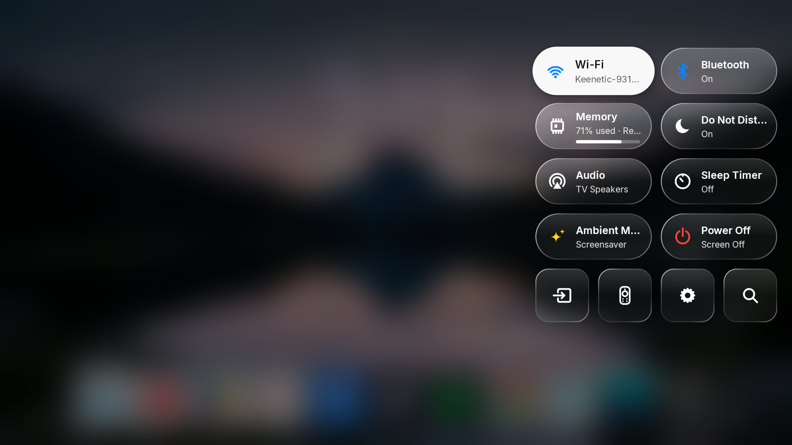 |

| Recent Apps Switcher & RAM Cleaner |
| :---: |
|  |

---

### First-Time Setup Assistant

| 1. Welcome & Language Selection | 2. Profile & Avatar Setup |
| :---: | :---: |
| 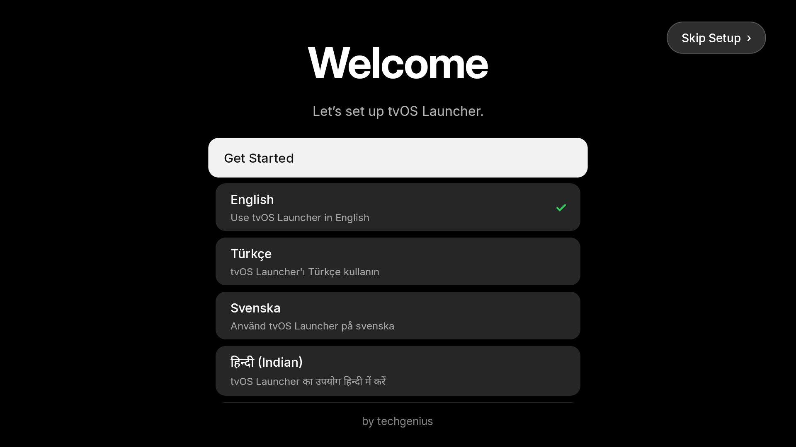 | 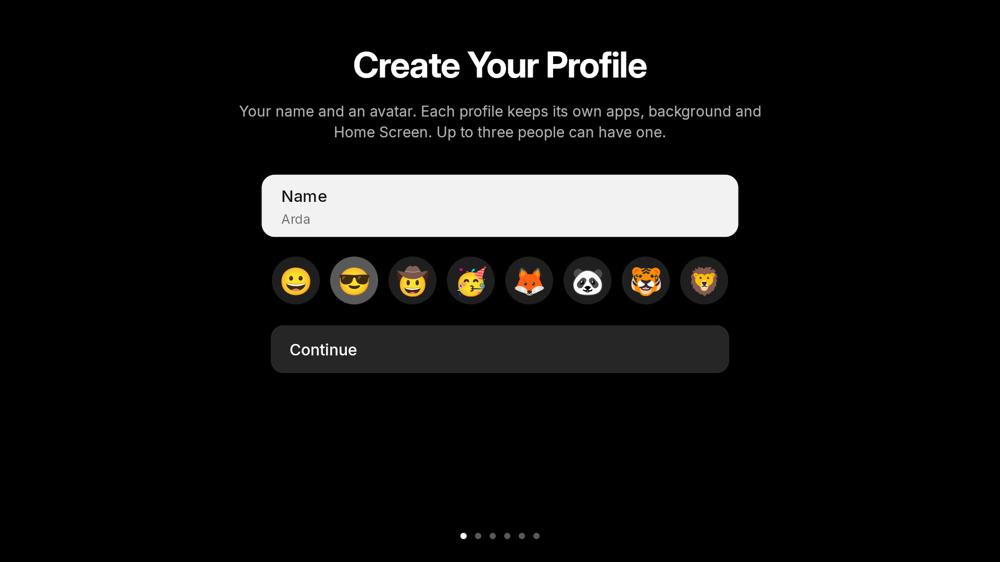 |

| 3. Appearance Mode (`Night Scenes` / `Classic`) | 4. Weather & Location |
| :---: | :---: |
| 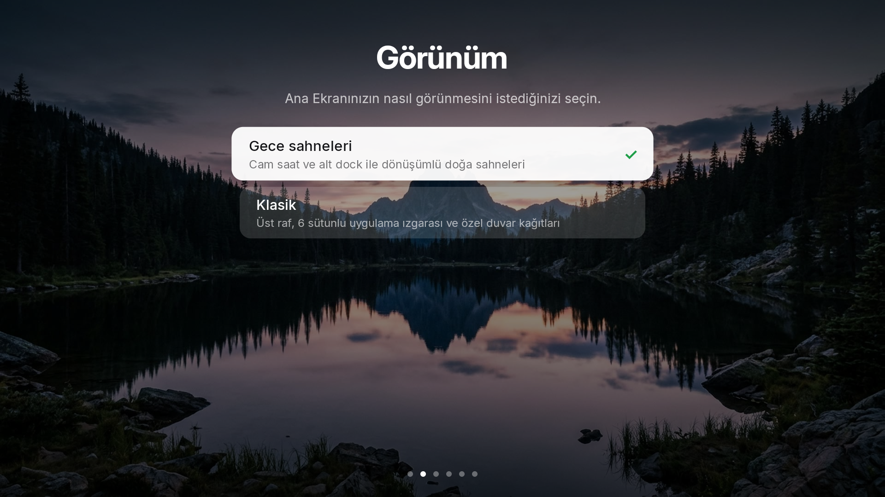 | 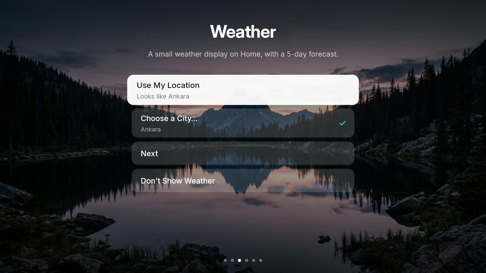 |

| 5. Easy Setup (Auto ADB) vs. Manual Permissions | 6. Remote Button Mapper Setup (`1x / 2x / 3x`) |
| :---: | :---: |
| 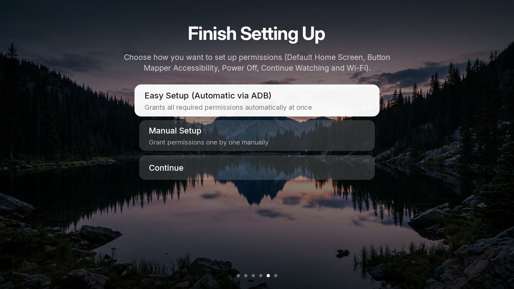 | 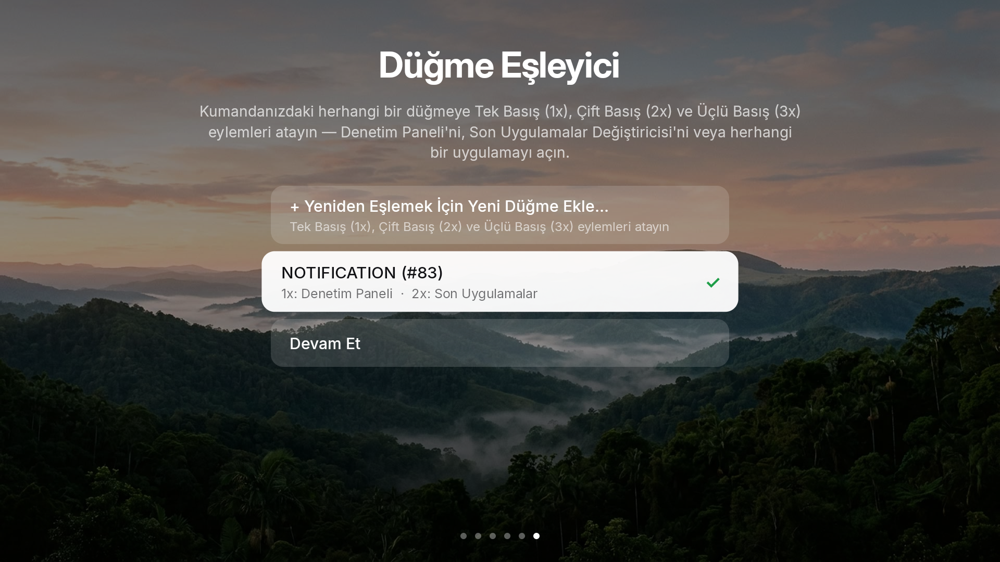 |

---

### Home Settings

| Appearance & Scenes (`Dock Size 50%–150%`) | Control Panel (`Quick Settings`) |
| :---: | :---: |
| 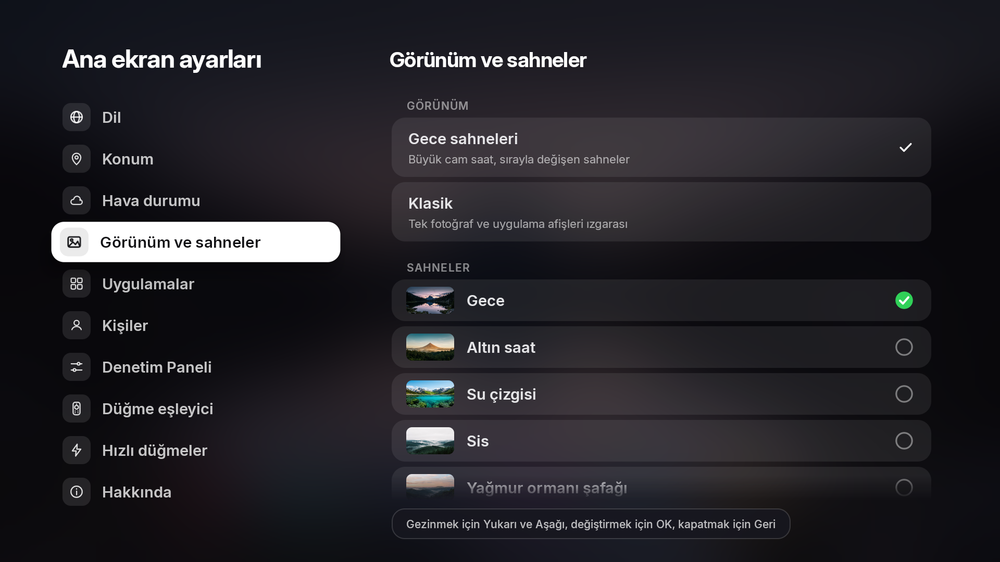 | 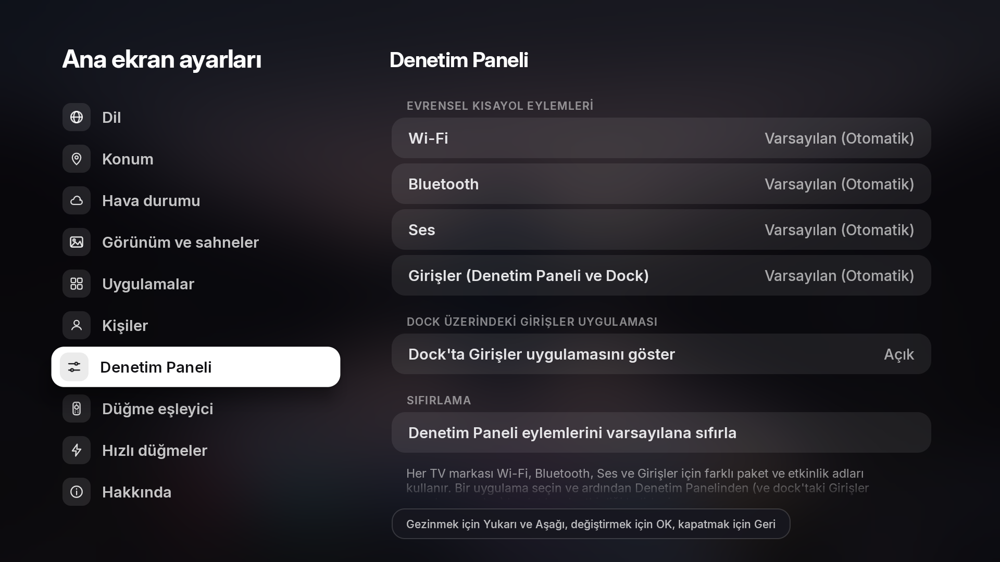 |

| Button Mapper (`1x / 2x / 3x Tap` & Home Button Fix) | Advanced, ADB Status & Permission Check (`5 / 5`) |
| :---: | :---: |
| 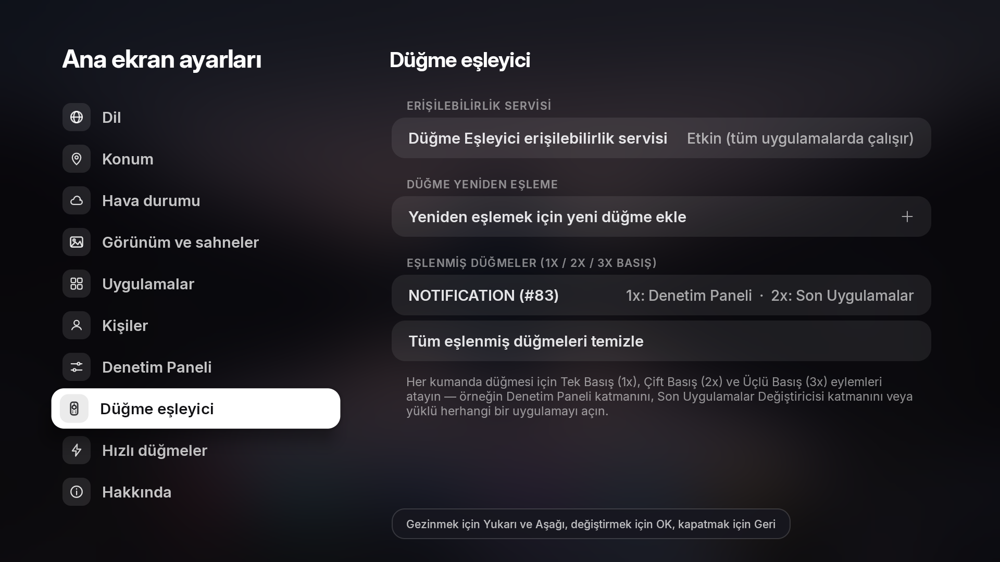 | 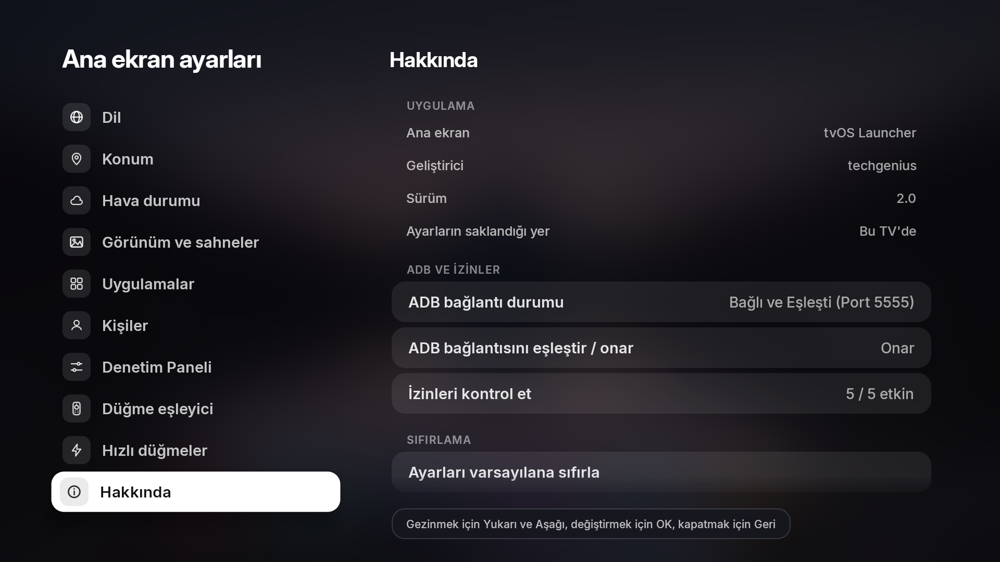 |

| CleanYourTV — Disable System Launchers | Automatic & Manual GitHub Updates |
| :---: | :---: |
| 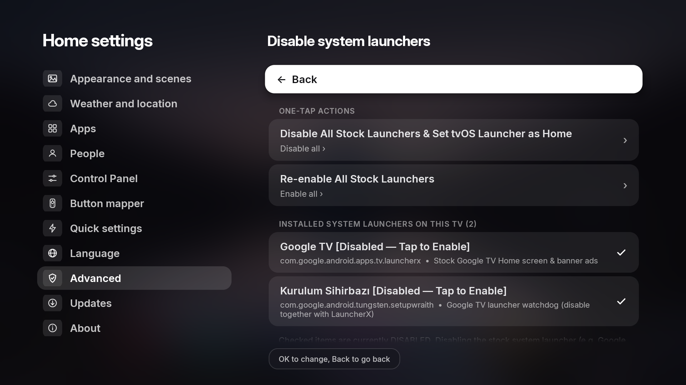 | 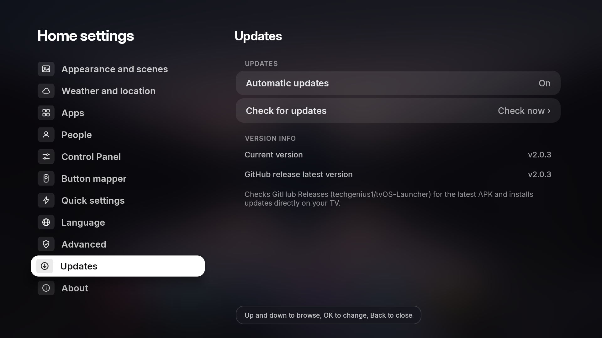 |

---

## 🚀 Quick Start (Build & Install)

### Prerequisites
- **JDK 17+** (`javac`, `jar`)
- **Android SDK** with `build-tools;34.0.0` and `platforms;android-34`

### Build on Windows (PowerShell)
```powershell
powershell -ExecutionPolicy Bypass -File .\build.ps1
# Output APK -> build\tvos-home.apk
```

### Build on macOS / Linux
```sh
./build.sh
# Output APK -> build/tvos-home.apk
```

### Install via ADB
```sh
adb connect <tv-ip>:5555
adb install -r build/tvos-home.apk
adb shell am start -n com.techgenius.tvoslauncher/.MainActivity
```

---

## 📚 Documentation

| Document | Description |
|---|---|
| **[Getting started](docs/getting-started.md)** | Install SDK tools, build from source, run on an Android TV or emulator |
| **[Features](docs/features.md)** | Detailed breakdown of launcher features |
| **[Install and set up](docs/install.md)** | Setting as default home screen, ADB permissions, and troubleshooting |
| **[Presentation mode](docs/presentation.md)** | Sending images, videos, and web pages from a browser |
| **[Architecture](docs/architecture.md)** | Code map, zero-dependency build pipeline, and performance design |
| **[Contributing](CONTRIBUTING.md)** | Workflow, code style, design and performance guidelines |

---

## 📋 Requirements

- **Android TV / Google TV 7.0+ (API 24+)**

---

## 🙌 Credits & Acknowledgements

Special thanks to the open-source projects that inspired and contributed to **tvOS Launcher**:

- **[Hume Launcher](https://github.com/petrobot-admin/hume-launcher)** by [@petrobot-admin](https://github.com/petrobot-admin) — Foundation for the zero-dependency Android TV Java architecture, Classic home layout, and system integrations.
- **[Couch TV](https://github.com/Seagey/couch-tv)** by [@Seagey](https://github.com/Seagey) — Design and inspiration for the Night Scenes depth wallpapers, giant glass clock, and glassmorphic Home Settings UI.
- **[CleanYourTV](https://github.com/Gathin23/cleanyourtv)** by [@Gathin23](https://github.com/Gathin23) — Community-curated Android TV / Google TV debloat profiles (`examples/`) and safety guidelines powering the built-in CleanYourTV (Beta) debloater.
- **Inter Typeface** (SIL Open Font License 1.1) & **Project Nayuki QR Code Generator** (MIT License).
- Weather data powered by **Open-Meteo**, **MET Norway**, and **wttr.in**.

---

## 📄 License

Licensed under the **Apache License 2.0** — see [LICENSE](LICENSE) and [NOTICE](NOTICE) for details.
