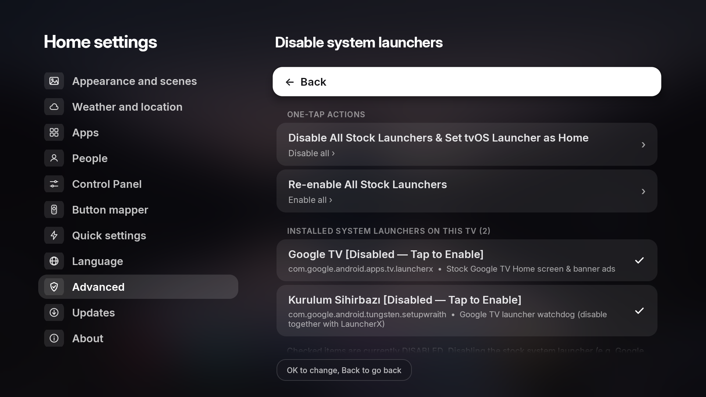
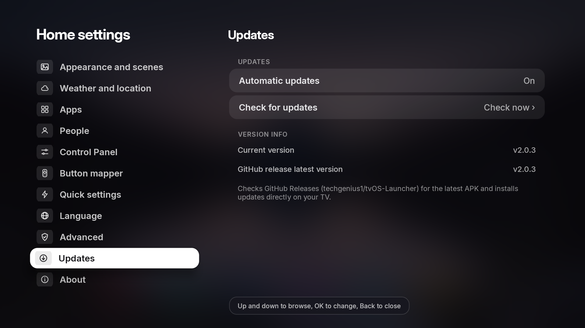

# tvOS Launcher (`v2.0.5`)

> 🇹🇷 **Türkçe dokümantasyon ve kurulum rehberi için:** **[README_TR.md (Türkçe)](README_TR.md)**  
> 📦 **Download Latest APK (`v2.0.5`):** **[GitHub Releases](https://github.com/techgenius1/tvOS-Launcher/releases/latest)**


A fast, lightweight, tvOS 26 & macOS–inspired home screen for Android TV & Google TV — built in pure Java with zero third-party runtime dependencies (**~30 MB private RAM / ~38 MB total PSS, `0.0%` background CPU**). Designed to stay buttery-smooth even on 1 GB RAM TV boxes while bringing a **resizable Liquid Glass Dock (`50%–150%`)**, rotating **Night Scenes**, **Custom Wallpapers (`Custom 1..5`)**, an **App Icon Changer & Interactive Icon Editor**, **Automatic GitHub App Updates**, a **built-in PC-free CleanYourTV Debloater (341 TV models + Manual System App Debloater + Stock Launcher Disabler)**, a **Universal Control Panel (`Quick Settings`) overlay**, a **Recent Apps Switcher**, **multi-tap (`1x / 2x / 3x`) Remote Button Remapping + Home Button Fix**, **Keep Alive auto-permission repair**, and **one-tap Local ADB setup** to any Android TV.

---

## 🆕 What's New in `v2.0.5`

- **Resizable Night Scenes Dock (`50%` – `150%`) & Smart Multi-Row Overflow**: Scale the Night Scenes dock from `50%` to `150%` (`100%` default) at the top of *Appearance and scenes*. If a larger dock size leaves room for fewer icons on the main row, overflow apps automatically move into the **Other apps (`...`)** folder, which expands into a multi-row dock with full **DPAD Up / Down / Left / Right** navigation and auto-hides when empty.
- **Refined Apple tvOS Classic Dock & Symmetrical Focus**: Updated Classic mode dock and app cards with authentic Apple tvOS squircle corner roundness, slightly larger app tiles, symmetrical edge spacing when the first or last dock app is focused, and smooth vertical scroll animations.
- **Native Right-Pane Sub-Menus in Settings**: CleanYourTV, Manual Debloat, Disable System Launchers, and all sub-screens now open natively inside the right-hand Settings pane instead of modal popup dialogs, with background pre-caching for instant opening of the 341 TV model list and system app browser.
- **One-Tap Stock Launcher Disabler & Manual System App Debloater**: Added **Disable system launchers** (automatically detects installed stock launchers like *Google TV Home / LauncherX, Android TV Home / Leanback, TCL, Philips, Xiaomi, Sony* to disable/enable in one tap) and **Manual debloat (All system apps)** with a safety confirmation and instant search.
- **Improved OEM Compatibility (TCL, Philips, Xiaomi & Android 11–14)**:
  - **Android 13/14 Restricted Settings Unlock**: Local ADB permission grant/repair now automatically sets `appops ACCESS_RESTRICTED_SETTINGS allow` so the Accessibility Service is never blocked on Android 13/14 TVs.
  - **Fix Home Button (`Settings → Button mapper`)**: Optional Accessibility-powered Home key interception (off by default) for TCL/Philips TVs that ignore the standard Android default home setting.
  - **Launch Automatically on Boot (`Settings → Advanced`)**: Optional boot-completed auto-launch toggle (off by default).
  - **Revoke All Permissions / Device Admin (`Settings → Advanced`)**: One-tap option to remove Device Admin and revoke special permissions so the app can be cleanly uninstalled on TVs that lack a system Device Admin UI.
  - **Crash-Safe ADB Repair & Key Handling**: Prevented black-screen loops during ADB permission repair, hardened `PowerService.onKeyEvent` so remote keys are never locked, renamed *Quick buttons* to **Quick settings** across all 13 languages, and set **Button sounds** to **Off** by default.

---

## ✨ Highlights & Features

- **Dual Appearance Modes (`Night Scenes` & `Classic`) + Custom Wallpapers**
  - **Night Scenes**: Layered foreground/background depth scenes (*Night*, *Golden Hour*, *Waterline*, *Fog*, *Rainforest Dawn*, plus up to **5 Custom Wallpapers** with configurable **Clock Position: Left / Center / Right**) with a giant glass clock (*iPhone Duo*, *iPhone Rounded*, *Tall Glass*), personalized greeting, date, live weather, and a macOS-inspired dynamically resizing **Liquid Glass Dock (`50%` to `150%`)** with floating app name callouts.
  - **App Icon Changer & Interactive Icon Editor (`JPG / PNG / ICO`)**:
    - Hold **OK** on any app in the dock or grid and choose **Change app icon** to pick any `.jpg`, `.jpeg`, `.png`, or Windows `.ico` file from internal storage or USB drives.
    - Includes a built-in **App Icon Editor** with a live rounded-square preview, **14 background color options** (including auto edge-color sampling), **Zoom In / Out**, and **Left / Right / Up / Down** positioning.
  - **Custom App Renaming, Other Apps & Hidden Apps Vault**:
    - Hold **OK** on any app in the dock to **Rename**, **Change app icon**, **Move**, **Move to Other Apps**, **Hide**, view **App Info**, **Uninstall**, or **Reset Layout**.
    - **Move to Other Apps**: Removes the app from the first dock row while keeping it one click away inside the **Other apps (`...`)** button in the dock (auto-hidden when empty, with multi-row Up/Down navigation when expanded).
    - **Hidden Apps (`Settings → Apps → Hidden apps`)**: Completely hides the app from both the main dock and Other Apps. Inside **Settings → Apps → Hidden apps**, press **OK** on a hidden app to launch it directly, or **Hold OK** to restore it back to the Home Screen.
  - **Classic**: Clean 6-column app banner grid with an Apple tvOS–styled centered glass dock, larger squircle app cards, symmetrical edge spacing, smooth row animations, built-in photography, ambient color backdrops, or your own **Custom Wallpaper**, and an optional Top Shelf.
- **Automatic & Manual GitHub Updates (`Settings → Updates`)**
  - Built-in updater right above the About menu that checks GitHub Releases for new versions, shows current vs. latest release info, supports one-tap **Check for updates**, and includes an **Automatic updates** toggle.
- **CleanYourTV (Beta) — Built-In PC-Free Android TV Debloater (`Settings → Advanced`)**
  - Runs **[CleanYourTV](https://github.com/Gathin23/cleanyourtv)** debloat profiles directly on your TV over Local ADB (`127.0.0.1:5555`) inside native right-side Settings menus — **no PC or external CLI required**.
  - **341 Bundled TV & Box Profiles**: Covers *TCL, Sony, Xiaomi, Hisense, Philips, Skyworth, OnePlus, Realme, Nvidia Shield, Motorola, Toshiba, Sharp, Onn, Chromecast with Google TV*, and more.
  - **Smart OEM Model Detection & ADB Package Similarity Scanner**: Automatically detects exact or similar models from your TV's hardware properties, lets you search all 341 profiles instantaneously, or scans your TV's installed OEM/vendor system apps via ADB with weighted scoring to rank the closest matching TV models.
  - **One-Tap Stock Launcher Disabler & Manual Debloater**: Includes a dedicated **Disable system launchers** menu for *Google TV Home, Android TV Home*, and OEM launchers, plus a **Manual debloat** browser for all installed system packages.
  - **Interactive Debloat Checklist**: Pre-selects telemetry, ad rows, and bloatware while keeping optional apps (*Google Assistant, YouTube Music, Play Games, TalkBack, Chromecast receiver, Remote Service*) unselected at the bottom of the list so you decide what stays.
  - **Google TV `setupwraith` Wi-Fi Guard**: Warns Google TV users about forgetting and re-adding Wi-Fi before disabling `setupwraith` / `launcherx` (or lets you safely skip `setupwraith` with one tap).
  - **One-Tap Backup, Restore & AdGuard DNS**: Tracks disabled packages, shows live **Debloat Status** (`Done` / `Not done`), restores disabled apps anytime with one tap, and includes an **Ad-blocking Private DNS (`dns.adguard-dns.com`)** toggle.
- **Universal Glass Control Panel (`Quick Settings`) Overlay**
  - Accessible from the home screen or over **any running app** via the Button Mapper accessibility service with real-time background blur (`RenderEffect` on Android 12+ with high-speed box-blur fallback).
  - Includes **Wi-Fi**, **Bluetooth**, **RAM / Recent Apps**, **Do Not Disturb**, **Audio / Sound**, **Sleep Timer**, **Ambient Mode**, **Power / Screen Off**, **Inputs**, **Button Mapper**, **Settings**, and **Search**.
  - **Universal Brand Activity Picker**: From **Settings → Control Panel**, choose any installed system app and specific activity to launch when tapping **Wi-Fi**, **Bluetooth**, **Sound**, or **Inputs** (synced with the **Inputs** app on the dock).
  - **Built-In Ambient Mode Fallback**: Launches your TV's native Google Ambient Mode / screensaver if installed, or automatically falls back to a built-in full-screen ambient showcase.
- **Recent Apps Switcher Overlay & RAM Cleaner**
  - Open from any app via a mapped remote button or by tapping the **RAM** tile in the Control Panel.
  - Displays live memory usage (`RAM used / total`), horizontal app cards, **DPAD UP** to force-stop/dismiss individual apps, and a **Close All** button.
- **Multi-Tap Remote Button Mapper (`1x` / `2x` / `3x` Tap), Home Button Fix & Volume Hold Fix**
  - Built-in crash-safe Accessibility Service that intercepts any remote button you choose and lets you assign independent actions for **Single Tap (1x)**, **Double Tap (2x)**, and **Triple Tap (3x)** — open the Control Panel on `1x`, Recent Apps Switcher on `2x`, or launch any installed app on `3x`.
  - **Fix Home Button (Off by default)**: Optional toggle to remap the remote's Home key directly to tvOS Launcher on TVs (such as TCL and Philips Android 11/12) where the firmware overrides the default launcher role.
  - **Long-Press Volume Button Fix (On by default)**: Ensures holding Volume Up/Down smoothly repeats volume steps on TVs where enabling Accessibility services normally blocks key-repeat on volume buttons.
- **Easy Setup via Local ADB, Keep Alive Auto-Repair & One-Tap Permission Revoke**
  - **Easy Setup (Auto via Local ADB)** connects to `127.0.0.1:5555` to automatically unlock `ACCESS_RESTRICTED_SETTINGS` (Android 13/14+) and grant Default Home, Accessibility Service, Device Admin, Notification Listener, Usage Stats, `WRITE_SECURE_SETTINGS`, and Background Activity Launch permissions in one click.
  - **Keep Alive (On by default)**: Lightly monitors permission status in the background with zero extra RAM/CPU load and automatically restores Accessibility or other permissions via Local ADB if the TV firmware disables them.
  - **Revoke All Permissions (`Settings → Advanced`)**: Removes Device Admin and revokes special permissions in one tap for easy uninstallation on any TV.
- **13 Supported Languages**
  - Fully localized UI across **English, Turkish, Swedish, Hindi, Spanish, French, German, Italian, Russian, Portuguese, Arabic, Japanese, and Chinese**.
- **Multi-User Profiles & Live Weather**
  - Up to 3 profiles, each with its own app order, hidden apps, and Continue Watching list.
  - Free 5-day weather forecast via Open-Meteo, MET Norway, or wttr.in (no API key required).
- **Ultra-Lightweight, Fast & Legacy Android TV Ready (Android 7.0 – Android 14+)**
  - Pure Android SDK Java — no Gradle, no Kotlin runtime, no AndroidX bloat. Instant zoom-in app launches, hardware-accelerated focus animations, and full compatibility from Android 7.0 / 8.0 up to Android 14 TV firmwares.

---

## 📸 Screenshots

### Home Screen, Control Panel & Recent Apps Switcher

| Night Scenes Home & macOS Glass Dock | Glass Control Panel Overlay |
| :---: | :---: |
|  |  |

| Recent Apps Switcher & RAM Cleaner |
| :---: |
|  |

---

### First-Time Setup Assistant

| 1. Welcome & Language Selection | 2. Profile & Avatar Setup |
| :---: | :---: |
|  |  |

| 3. Appearance Mode (`Night Scenes` / `Classic`) | 4. Weather & Location |
| :---: | :---: |
|  |  |

| 5. Easy Setup (Auto ADB) vs. Manual Permissions | 6. Remote Button Mapper Setup (`1x / 2x / 3x`) |
| :---: | :---: |
|  |  |

---

### Home Settings

| Appearance & Scenes (`Dock Size 50%–150%`) | Control Panel (`Quick Settings`) |
| :---: | :---: |
|  |  |

| Button Mapper (`1x / 2x / 3x Tap` & Home Button Fix) | Advanced, ADB Status & Permission Check (`5 / 5`) |
| :---: | :---: |
|  |  |

| CleanYourTV — Disable System Launchers | Automatic & Manual GitHub Updates |
| :---: | :---: |
|  |  |

---

## 🚀 Quick Start (Build & Install)

### Prerequisites
- **JDK 17+** (`javac`, `jar`)
- **Android SDK** with `build-tools;34.0.0` and `platforms;android-34`

### Build on Windows (PowerShell)
```powershell
powershell -ExecutionPolicy Bypass -File .\build.ps1
# Output APK -> build\tvos-home.apk
```

### Build on macOS / Linux
```sh
./build.sh
# Output APK -> build/tvos-home.apk
```

### Install via ADB
```sh
adb connect <tv-ip>:5555
adb install -r build/tvos-home.apk
adb shell am start -n com.techgenius.tvoslauncher/.MainActivity
```

---

## 📚 Documentation

| Document | Description |
|---|---|
| **[Getting started](docs/getting-started.md)** | Install SDK tools, build from source, run on an Android TV or emulator |
| **[Features](docs/features.md)** | Detailed breakdown of launcher features |
| **[Install and set up](docs/install.md)** | Setting as default home screen, ADB permissions, and troubleshooting |
| **[Presentation mode](docs/presentation.md)** | Sending images, videos, and web pages from a browser |
| **[Architecture](docs/architecture.md)** | Code map, zero-dependency build pipeline, and performance design |
| **[Contributing](CONTRIBUTING.md)** | Workflow, code style, design and performance guidelines |

---

## 📋 Requirements

- **Android TV / Google TV 7.0+ (API 24+)**

---

## 🙌 Credits & Acknowledgements

Special thanks to the open-source projects that inspired and contributed to **tvOS Launcher**:

- **[Hume Launcher](https://github.com/petrobot-admin/hume-launcher)** by [@petrobot-admin](https://github.com/petrobot-admin) — Foundation for the zero-dependency Android TV Java architecture, Classic home layout, and system integrations.
- **[Couch TV](https://github.com/Seagey/couch-tv)** by [@Seagey](https://github.com/Seagey) — Design and inspiration for the Night Scenes depth wallpapers, giant glass clock, and glassmorphic Home Settings UI.
- **[CleanYourTV](https://github.com/Gathin23/cleanyourtv)** by [@Gathin23](https://github.com/Gathin23) — Community-curated Android TV / Google TV debloat profiles (`examples/`) and safety guidelines powering the built-in CleanYourTV (Beta) debloater.
- **Inter Typeface** (SIL Open Font License 1.1) & **Project Nayuki QR Code Generator** (MIT License).
- Weather data powered by **Open-Meteo**, **MET Norway**, and **wttr.in**.

---

## 📄 License

Licensed under the **Apache License 2.0** — see [LICENSE](LICENSE) and [NOTICE](NOTICE) for details.
