# tvOS Launcher (`v2.2.5`)

> 🇹🇷 **Türkçe dokümantasyon ve kurulum rehberi için:** **[README_TR.md (Türkçe)](README_TR.md)**  
> 📦 **Download Latest APK (`v2.2.5`):** **[GitHub Releases](https://github.com/techgenius1/tvOS-Launcher/releases/latest)**

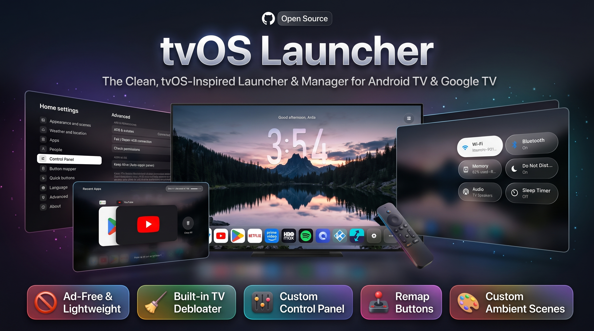

A fast, lightweight, tvOS 26 & macOS–inspired home screen for Android TV & Google TV — built in pure Java with zero third-party runtime dependencies (**~5.7 MB APK, `0.0%` background CPU, baked Liquid Glass rendering with 60 FPS navigation**). Designed to stay buttery-smooth from **Android 6.0 (API 23)** to **Android 14+** even on 1 GB RAM TV boxes while bringing a **resizable Multi-Row Liquid Glass Dock (`50%–150%`, `1–3 rows`)**, a **macOS 26–inspired Applications Popup**, a **Native Liquid Glass Universal Search Modal with a Home Screen Search Shortcut**, rotating **Night Scenes** with **Custom Foreground Depth Cutouts** and **Big Glass Clock or Small Header Clock**, **7 Interactive Home Dashboard Widgets** (with **Prayer Times Country/City Selector + Weather Sync** and **Live News Country Selector**), **Custom Wallpapers (`Single/Multi, Folder Shuffle & Reddit Wallpapers`)**, a **Built-In Lock Screen / Idle Screensaver**, an **App Icon Changer & Interactive Icon Editor**, **Automatic GitHub App Updates**, a **built-in PC-free CleanYourTV Debloater (On-Demand GitHub Profile Downloader + Manual System App Debloater + Stock Launcher Disabler)**, a **Customizable Glass Control Panel (`Quick Settings`) overlay with Extended Weather & Native Power Menu**, an **Input Manager (Hide & Rename TV Inputs)**, a **Recent Apps Switcher**, **multi-tap (`1x / 2x / 3x`) Remote Button Remapping with ScanCode Support + Direct-Boot Home Button Fix**, a **Universal 3-Mode Volume Button Hold Fix (Standard, HY320 Projector, Onn TV Box)**, **Apple TV UI Sound Effects**, **Caffeine Mode**, and **Dual-Mode Secure Local ADB Setup (with Dynamic Port Discovery)** to any Android TV.

---

## ✨ Highlights & Features

- **Native Liquid Glass Universal Search & Home Screen Search Shortcut**
  - Redesigned **Search** in a centered macOS 26–style Liquid Glass modal matching the *Other Apps* UI, complete with voice dictation and keyboard support.
  - Filters **Movies & TV** results to your actually installed streaming apps and active region, plus **Search in Apps** quick launchers and **In-App Results** from installed TV apps' search providers.
  - Toggleable **Search shortcut** button next to the Weather & Control Panel buttons on the Home Screen (**Settings → Home Dashboard / Quick & Home**).

- **Default Home Dashboard (7 Interactive & Customizable Widgets)**
  - Displays a horizontally scrollable row of 7 Liquid Glass widget tiles with native Liquid Glass detail popups (all enabled by default, with **Hold OK** on any widget to **Move** or **Disable** directly from the Home Screen, and zero-flash Home button handling):
    - 🕌 **Prayer Times**: Daily schedule (Fajr, Sunrise, Dhuhr, Asr, Maghrib, Isha), live countdown to the next prayer, 10 calculation methods, and a **Country/City selector** (worldwide search, 20 popular cities, or automatic **Sync with Weather location** configured during Initial Setup or Settings).
    - ⚽ **Interactive Football Matches**: Upcoming and live fixtures across all leagues and competitions (Champions League, Europa League, Premier League, LaLiga, Serie A, Bundesliga, Ligue 1, Süper Lig, etc.) involving your favorite teams, dual team logos, live in-play scores, and D-Pad Left/Right fixture browsing.
    - 🎬 **Most Watched (Çok İzlenenler)**: Popular and trending movies and TV series across top streaming platforms powered by JustWatch, synced with your UI language by default with custom multi-country selection.
    - ⛅ **Weather**: Current temperature, condition, location name, and today's & tomorrow's forecast.
    - 🏏 **Live Cricket Scores**: Real-time international and league cricket match scores and status updates.
    - 📰 **Live News**: Curated breaking headlines and top news stories with a **Country selector** (auto-synced with your UI language by default).
    - 🍿 **Top Movies & Series**: Highest-rated trending movies and series recommendations.
  - Fully available and configurable on both **Night Scenes** and **Classic Appearance**.

- **Dual Appearance Modes (`Night Scenes` & `Classic`) + Multi-Row Dock**
  - **Night Scenes**: Layered foreground/background depth scenes (*Night*, *Golden Hour*, *Waterline*, *Fog*, *Rainforest Dawn*) or custom wallpapers (including **Custom Foreground PNG Depth Cutouts** so the giant glass clock sits behind your custom foreground subject) with a giant glass clock (*iPhone Duo*, *iPhone Rounded*, *Tall Glass*) or an optional **Small Clock** in the top-left header, personalized greeting, date, live weather, background-threaded scene crossfades, and a macOS-inspired dynamically resizing **Liquid Glass Dock (`50%` to `150%`, configurable `1 to 3 rows`)** with supersampled anti-aliased squircle icons, adaptive white/black focus rings, and always-on-top floating app name callouts.
  - **macOS 26 Applications Popup (`Other Apps`) & Hidden Apps Vault**: Dedicated frosted-glass Applications modal with a 5-column scrollable grid. Hold **OK** on any app to **Rename**, **Change app icon**, **Move**, **Move to Other Apps** (shrinking the main dock cleanly), **Hide** (accessible via **Settings → Apps → Hidden apps**), view **App Info**, **Uninstall**, or **Reset Layout**.
  - **Classic Appearance**: Clean 6-column app grid with an Apple tvOS–styled centered glass dock, squircle app cards, symmetrical edge spacing, and built-in photography or ambient backdrops.
  - **Big Clock for Classic Appearance**: Brings the authentic iOS/tvOS-style big glass clock, greeting, date, and top-right weather shortcut to Classic mode by default (disabling the top mini-clock), with configurable **Clock Alignment (`Left / Center / Right`)**.
  - **Dynamic & Custom Wallpaper Clock Alignment**: Dynamic alignment for default night scenes that adapts per wallpaper, plus independent Left / Center / Right alignment for custom wallpapers.

- **Expanded Custom Wallpaper Engine (`1–60 Min Intervals`)**
  - **Single & Multi-Wallpaper**: Unlimited wallpaper selection from internal storage or USB drives, plus optional custom foreground PNG depth layers for Night Scenes.
  - **Folder Shuffle**: Automatically cycles through all wallpapers in any chosen folder.
  - **Reddit Wallpapers**: Pull high-resolution wallpapers directly from selected subreddits (e.g. `wallpapers`, `EarthPorn`) with customizable auto-change intervals (`1, 2, 3, 5, 10, 15, 20, 25, 30, or 60 minutes`) and an instant "Next Wallpaper" skip action.

- **Universal Continue Watching for All Media Apps**
  - Supports installed media apps (YouTube, SmartTube, Netflix, Prime Video, Disney+, Apple TV+, HBO Max, Stremio, Nuvio, Lampa, and other third-party TV channel apps) using Android TV `TvContract` EPG / Watch Next / Preview channels, `MediaSessionManager` active session tracking, and notification listeners.
  - **Dock-Linked Focused App Filtering**: The shelf only displays content for the media app currently focused on the dock.
  - **Integrated Stremio & Nuvio Dock Popups**: Popups directly above dock tiles with local caching, QR code sign-in, and multi-profile switching (including Nuvio fork linking).
  - **Direct Deep Links**: Clicking any Continue Watching card launches directly into the exact video/episode.

- **Standalone TV Inputs Overlay Panel & Input Manager (`Settings → Control Panel → Inputs`)**
  - Instant input switching overlay with glass UI styling, assignable via Button Mapper or accessible from the Control Panel and Home Dock.
  - **Input Manager**: Hide unused TV/HDMI inputs or assign custom names/labels to any input directly from Settings.

- **Caffeine Mode (`Settings → Advanced`)**
  - Denies Android's idle mode and prevents Android TV's automatic Ambient Mode / screensaver from turning on, keeping your TV awake during long sessions or presentations.

- **Universal Glass Control Panel (`Quick Settings`) Overlay, Native Power Menu & Apple TV UI Sounds**
  - Accessible from the home screen or over **any running app** via Button Mapper with selectable **Blurry** or **Transparent** background modes.
  - Authentic **Apple TV UI Sound Effects** (*Navigate*, *Click*, *Back*) toggleable directly from the Control Panel.
  - **Configurable Power Tile**: Choose between **Screen Off**, Android's **Native Power Menu** (via Accessibility or ADB long-press), or a custom action.
  - **Extended Weather Panel**: Bottom weather tile spanning 4 columns showing current and tomorrow's forecast (clicking opens the full 5-day weather view).
  - Includes tiles for **Wi-Fi**, **Bluetooth**, **RAM / Recent Apps**, **Do Not Disturb**, **Audio / Sound**, **Sleep Timer**, **Ambient Mode**, **Power / Screen Off**, **Inputs**, **Button Mapper**, **Settings**, and **Search**.

- **Recent Apps Switcher Overlay & RAM Cleaner**
  - Open from any app via a mapped remote button or by tapping the **RAM** tile in the Control Panel.
  - Displays live memory usage (`RAM used / total`), smooth horizontal app cards, **DPAD UP** to force-stop/dismiss individual apps, a **Close All** button, and clear status guidance if Secure ADB Mode restricts background task listing.

- **Multi-Tap Remote Button Mapper, ScanCode Discrimination & 3-Mode Volume Button Hold Fix**
  - Direct-boot–aware, crash-safe Accessibility Service that intercepts remote buttons with independent actions for **Single Tap (1x)**, **Double Tap (2x)**, and **Triple Tap (3x)**, plus **Send Key Code**.
  - **Hardware ScanCode Support & Bluetooth Remote Safety**: Distinguishes buttons that share the same Android keyCode (such as Philips TV *Sources* `scanCode 757` and *Settings* `scanCode 641` on keyCode `#602`) while passing standard gamepad controller buttons and keyboard D-Pad hold inputs through untouched without blocking Bluetooth TV remotes.
  - **Fix Home Button & Instant Boot Priority**: Intercepts Home key presses and launches tvOS Launcher immediately after boot/unlock (`directBootAware` + `USER_UNLOCKED`) without OEM launcher delay.
  - **Universal Volume Button Hold Fix**:
    - **Mode 1 (Standard — Default)**: Smooth volume repeat (`320ms` delay, `85ms` repeat) and instant stopping (`<= 45ms`) on Android 9–14 TVs.
    - **Mode 2 (HY320 / Projector)**: Binder dump watcher with IR pulse-burst handling tailored for Magcubic HY320 and Android 9–12 projectors.
    - **Mode 3 (Onn TV Box)**: Optimized repeat speed and instant release handling specifically tuned for Onn Google TV streaming boxes.

- **CleanYourTV (Beta) — Built-In PC-Free Android TV Debloater & Uninstaller Helper (`Settings → Advanced`)**
  - Downloads the latest **[CleanYourTV](https://github.com/Gathin23/cleanyourtv)** release archive on demand into `Download/cleanyourtv`, extracts TV debloat profiles with a live progress popup, and lets you clean up unneeded model files after selecting your TV to keep storage usage minimal.
  - **Smart OEM Model Detection & ADB Package Similarity Scanner**: Automatically identifies exact or similar models from hardware properties or scans installed vendor packages.
  - **One-Tap Stock Launcher Disabler & Manual Debloater**: Disable stock launchers (*Google TV Home / LauncherX, Android TV Home / Leanback, TCL, Philips, Xiaomi, Sony, Amlogic/Droidlogic*) with safety confirmations and one-tap restore.
  - **Safe Uninstall Helper**: Dedicated **Uninstall tvOS Launcher** option in Advanced Settings that offers to restore debloated apps and re-enable OEM launchers, revokes special permissions cleanly, and opens the system uninstall screen.

- **Settings Backup & Restore (`Settings → System / About / Quick & Home`)**
  - Full backup of launcher preferences, dock order, custom app names, custom icons, button remapping, and scene settings to `Download/tvos-launcher-settings.json`.

- **App Icon Changer & Interactive Icon Editor (`JPG / PNG / ICO`)**
  - Hold **OK** on any app to pick any `.jpg`, `.jpeg`, `.png`, or Windows `.ico` file from internal storage or USB drives with a built-in 14-color rounded-square **App Icon Editor** (live preview, auto edge-color sampling, zoom, and pan).

- **Automatic & Manual GitHub Updates (`Settings → Updates`)**
  - Downloads updates into `Download/tvOSLauncherUpdates` without re-downloading existing files, installs silently via Local ADB (`pm install -r`) in Persistent ADB Mode or via the system PackageInstaller in Secure Mode, and automatically cleans up the update folder on first launch after updating.

- **Dual-Mode Secure Local ADB Setup with Dynamic Port Detection**
  - Automatically scans and connects to your TV's active local ADB port (`5555`, `5070`, `adb.tcp.port`, or active listening sockets) using a single persistent RSA keypair.
  - **Secure Mode (Default & Recommended)**: Grants permissions once and immediately closes network ADB (`adb_enabled = 0`).
  - **Persistent ADB Mode**: Keeps network ADB open for runtime debloating, Recent Apps management, and silent background auto-updates.

- **17 Supported Languages (Full RTL Support for Hebrew & Arabic)**
  - Fully localized across **English, Turkish, Azerbaijani (Azərbaycan dili), Swedish, Hindi, Spanish, French, German, Italian, Russian, Portuguese, Brazilian Portuguese (Português do Brasil), Arabic, Japanese, Chinese, Korean (한국어), and Hebrew (עברית)** with right-to-left UI mirroring for both Hebrew and Arabic.

- **Multi-User Profiles & Live Weather**
  - Up to 3 profiles, each with its own app order, hidden apps, and Continue Watching list, plus a free 5-day weather forecast via Open-Meteo, MET Norway, or wttr.in (no API key required).

- **Ultra-Lightweight, Fast & Legacy Android TV Ready (Android 6.0 – Android 14+)**
  - Pure Android SDK Java — no Gradle, no Kotlin runtime, no AndroidX bloat. Baked Liquid Glass surfaces, lazy Classic view creation, in-place widget refreshes, zero-flash Home presses, and full compatibility from **Android 6.0 (API 23)** up to **Android 14+** TV firmwares.

---

## 📸 Screenshots

### Home Screen, Control Panel & Recent Apps Switcher

| Night Scenes Home & macOS Glass Dock | Glass Control Panel Overlay |
| :---: | :---: |
| 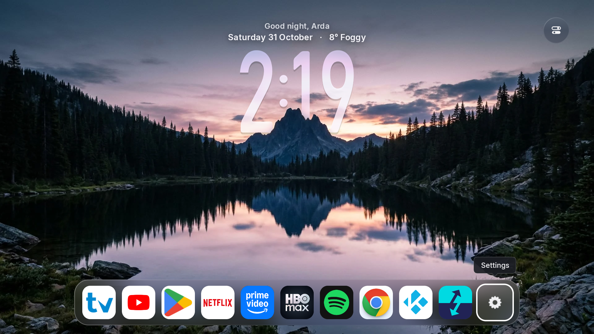 | 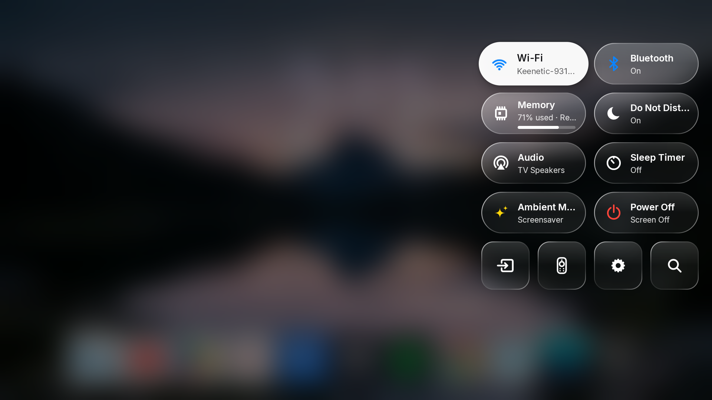 |

| Recent Apps Switcher & RAM Cleaner |
| :---: |
|  |

---

### First-Time Setup Assistant

| 1. Welcome & Language Selection | 2. Profile & Avatar Setup |
| :---: | :---: |
| 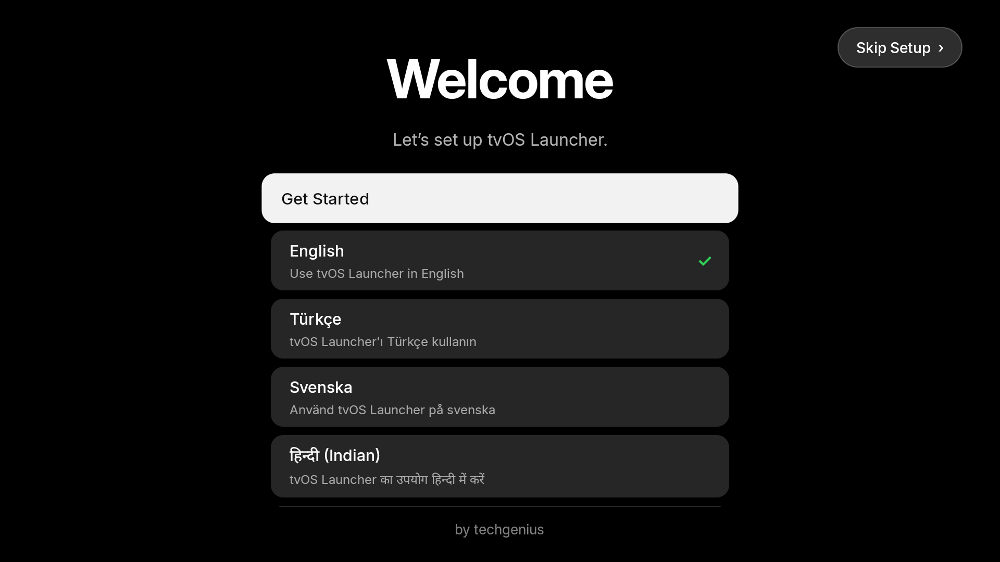 | 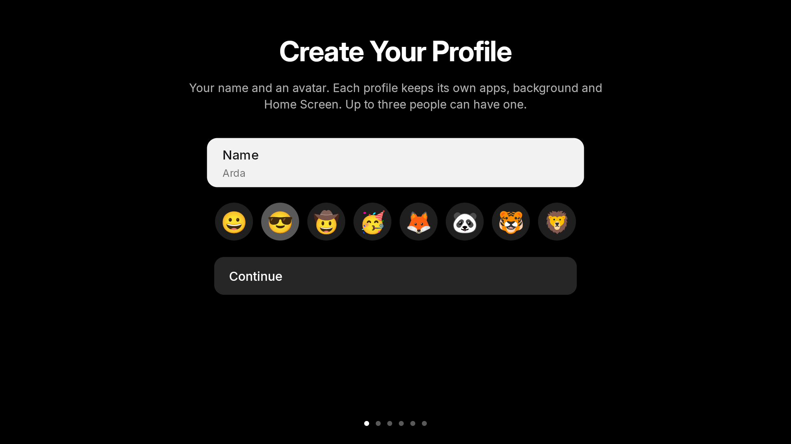 |

| 3. Appearance Mode (`Night Scenes` / `Classic`) | 4. Weather & Location |
| :---: | :---: |
| 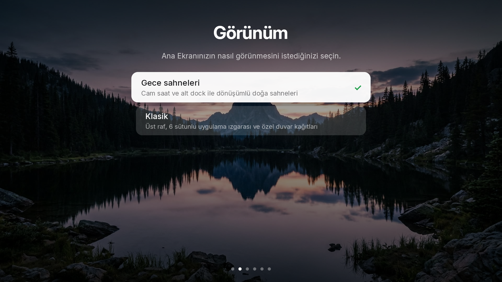 | 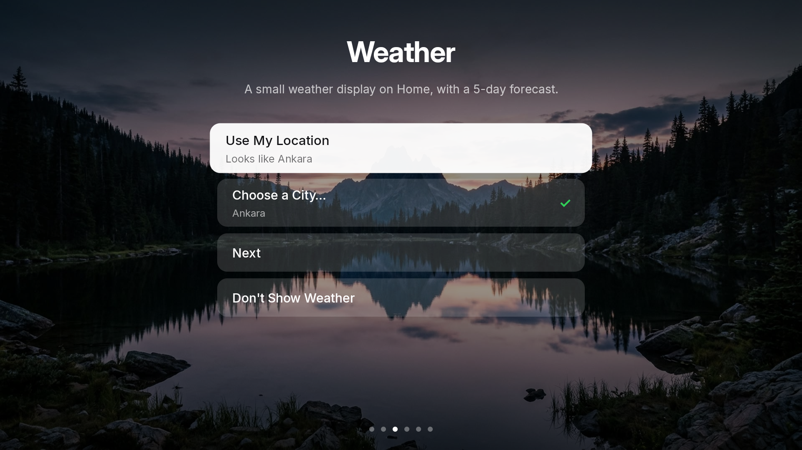 |

| 5. Easy Setup (Auto ADB) vs. Manual Permissions | 6. Remote Button Mapper Setup (`1x / 2x / 3x`) |
| :---: | :---: |
| 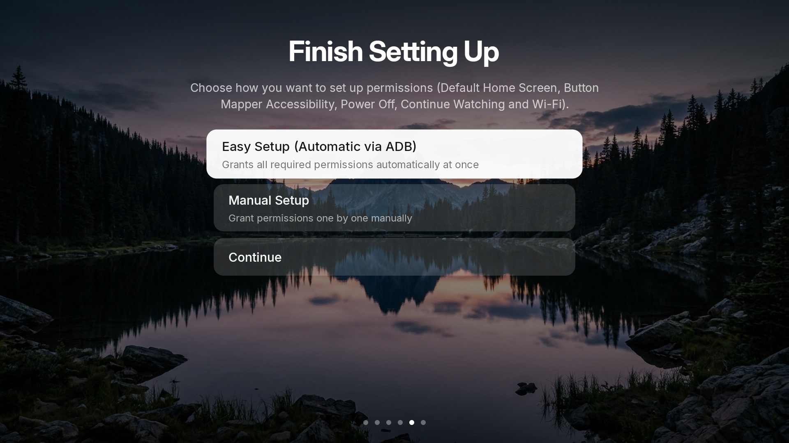 | 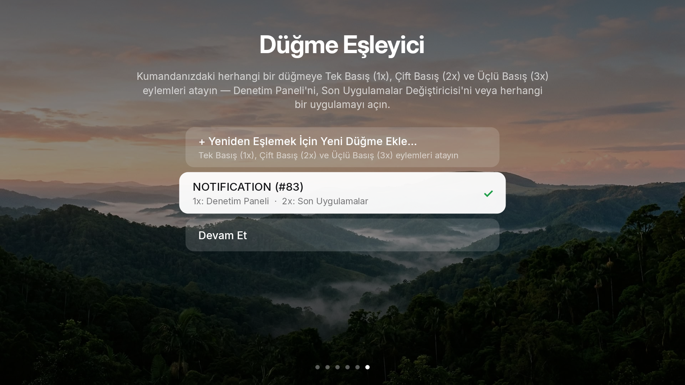 |

---

### Home Settings

| Appearance & Scenes (`Dock Size 50%–150%`) | Control Panel (`Quick Settings`) |
| :---: | :---: |
| 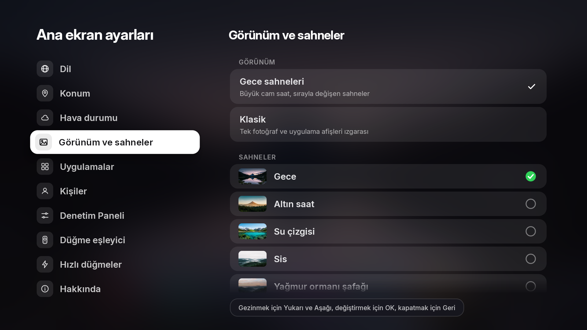 | 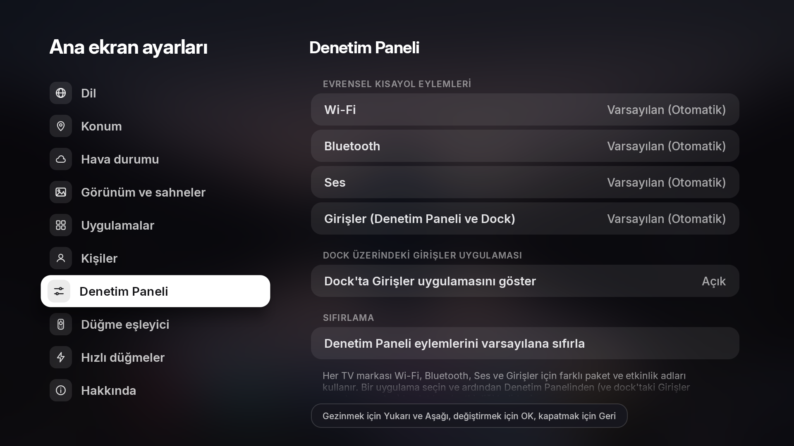 |

| Button Mapper (`1x / 2x / 3x Tap` & Home Button Fix) | Advanced, ADB Status & Permission Check (`5 / 5`) |
| :---: | :---: |
| 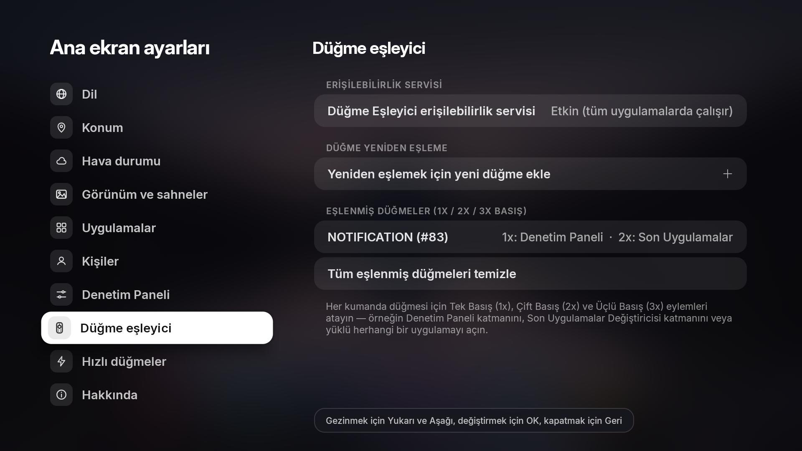 | 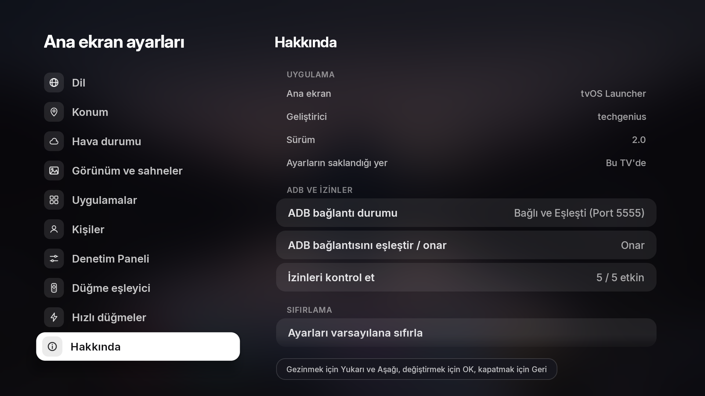 |

| CleanYourTV — Disable System Launchers | Automatic & Manual GitHub Updates |
| :---: | :---: |
| 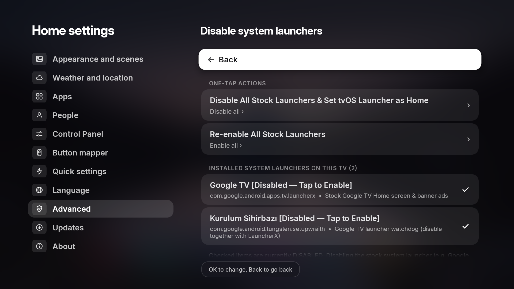 | 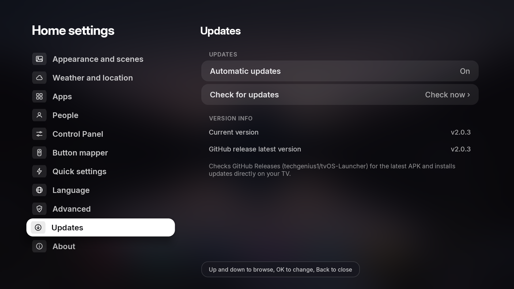 |

---

## 🚀 Quick Start (Build & Install)

### Prerequisites
- **JDK 17+** (`javac`, `jar`)
- **Android SDK** with `build-tools;34.0.0` and `platforms;android-34`

### Build on Windows (PowerShell)
```powershell
powershell -ExecutionPolicy Bypass -File .\build.ps1
# Output APK -> build\tvos-home.apk
```

### Build on macOS / Linux
```sh
./build.sh
# Output APK -> build/tvos-home.apk
```

### Install via ADB
```sh
adb connect <tv-ip>:5555
adb install -r build/tvos-home.apk
adb shell am start -n com.techgenius.tvoslauncher/.MainActivity
```

---

## 📚 Documentation

| Document | Description |
|---|---|
| **[Getting started](docs/getting-started.md)** | Install SDK tools, build from source, run on an Android TV or emulator |
| **[Features](docs/features.md)** | Detailed breakdown of launcher features |
| **[Install and set up](docs/install.md)** | Setting as default home screen, ADB permissions, and troubleshooting |
| **[Presentation mode](docs/presentation.md)** | Sending images, videos, and web pages from a browser |
| **[Architecture](docs/architecture.md)** | Code map, zero-dependency build pipeline, and performance design |
| **[Contributing](CONTRIBUTING.md)** | Workflow, code style, design and performance guidelines |

---

## 📋 Requirements

- **Android TV / Google TV 6.0+ (API 23+)**

---

## 🙌 Credits & Acknowledgements

Special thanks to the open-source projects that inspired and contributed to **tvOS Launcher**:

- **[Hume Launcher](https://github.com/petrobot-admin/hume-launcher)** by [@petrobot-admin](https://github.com/petrobot-admin) — Foundation for the zero-dependency Android TV Java architecture, Classic home layout, and system integrations.
- **[Couch TV](https://github.com/Seagey/couch-tv)** by [@Seagey](https://github.com/Seagey) — Design and inspiration for the Night Scenes depth wallpapers, giant glass clock, and glassmorphic Home Settings UI.
- **[CleanYourTV](https://github.com/Gathin23/cleanyourtv)** by [@Gathin23](https://github.com/Gathin23) — Community-curated Android TV / Google TV debloat profiles (`examples/`) and safety guidelines powering the built-in CleanYourTV (Beta) debloater.
- **Inter Typeface** (SIL Open Font License 1.1) & **Project Nayuki QR Code Generator** (MIT License).
- Weather data powered by **Open-Meteo**, **MET Norway**, and **wttr.in**.

---

## 📄 License

Licensed under the **Apache License 2.0** — see [LICENSE](LICENSE) and [NOTICE](NOTICE) for details.
