# tvOS Launcher (`v2.0.2`)

> 🇹🇷 **Türkçe dokümantasyon ve kurulum rehberi için:** **[README_TR.md (Türkçe)](README_TR.md)**  
> 📦 **Download Latest APK (`v2.0.2`):** **[GitHub Releases](https://github.com/techgenius1/tvOS-Launcher/releases/latest)**

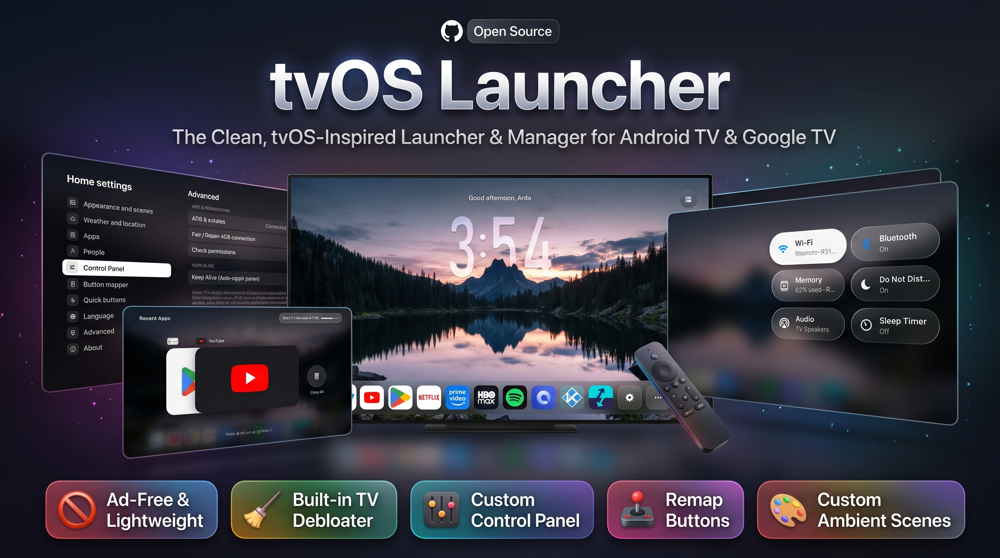

A fast, lightweight, tvOS 26 & macOS–inspired home screen for Android TV & Google TV — built in pure Java with zero third-party runtime dependencies (**~30 MB private RAM / ~38 MB total PSS, `0.0%` background CPU**). Designed to stay buttery-smooth even on 1 GB RAM TV boxes while bringing a **Liquid Glass Dock**, rotating **Night Scenes**, a **built-in PC-free CleanYourTV Debloater (341 TV models)**, a **Universal Control Panel overlay**, a **Recent Apps Switcher**, **multi-tap (`1x / 2x / 3x`) Remote Button Remapping**, **Keep Alive auto-permission repair**, and **one-tap Local ADB setup** to any Android TV.

---

## ✨ Highlights & Features

- **Dual Appearance Modes (`Night Scenes` & `Classic`)**
  - **Night Scenes**: Layered foreground/background depth scenes (*Night*, *Golden Hour*, *Waterline*, *Fog*, *Rainforest Dawn*, 60s default rotation) with a giant glass clock (*iPhone Duo*, *iPhone Rounded*, *Tall Glass*) behind the mountain/landscape foreground, personalized greeting, date, live weather, and a macOS-inspired dynamically resizing **Liquid Glass Dock** with floating app name callouts.
  - **Custom App Renaming, Other Apps & Hidden Apps Vault**:
    - Hold **OK** on any app in the dock to **Rename**, **Move**, **Move to Other Apps**, **Hide**, view **App Info**, **Uninstall**, or **Reset Layout**.
    - **Move to Other Apps**: Removes the app from the first dock row while keeping it one click away inside the **Other apps (`...`)** button in the dock.
    - **Hidden Apps (`Settings → Apps → Hidden apps`)**: Completely hides the app from both the main dock and Other Apps. Inside **Settings → Apps → Hidden apps**, press **OK** on a hidden app to launch it directly, or **Hold OK** to restore it back to the Home Screen.
  - **Classic**: Clean 6-column app banner grid with a dynamically centered glass dock, an **Other Apps** folder tile, custom photography or ambient color backdrops, and an optional Top Shelf.
- **CleanYourTV (Beta) — Built-In PC-Free Android TV Debloater (`Settings → Advanced`)**
  - Runs **[CleanYourTV](https://github.com/Gathin23/cleanyourtv)** debloat profiles directly on your TV over Local ADB (`127.0.0.1:5555`) — **no PC or external CLI required**.
  - **341 Bundled TV & Box Profiles**: Covers *TCL, Sony, Xiaomi, Hisense, Philips, Skyworth, OnePlus, Realme, Nvidia Shield, Motorola, Toshiba, Sharp, Onn, Chromecast with Google TV*, and more.
  - **Smart Model Detection & ADB Package Similarity Scanner**: Automatically detects exact or similar models from your TV's hardware properties, lets you search all 341 profiles, or scans your TV's installed system apps via ADB to rank models with matching OEM/system packages.
  - **Interactive Debloat Checklist**: Pre-selects telemetry, ad rows, and bloatware while keeping optional apps (*Google Assistant, YouTube Music, Play Games, TalkBack, Chromecast receiver, Remote Service*) unselected at the bottom of the list so you decide what stays.
  - **Google TV `setupwraith` Wi-Fi Guard**: Warns Google TV users about forgetting and re-adding Wi-Fi before disabling `setupwraith` / `launcherx` (or lets you safely skip `setupwraith` with one tap).
  - **One-Tap Backup, Restore & AdGuard DNS**: Tracks disabled packages, shows live **Debloat Status** (`Done` / `Not done`), restores disabled apps anytime with one tap, and includes an **Ad-blocking Private DNS (`dns.adguard-dns.com`)** toggle.
- **Universal Glass Control Panel Overlay**
  - Accessible from the home screen or over **any running app** via the Button Mapper accessibility service with real-time background blur (`RenderEffect` on Android 12+ with high-speed box-blur fallback).
  - Includes **Wi-Fi**, **Bluetooth**, **RAM / Recent Apps**, **Do Not Disturb**, **Audio / Sound**, **Sleep Timer**, **Ambient Mode**, **Power / Screen Off**, **Inputs**, **Button Mapper**, **Settings**, and **Search**.
  - **Universal Brand Activity Picker**: From **Settings → Control Panel**, choose any installed system app and specific activity to launch when tapping **Wi-Fi**, **Bluetooth**, **Sound**, or **Inputs** (synced with the **Inputs** app on the dock).
  - **Built-In Ambient Mode Fallback**: Launches your TV's native Google Ambient Mode / screensaver if installed, or automatically falls back to a built-in full-screen ambient showcase.
- **Recent Apps Switcher Overlay & RAM Cleaner**
  - Open from any app via a mapped remote button or by tapping the **RAM** tile in the Control Panel.
  - Displays live memory usage (`RAM used / total`), horizontal app cards, **DPAD UP** to force-stop/dismiss individual apps, and a **Close All** button.
- **Multi-Tap Remote Button Mapper (`1x` / `2x` / `3x` Tap) & Volume Hold Fix**
  - Built-in Accessibility Service that intercepts any remote button you choose and lets you assign independent actions for **Single Tap (1x)**, **Double Tap (2x)**, and **Triple Tap (3x)** — open the Control Panel on `1x`, Recent Apps Switcher on `2x`, or launch any installed app on `3x`.
  - **Long-Press Volume Button Fix (On by default)**: Ensures holding Volume Up/Down smoothly repeats volume steps on TVs where enabling Accessibility services normally blocks key-repeat on volume buttons.
- **Easy Setup via Local ADB & Keep Alive Auto-Repair**
  - **Easy Setup (Auto via Local ADB)** connects to `127.0.0.1:5555` to automatically grant Default Home, Accessibility Service, Device Admin, Notification Listener, Usage Stats, `WRITE_SECURE_SETTINGS`, and Background Activity Launch permissions in one click.
  - **Keep Alive (On by default)**: Lightly monitors permission status in the background with zero extra RAM/CPU load and automatically restores Accessibility or other permissions via Local ADB if the TV firmware disables them.
- **12 Supported Languages**
  - Fully localized UI across **English, Turkish, Hindi, Spanish, French, German, Italian, Russian, Portuguese, Arabic, Japanese, and Chinese**.
- **Multi-User Profiles & Live Weather**
  - Up to 3 profiles, each with its own app order, hidden apps, and Continue Watching list.
  - Free 5-day weather forecast via Open-Meteo, MET Norway, or wttr.in (no API key required).
- **Ultra-Lightweight, Fast & Legacy Android TV Ready (Android 7.0 / 8.0+)**
  - Pure Android SDK Java — no Gradle, no Kotlin runtime, no AndroidX bloat. Instant zoom-in app launches, hardware-accelerated focus animations, and full compatibility with older Android 7.0 / 8.0 TV firmwares (including TVs that strip system Accessibility or Device Admin UI screens, with automatic Local ADB fallback).

---

## 📸 Screenshots

### Home Screen, Control Panel & Recent Apps Switcher

| Night Scenes Home & macOS Glass Dock | Glass Control Panel Overlay |
| :---: | :---: |
| 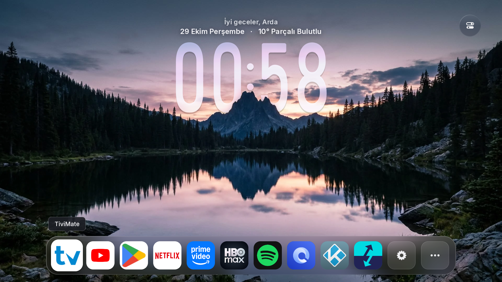 | 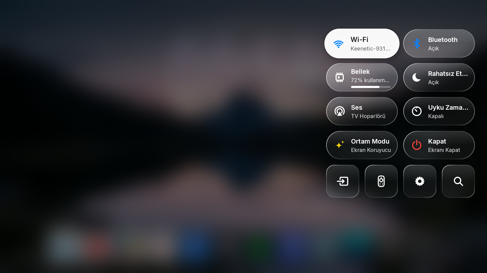 |

| Recent Apps Switcher & RAM Cleaner |
| :---: |
|  |

---

### First-Time Setup Assistant

| 1. Welcome & Language Selection | 2. Profile & Avatar Setup |
| :---: | :---: |
| 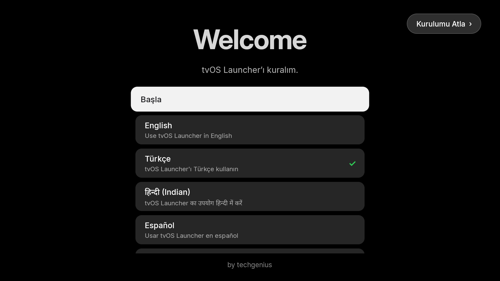 | 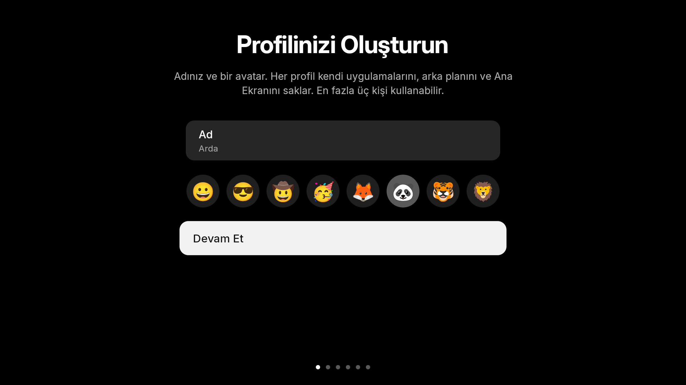 |

| 3. Appearance Mode (`Night Scenes` / `Classic`) | 4. Weather & Location |
| :---: | :---: |
| 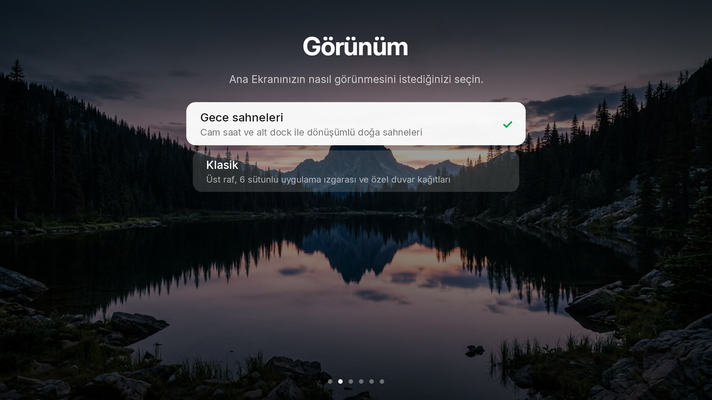 | 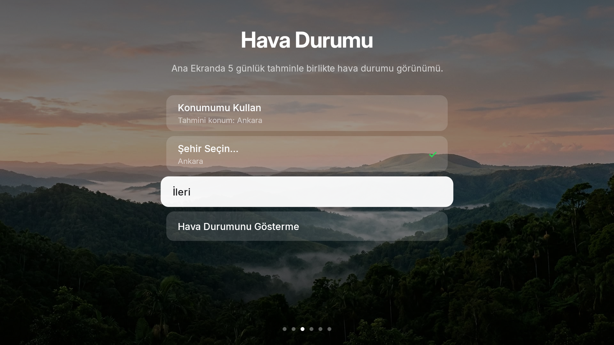 |

| 5. Easy Setup (Auto ADB) vs. Manual Permissions | 6. Remote Button Mapper Setup (`1x / 2x / 3x`) |
| :---: | :---: |
| 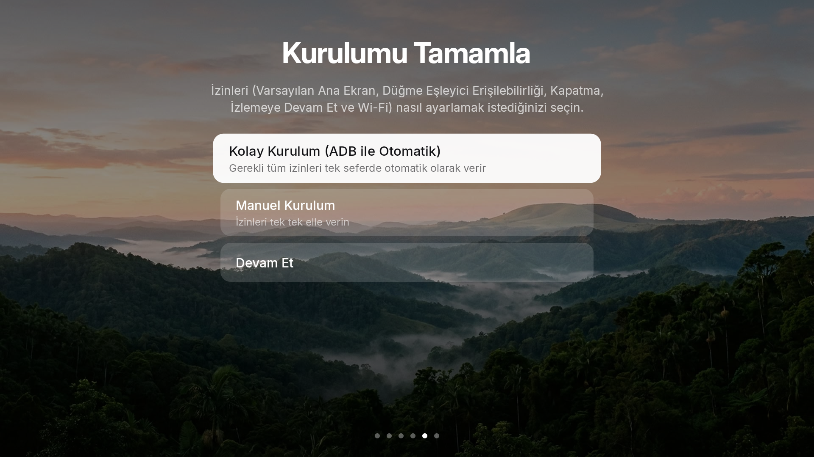 | 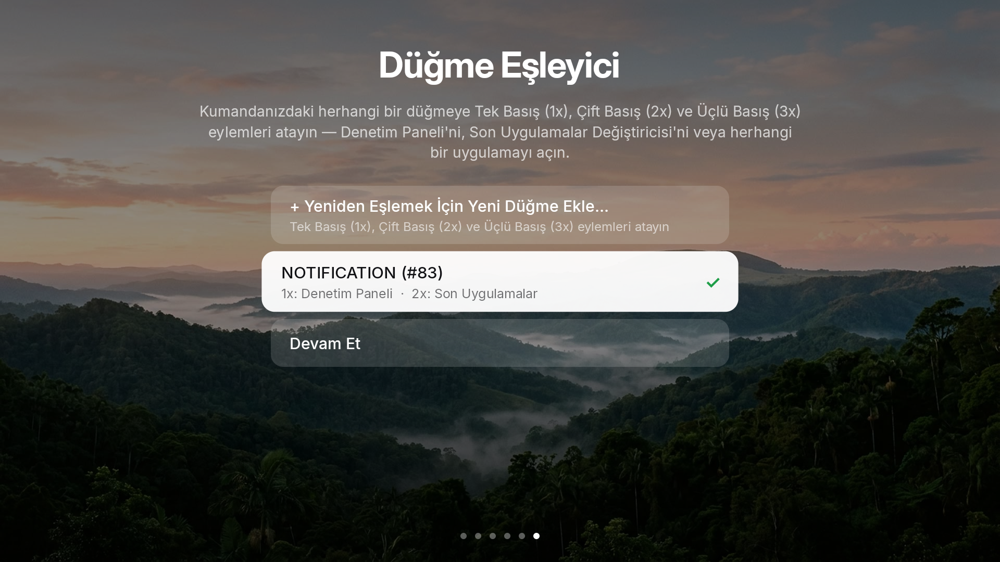 |

---

### Home Settings

| Look & Scenes | Universal Control Panel Actions |
| :---: | :---: |
| 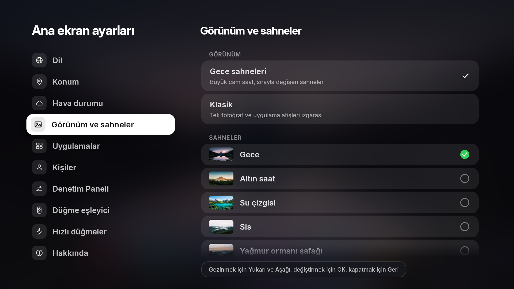 |  |

| Button Mapper (`1x / 2x / 3x Tap`) | About, ADB Status & Permission Check |
| :---: | :---: |
| 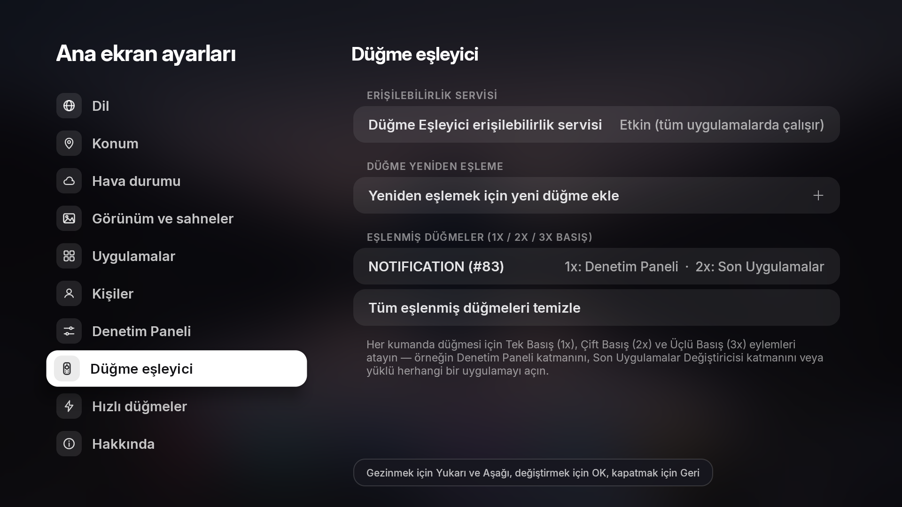 |  |

---

## 🚀 Quick Start (Build & Install)

### Prerequisites
- **JDK 17+** (`javac`, `jar`)
- **Android SDK** with `build-tools;34.0.0` and `platforms;android-34`

### Build on Windows (PowerShell)
```powershell
powershell -ExecutionPolicy Bypass -File .\build.ps1
# Output APK -> build\tvos-home.apk
```

### Build on macOS / Linux
```sh
./build.sh
# Output APK -> build/tvos-home.apk
```

### Install via ADB
```sh
adb connect <tv-ip>:5555
adb install -r build/tvos-home.apk
adb shell am start -n com.techgenius.tvoslauncher/.MainActivity
```

---

## 📚 Documentation

| Document | Description |
|---|---|
| **[Getting started](docs/getting-started.md)** | Install SDK tools, build from source, run on an Android TV or emulator |
| **[Features](docs/features.md)** | Detailed breakdown of launcher features |
| **[Install and set up](docs/install.md)** | Setting as default home screen, ADB permissions, and troubleshooting |
| **[Presentation mode](docs/presentation.md)** | Sending images, videos, and web pages from a browser |
| **[Architecture](docs/architecture.md)** | Code map, zero-dependency build pipeline, and performance design |
| **[Contributing](CONTRIBUTING.md)** | Workflow, code style, design and performance guidelines |

---

## 📋 Requirements

- **Android TV / Google TV 7.0+ (API 24+)**

---

## 🙌 Credits & Acknowledgements

Special thanks to the open-source projects that inspired and contributed to **tvOS Launcher**:

- **[Hume Launcher](https://github.com/petrobot-admin/hume-launcher)** by [@petrobot-admin](https://github.com/petrobot-admin) — Foundation for the zero-dependency Android TV Java architecture, Classic home layout, and system integrations.
- **[Couch TV](https://github.com/Seagey/couch-tv)** by [@Seagey](https://github.com/Seagey) — Design and inspiration for the Night Scenes depth wallpapers, giant glass clock, and glassmorphic Home Settings UI.
- **[CleanYourTV](https://github.com/Gathin23/cleanyourtv)** by [@Gathin23](https://github.com/Gathin23) — Community-curated Android TV / Google TV debloat profiles (`examples/`) and safety guidelines powering the built-in CleanYourTV (Beta) debloater.
- **Inter Typeface** (SIL Open Font License 1.1) & **Project Nayuki QR Code Generator** (MIT License).
- Weather data powered by **Open-Meteo**, **MET Norway**, and **wttr.in**.

---

## 📄 License

Licensed under the **Apache License 2.0** — see [LICENSE](LICENSE) and [NOTICE](NOTICE) for details.
