# tvOS Launcher (`v2.0.5`)

> 🇬🇧 **For English documentation and setup guide:** **[README.md (English)](README.md)**  
> 📦 **En Son APK İndir (`v2.0.5`):** **[GitHub Releases](https://github.com/techgenius1/tvOS-Launcher/releases/latest)**

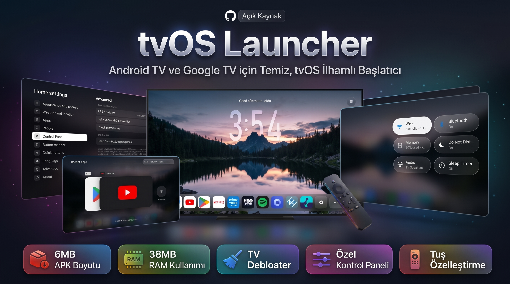

Android TV ve Google TV cihazlar için hiçbir üçüncü parti çalışma zamanı (runtime) kütüphanesi kullanılmadan **%100 saf Java** ile geliştirilmiş, hızlı ve ultra hafif **tvOS 26 & macOS** tasarımlı ana ekran başlatıcısı (**arka planda `%0.0` CPU kullanımı ve yalnızca ~30 MB özel RAM / ~38 MB toplam PSS tüketimi**). **1 GB RAM'li** uygun fiyatlı TV kutularında ve eski **Android 7.0 / 8.0** televizyonlardan **Android 14** modellere kadar 60 FPS akıcılık sunarken; **boyutlandırılabilir macOS Liquid Glass Dock (`%50–%150`)**, dönüşümlü **Gece Sahneleri**, **Özel Duvar Kağıtları (`Özel 1..5`)**, **Uygulama Simgesi Değiştirici ve Simge Düzenleyici**, **Otomatik GitHub Uygulama Güncellemeleri**, **bilgisayar gerektirmeyen dahili CleanYourTV Debloat aracı (341 TV modeli + Manuel Sistem Uygulaması Debloat + Sistem Başlatıcılarını Devre Dışı Bırakma)**, **Evrensel Denetim Paneli (`Hızlı Ayarlar`)**, **Son Uygulamalar Değiştiricisi**, **çoklu basış (`1x / 2x / 3x`) Kumanda Tuş Atayıcı + Ana Ekran Tuşu Düzeltmesi**, **Keep Alive otomatik izin onarımı** ve **tek tıkla Yerel ADB kurulumu** özelliklerini bir araya getirir.

---

## 🆕 `v2.0.5` Sürümündeki Yenilikler

- **Boyutlandırılabilir Gece Sahneleri Dock'u (`%50` – `%150`) & Çok Satırlı Navigasyon**: *Görünüm ve sahneler* menüsünün en üstünden Gece Sahneleri dock boyutunu `%50` ile `%150` arasında (`%100` varsayılan) ölçeklendirebilirsiniz. Dock büyütüldüğünde ekrana sığmayan fazla uygulamalar otomatik olarak **Diğer uygulamalar (`...`)** menüsüne taşınır; açılan çok satırlı dock içerisinde **Yukarı / Aşağı / Sol / Sağ** yön tuşlarıyla gezinebilir ve klasör boşaldığında `Diğer uygulamalar` simgesi otomatik gizlenir.
- **Yenilenen Apple tvOS Klasik Dock & Simetrik Odaklama**: Klasik görünümde dock ve uygulama simgelerinin köşe yuvarlaklığı Apple tvOS stilinde güncellendi, uygulama kutucukları büyütüldü, ilk ve son sıradaki uygulama seçildiğinde simetrik kenar boşluğu sağlandı ve satırlar arası geçiş animasyonu akıcı hale getirildi.
- **Ayarlar İçinde Yerel Sağ Panel Alt Menüleri**: CleanYourTV, Manuel Debloat, Sistem Başlatıcılarını Devre Dışı Bırakma ve diğer tüm alt menüler artık açılır pencere (popup) yerine Ayarlar menüsünün sağ tarafında yerel alt menü olarak açılır; 341 TV modeli ve sistem uygulamaları arka planda önbelleğe alınarak anında yüklenir.
- **Tek Tıkla Sistem Başlatıcılarını Devre Dışı Bırakma & Manuel Debloat**: Yüklü stok başlatıcıları (*Google TV Home / LauncherX, Android TV Home / Leanback, TCL, Philips, Xiaomi, Sony* vb.) tespit edip tek dokunuşla devre dışı bırakan **Sistem başlatıcılarını devre dışı bırak** menüsü ve tüm sistem paketlerini arayıp yönetebileceğiniz **Manuel debloat (Tüm sistem uygulamaları)** ekranı eklendi.
- **Gelişmiş TCL, Philips, Xiaomi ve Android 11–14 Uyumluluğu**:
  - **Android 13/14 Kısıtlanmış Ayarlar (`ACCESS_RESTRICTED_SETTINGS`) Kilidi Açma**: Yerel ADB izin verme ve onarma işlemleri artık `appops ACCESS_RESTRICTED_SETTINGS allow` komutunu otomatik çalıştırarak Android 13 ve 14 TV'lerde Erişilebilirlik Servisinin sistem tarafından engellenmesini önler.
  - **Ana Ekran (Home) Tuşunu Düzelt (`Ayarlar → Düğme eşleyici`)**: Varsayılan başlatıcı ayarını yok sayan TCL ve Philips (Android 11/12) TV'ler için Home tuşunu doğrudan tvOS Launcher'a yönlendiren isteğe bağlı seçenek (varsayılan kapalı).
  - **Açılışta Otomatik Başlat (`Ayarlar → Gelişmiş`)**: Sistem açılışından hemen sonra başlatıcıyı otomatik çalıştıran seçenek (varsayılan kapalı).
  - **Tüm İzinleri Kaldır / Cihaz Yöneticisini Devre Dışı Bırak (`Ayarlar → Gelişmiş`)**: Cihaz Yöneticisi kapatma ekranı bulunmayan TV'lerde uygulamayı kolayca kaldırabilmek için tek tıkla tüm izinleri geri alma seçeneği.
  - **Çökme Korumalı Kumanda Tuş Yönetimi & Tuş Sesleri**: ADB izin onarımı sırasındaki siyah ekran döngüsü giderildi, `PowerService` kumanda tuşlarını hiçbir koşulda kilitlemeyecek şekilde güçlendirildi, *Hızlı düğmeler* başlığı 13 dilde **Hızlı ayarlar** olarak güncellendi ve **Tuş sesleri** varsayılan olarak **Kapalı** ayarlandı.

---

## ✨ Öne Çıkan Özellikler

- **Çift Görünüm Modu (`Gece Sahneleri` & `Klasik`) + Özel Duvar Kağıtları**
  - **Gece Sahneleri (Night Scenes)**: Dağ ve manzara katmanlarının arkasında duran dev cam saat (*iPhone Duo*, *iPhone Rounded*, *Tall Glass*), derinlikli arka plan sahneleri (*Gece*, *Altın Saat*, *Su Çizgisi*, *Sis*, *Yağmur Ormanı Şafağı* ve **Sol / Orta / Sağ Saat Konumu** seçilebilen **5 adede kadar Özel Sahne Duvar Kağıdı**), kişisel karşılama mesajı, tarih, canlı hava durumu ve dinamik boyutlanan **macOS Liquid Glass Dock (`%50` – `%150`)**.
  - **Uygulama Simgesi Değiştirici & Simge Düzenleyici (`JPG / PNG / ICO`)**:
    - Dock veya ızgara üzerindeki herhangi bir uygulamaya **OK** tuşuyla basılı tutup **Uygulama simgesini değiştir** seçeneğiyle dahili depolama veya USB bellekten `.jpg`, `.jpeg`, `.png` ya da `.ico` dosyası seçebilirsiniz.
    - Dahili **Uygulama Simgesi Düzenleyici** ile canlı önizleme, **14 arka plan rengi** (otomatik kenar rengi algılama dahil), **Yakınlaştırma / Uzaklaştırma** ve **Sol / Sağ / Yukarı / Aşağı** hizalama ayarlarını anında yapabilirsiniz.
  - **Uygulama Yeniden Adlandırma, Diğer Uygulamalar & Gizlenen Uygulamalar Ayrımı**:
    - Dock üzerindeki herhangi bir uygulamaya **OK** tuşuyla basılı tutarak **Yeniden Adlandır**, **Uygulama simgesini değiştir**, **Taşı**, **Diğer Uygulamalara Taşı**, **Gizle**, **Uygulama Bilgisi**, **Kaldır** veya **Düzeni Sıfırla** seçeneklerini kullanabilirsiniz.
    - **Diğer Uygulamalara Taşı**: Uygulamayı ilk dock satırından kaldırır ancak dock'taki **`...` (Diğer uygulamalar)** butonunun içinde tek tıkla erişilebilir tutar (klasör boşsa otomatik gizlenir, çok satırlı olduğunda Yukarı/Aşağı yön tuşlarıyla gezilebilir).
    - **Gizlenen Uygulamalar (`Ayarlar → Uygulamalar → Gizlenen uygulamalar`)**: Uygulamayı hem ana dock satırından hem de Diğer Uygulamalar menüsünden tamamen gizler. **Ayarlar → Uygulamalar → Gizlenen uygulamalar** menüsünden gizlenen bir uygulamanın üzerine **OK** ile basarak doğrudan açabilir veya **OK tuşuna basılı tutarak** ana ekrana geri yükleyebilirsiniz.
  - **Klasik (Classic)**: Apple tvOS tarzı yuvarlatılmış köşelere sahip 6 sütunlu uygulama ızgarası ve ortalanmış cam dock, simetrik odak boşlukları, akıcı satır kaydırma animasyonu, yerleşik fotoğraflar, ortam rengi temaları veya kendi **Özel Duvar Kağıdınız** ve isteğe bağlı Üst Raf (Top Shelf).
- **Otomatik ve Manuel GitHub Güncellemeleri (`Ayarlar → Güncellemeler`)**
  - Hakkında menüsünün hemen üzerinde yer alan **Güncellemeler** menüsü ile mevcut sürümü ve GitHub üzerindeki en son sürümü görüntüleyebilir, tek tıkla güncelleme kontrolü yapabilir veya **Otomatik güncellemeler** seçeneğini açıp kapatabilirsiniz.
- **CleanYourTV (Beta) — Bilgisayar Gerektirmeyen Dahili Android TV Debloat Aracı (`Ayarlar → Gelişmiş`)**
  - **[CleanYourTV](https://github.com/Gathin23/cleanyourtv)** debloat profillerini **Yerel ADB (`127.0.0.1:5555`)** üzerinden doğrudan TV'nizde yerel sağ panel menülerinde çalıştırır — **bilgisayar veya harici CLI gerektirmez**.
  - **341 Gömülü TV & Box Profili**: *TCL, Sony, Xiaomi, Hisense, Philips, Skyworth, OnePlus, Realme, Nvidia Shield, Motorola, Toshiba, Sharp, Onn, Chromecast with Google TV* ve daha fazlası.
  - **Gelişmiş Üretici (OEM) Model Algılama & ADB Paket Benzerlik Tarayıcısı**: TV'nizin donanım özelliklerinden tam veya yakın modelleri otomatik bulur, 341 profili gecikmesiz aramanızı sağlar veya TV'nizdeki üreticiye özgü sistem paketlerini ADB ile ağırlıklı olarak tarayarak en yakın modelleri yüzdelik benzerlik oranıyla sıralar.
  - **Sistem Başlatıcılarını Devre Dışı Bırakma & Manuel Debloat**: Yüklü stok başlatıcıları (*Google TV Home, Android TV Home*, OEM başlatıcılar) tek tıkla devre dışı bırakma veya yeniden etkinleştirme menüsü ve tüm sistem uygulamalarını tek tek yönetebileceğiniz **Manuel debloat** ekranı.
  - **Seçmeli Debloat Kontrol Listesi**: Telemetri, reklam satırları ve gereksiz ön yüklü uygulamalar ön seçili gelirken; **isteğe bağlı uygulamalar** (*Google Asistan, YouTube Music, Play Oyunlar, TalkBack, Chromecast alıcısı, Telefon Kumanda Servisi*) otomatik seçilmez ve listenin en altında yer alır.
  - **Google TV `setupwraith` Wi-Fi Koruması**: Google TV cihazlarda `setupwraith` / `launcherx` devre dışı bırakılmadan önce Wi-Fi ağını unutup yeniden eklemeniz konusunda uyarır (veya tek dokunuşla `setupwraith`'i güvenle atlamanızı sağlar).
  - **Tek Tıkla Yedekleme, Geri Yükleme & AdGuard DNS**: Devre dışı bırakılan paketleri kaydeder, canlı **Debloat Durumunu** (`Tamamlandı` / `Yapılmadı`) gösterir, istediğiniz zaman tek dokunuşla tüm uygulamaları geri yükler ve **Reklam Engelleyici Özel DNS (`dns.adguard-dns.com`)** anahtarı sunar.
- **Evrensel Cam Denetim Paneli (`Hızlı Ayarlar`)**
  - Ana ekrandan veya Tuş Atayıcı erişilebilirlik servisi sayesinde **çalışan herhangi bir uygulamanın üzerinde** gerçek zamanlı bulanık arka plan ile açılır.
  - **Wi-Fi**, **Bluetooth**, **RAM / Son Uygulamalar**, **Rahatsız Etmeyin**, **Ses Çıkışı**, **Uyku Zamanlayıcısı**, **Ortam Modu**, **Kapat / Ekranı Kapat**, **Girişler (HDMI)**, **Tuş Atayıcı**, **Ayarlar** ve **Arama** kısayollarını içerir.
  - **Evrensel Marka Etkinlik Seçici (`Ayarlar → Denetim Paneli`)**: **Wi-Fi**, **Bluetooth**, **Ses** veya **Girişler** kutucuklarına tıklandığında TV'nizdeki hangi sistem uygulamasının ve alt ekranın (Activity) açılacağını özgürce seçebilirsiniz.
- **Son Uygulamalar Değiştiricisi (Recent Apps Switcher) & RAM Temizleyici**
  - Atanmış kumanda tuşuyla veya Denetim Panelindeki **RAM** kutucuğundan her uygulamanın üzerinde açılır.
  - Canlı bellek kullanımını (`kullanılan / toplam RAM`), yatay uygulama kartlarını, **Yukarı (DPAD UP)** tuşuyla tekil uygulama kapatmayı (`force-stop`) ve **Tümünü Kapat** butonunu içerir; tüm uygulamalar kapatıldığında 1.5 saniye sonra otomatik olarak ana ekrana döner.
- **Çoklu Basış Kumanda Tuş Atayıcı (`1x` / `2x` / `3x`), Ana Ekran Tuşu & Ses Tuşu Düzeltmesi**
  - Seçtiğiniz herhangi bir kumanda tuşuna **Tek Basış (1x)**, **Çift Basış (2x)** ve **Üçlü Basış (3x)** için bağımsız görevler atamanızı sağlar.
  - **Ana Ekran (Home) Tuşunu Düzelt (Varsayılan Kapalı)**: Varsayılan ana ekran ayarını yok sayan TV'lerde Home tuşunu doğrudan tvOS Launcher'ı açacak şekilde yeniden eşler.
  - **Ses Tuşu Basılı Tutma Düzeltmesi (Varsayılan Açık)**: Erişilebilirlik servisi etkinleştirildiğinde ses açma/kısma tuşuna basılı tutmanın çalışmaması sorununu otomatik olarak çözer.
- **Yerel ADB ile Kolay Kurulum, Keep Alive Otomatik İzin Onarımı & Tek Tıkla İzin Kaldırma**
  - **Kolay Kurulum (ADB ile Otomatik)** `127.0.0.1:5555` üzerinden bağlanarak `ACCESS_RESTRICTED_SETTINGS` (Android 13/14+) kilidini açar ve Varsayılan Ana Ekran, Erişilebilirlik Servisi, Cihaz Yöneticisi, Bildirim Erişimi ve Kullanım İzinlerini tek tıkla verir.
  - **Keep Alive (Varsayılan Açık)**: Arka planda sıfır ek CPU/RAM yüküyle izinleri kontrol eder ve TV yazılımı Erişilebilirlik iznini kapatırsa Yerel ADB üzerinden otomatik olarak onarır.
  - **Tüm İzinleri Kaldır (`Ayarlar → Gelişmiş`)**: Uygulamayı kaldırmak istediğinizde Cihaz Yöneticisi ve diğer özel izinleri tek dokunuşla devre dışı bırakır.
- **13 Dil Desteği**
  - **Türkçe, İngilizce, İsveççe, Almanca, Fransızca, İspanyolca, İtalyanca, Rusça, Portekizce, Arapça, Hintçe, Japonca ve Çince** dillerinde tam yerelleştirilmiş arayüz.
- **Çoklu Kullanıcı Profilleri & Canlı Hava Durumu**
  - Her biri kendi uygulama sırasına, gizli uygulamalarına ve İzlemeye Devam Et listesine sahip 3'e kadar kullanıcı profili ve API anahtarı gerektirmeyen 5 günlük hava durumu tahmini.

---

## 📸 Ekran Görüntüleri

### Ana Ekran, Denetim Paneli ve Son Uygulamalar Değiştiricisi

| Gece Sahneleri Ana Ekranı & macOS Cam Dock | Cam Denetim Paneli (Control Panel) |
| :---: | :---: |
| 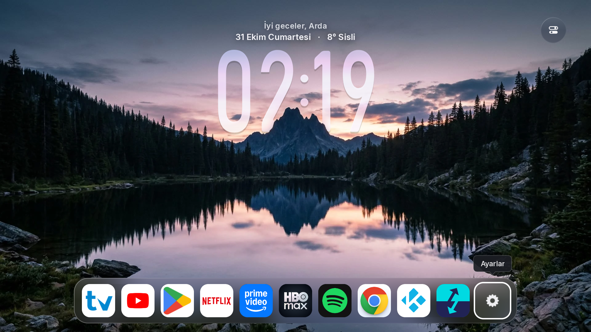 | 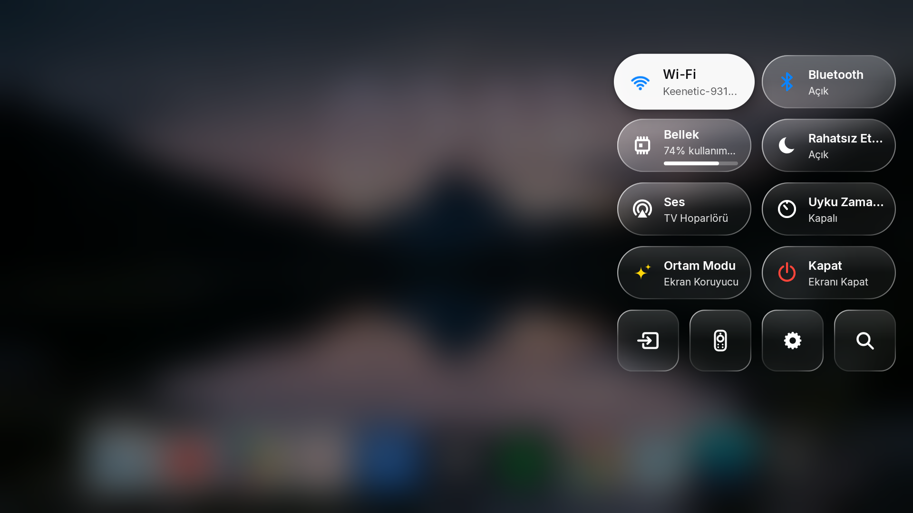 |

| Son Uygulamalar Değiştiricisi & RAM Temizleyici |
| :---: |
|  |

---

### İlk Kurulum Sihirbazı

| 1. Hoş Geldiniz & Dil Seçimi | 2. Profil & Avatar Kurulumu |
| :---: | :---: |
| 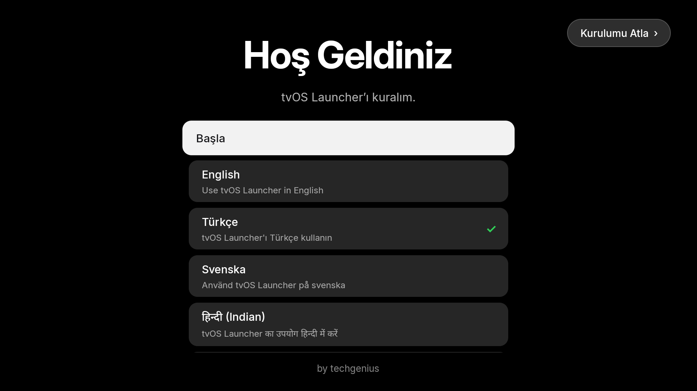 | 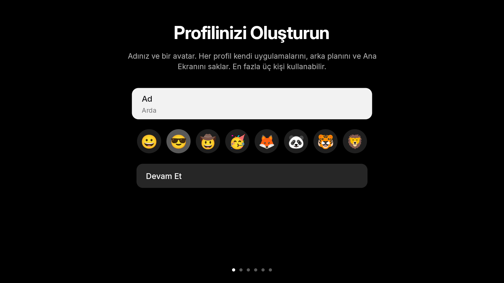 |

| 3. Görünüm Modu (`Gece Sahneleri` / `Klasik`) | 4. Hava Durumu & Konum |
| :---: | :---: |
| 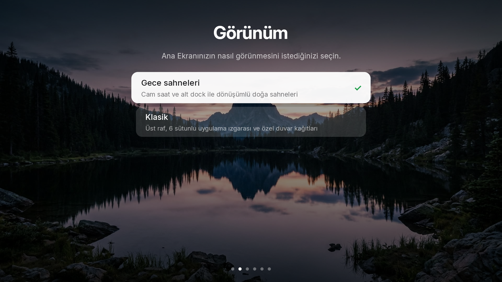 | 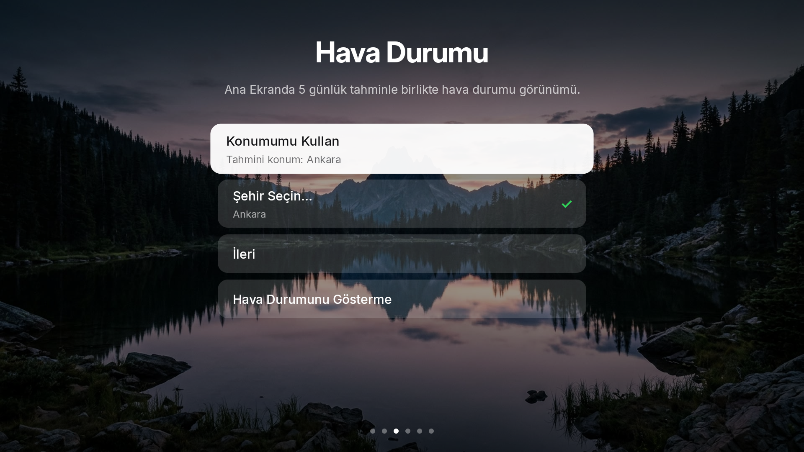 |

| 5. Kolay Kurulum (Otomatik ADB) ve Manuel İzinler | 6. Kumanda Tuş Atayıcı Kurulumu (`1x / 2x / 3x`) |
| :---: | :---: |
| 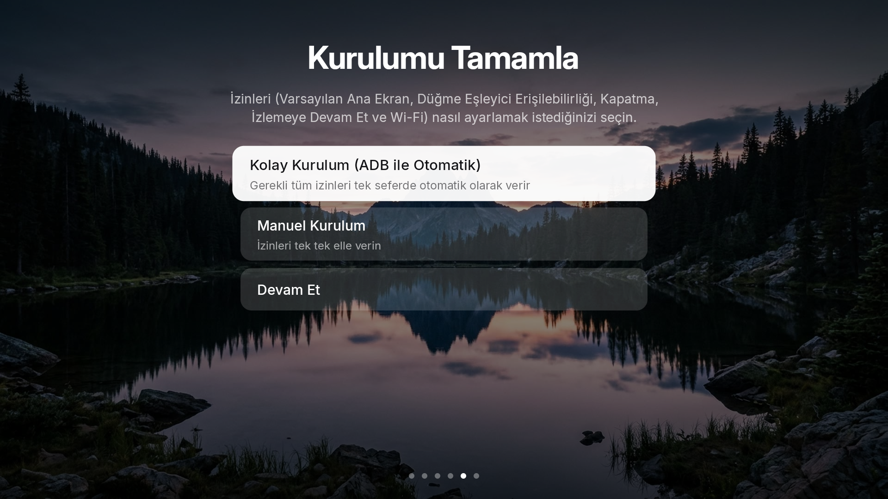 |  |

---

### Ana Ekran Ayarları

| Görünüm & Sahneler (`Dock Boyutu %50–%150`) | Denetim Paneli (`Hızlı Ayarlar`) |
| :---: | :---: |
|  | 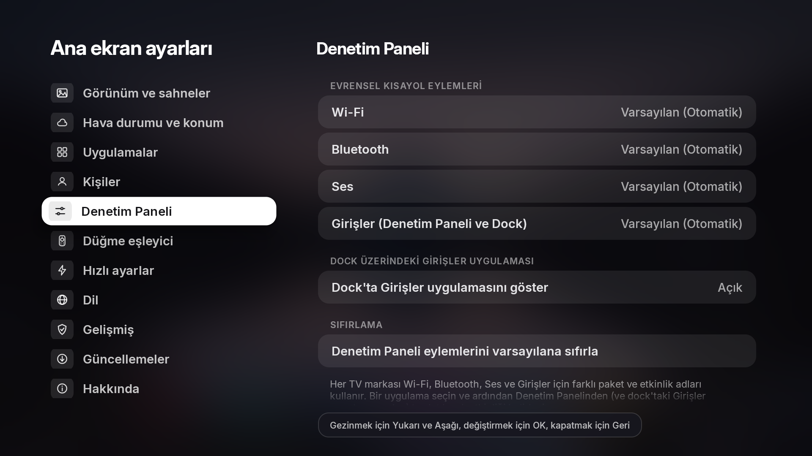 |

| Düğme Eşleyici (`1x / 2x / 3x` & Home Tuşu Düzeltmesi) | Gelişmiş, ADB Durumu & İzin Kontrolü (`5 / 5`) |
| :---: | :---: |
|  | 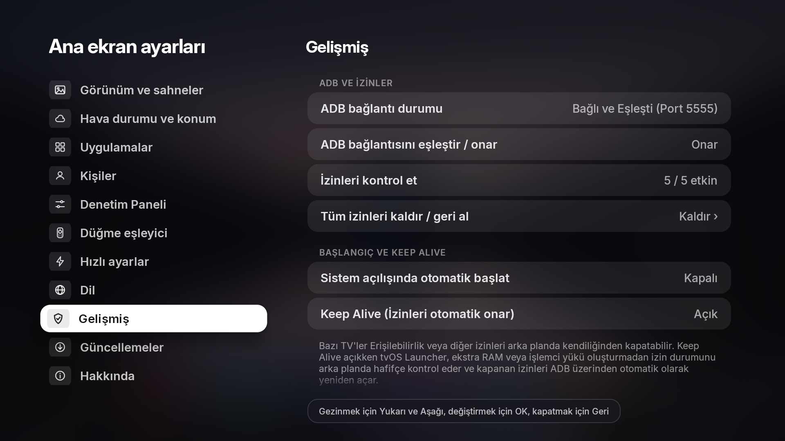 |

| CleanYourTV — Sistem Başlatıcılarını Devre Dışı Bırak | Otomatik ve Manuel GitHub Güncellemeleri |
| :---: | :---: |
| 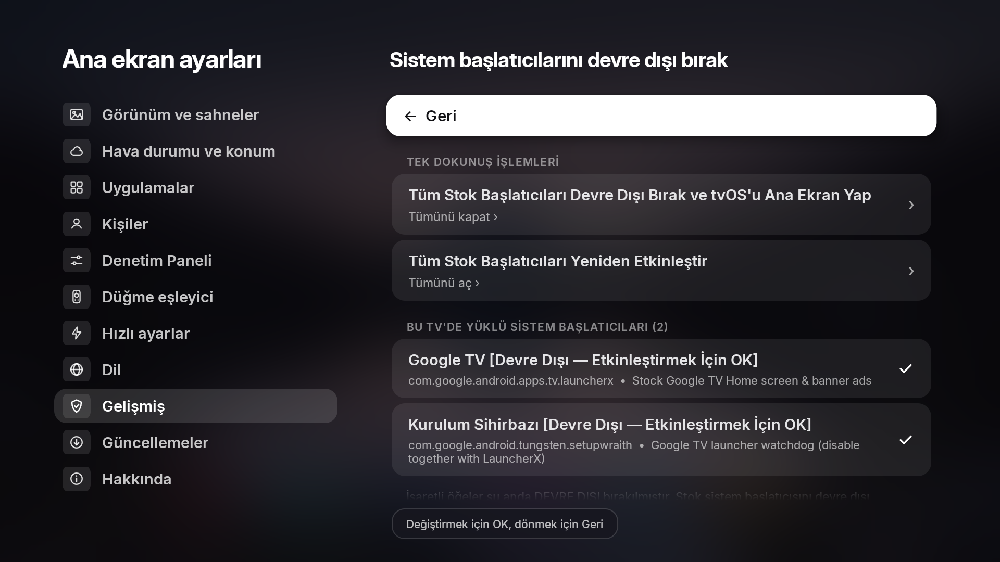 | 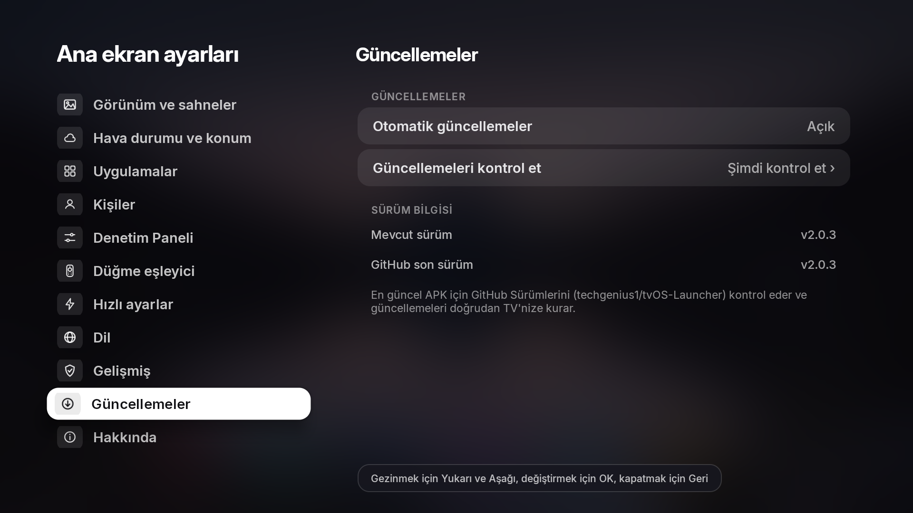 |

---

## 🚀 Hızlı Başlangıç (Derleme & Kurulum)

### Gereksinimler
- **JDK 17+** (`javac`, `jar`)
- **Android SDK** (`build-tools;34.0.0` ve `platforms;android-34`)

### Windows'ta Derleme (PowerShell)
```powershell
powershell -ExecutionPolicy Bypass -File .\build.ps1
# Çıktı APK -> build\tvos-home.apk
```

### macOS / Linux'ta Derleme
```sh
./build.sh
# Çıktı APK -> build/tvos-home.apk
```

### ADB ile Kurulum
```sh
adb connect <tv-ip>:5555
adb install -r build/tvos-home.apk
adb shell am start -n com.techgenius.tvoslauncher/.MainActivity
```

---

## 📋 Sistem Gereksinimleri

- **Android TV / Google TV 7.0+ (API 24+)**

---

## 🙌 Teşekkürler & Katkıda Bulunan Projeler

**tvOS Launcher** projesine ilham veren ve katkıda bulunan açık kaynak projelere teşekkürler:

- **[Hume Launcher](https://github.com/petrobot-admin/hume-launcher)** ([@petrobot-admin](https://github.com/petrobot-admin)) — Sıfır bağımlılıklı Android TV Java mimarisi, Klasik ana ekran düzeni ve sistem entegrasyonları için temel yapı.
- **[Couch TV](https://github.com/Seagey/couch-tv)** ([@Seagey](https://github.com/Seagey)) — Gece Sahneleri derinlikli duvar kağıtları, dev cam saat ve cam efektli Ayarlar arayüzü tasarımı.
- **[CleanYourTV](https://github.com/Gathin23/cleanyourtv)** ([@Gathin23](https://github.com/Gathin23)) — Dahili CleanYourTV (Beta) aracına güç veren topluluk tarafından hazırlanmış Android TV / Google TV debloat profilleri (`examples/`).
- **Inter Yazı Tipi** (SIL Open Font License 1.1) & **Project Nayuki QR Kod Üretici** (MIT Lisansı).
- Hava durumu verileri: **Open-Meteo**, **MET Norway** ve **wttr.in**.

---

## 📄 Lisans

**Apache License 2.0** kapsamında lisanslanmıştır — ayrıntılar için [LICENSE](LICENSE) ve [NOTICE](NOTICE) dosyalarına göz atabilirsiniz.
