# tvOS Launcher (`v2.1.5`)

> 🇬🇧 **For English documentation and setup guide:** **[README.md (English)](README.md)**  
> 📦 **En Son APK İndir (`v2.1.5`):** **[GitHub Releases](https://github.com/techgenius1/tvOS-Launcher/releases/latest)**

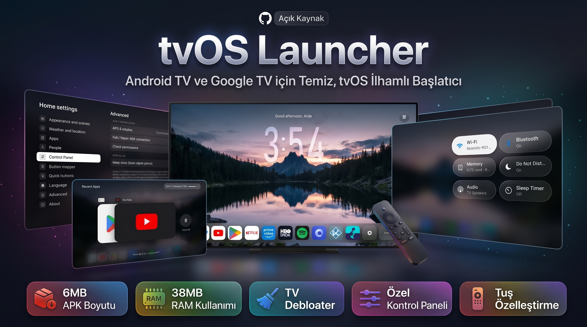

Android TV ve Google TV cihazlar için hiçbir üçüncü parti çalışma zamanı (runtime) kütüphanesi kullanılmadan **%100 saf Java** ile geliştirilmiş, hızlı ve ultra hafif **tvOS 26 & macOS** tasarımlı ana ekran başlatıcısı (**arka planda `%0.0` CPU kullanımı ve yalnızca ~30 MB özel RAM / ~38 MB toplam PSS tüketimi**). **1 GB RAM'li** uygun fiyatlı TV kutularında ve eski **Android 7.0 / 8.0** televizyonlardan **Android 14** modellere kadar 60 FPS akıcılık sunarken; **boyutlandırılabilir macOS Liquid Glass Dock (`%50–%150`)**, dönüşümlü **Gece Sahneleri**, **Varsayılan Ana Ekran Widget Paneli**, **Özel Duvar Kağıtları (`Tekli/Çoklu, Klasörden Karışık & Reddit Duvar Kağıtları`)**, **Dahili Kilit Ekranı / Ekran Koruyucu**, **Uygulama Simgesi Değiştirici ve Simge Düzenleyici**, **Otomatik GitHub Uygulama Güncellemeleri**, **bilgisayar gerektirmeyen dahili CleanYourTV Debloat aracı (341 TV modeli + Manuel Sistem Uygulaması Debloat + Sistem Başlatıcılarını Devre Dışı Bırakma)**, **Genişletilmiş Hava Durumu Panelli Özelleştirilebilir Evrensel Denetim Paneli (`Hızlı Ayarlar`)**, **Son Uygulamalar Değiştiricisi**, **çoklu basış (`1x / 2x / 3x`) Kumanda Tuş Atayıcı + Tuş Kodu Gönder (`Send Key Code`) + Ana Ekran Tuşu Düzeltmesi**, **Evrensel 3 Modlu Ses Tuşu Basılı Tutma Düzeltmesi (Standart, HY320 Projeksiyon, Onn TV Box)**, **Caffeine Modu** ve **Çift Modlu Güvenli Yerel ADB Kurulumu (Port 5555'i açık bırakmadan Otomatik Onarım & Ses Tuşu Düzeltmesi)** özelliklerini bir araya getirir.

---

## ✨ Öne Çıkan Özellikler

- **Varsayılan Ana Ekran Widget Paneli (4 Özelleştirilebilir Widget)**
  - Hiçbir uygulama seçili olmadığında veya seçili uygulamanın İzlemeye Devam Et içeriği bulunmadığında tek bir yatay sırada 4 özelleştirilebilir Liquid Glass widget kartı görüntüler:
    - 🕌 **Namaz Vakitleri**: Günlük namaz vakitleri (İmsak, Güneş, Öğle, İkindi, Akşam, Yatsı), sonraki vakte canlı geri sayım ve 10 farklı hesaplama yöntemi (Diyanet, MWL, ISNA, Mısır, Mekke, Karaçi, Tahran, Caferi, Körfez, Fransa).
    - ⚽ **Futbol Maçları**: Günün ve yaklaşan günlerin maç takvimi, canlı skorlar, favori takım takibi ve lig fikstürleri.
    - 🎬 **Çok İzlenenler (Son Çıkanlar)**: JustWatch altyapısıyla en popüler yayın platformlarındaki popüler film ve diziler; varsayılan olarak arayüz diliyle eşitlenir ve istenirse birden fazla ülke seçilebilir.
    - ⛅ **Hava Durumu**: Anlık sıcaklık, hava durumu ikonu, konum adı ve günün en yüksek/en düşük sıcaklıkları.
  - Hem **Gece Sahneleri** hem de **Klasik Görünüm** ile tam uyumludur.
  - Widget'ları tek tek açıp kapatabilir, seçili uygulamada İzlemeye Devam Et içeriği olmadığında widget'ların gösterilip gösterilmeyeceğini ayarlayabilirsiniz.

- **Çift Görünüm Modu (`Gece Sahneleri` & `Klasik`)**
  - **Gece Sahneleri (Night Scenes)**: Dağ ve manzara katmanlarının arkasında duran dev cam saat (*iPhone Duo*, *iPhone Rounded*, *Tall Glass*), derinlikli arka plan sahneleri (*Gece*, *Altın Saat*, *Su Çizgisi*, *Sis*, *Yağmur Ormanı Şafağı*), kişisel karşılama mesajı, tarih, canlı hava durumu ve dinamik boyutlanan **macOS Liquid Glass Dock (`%50` – `%150`)**.
  - **Klasik Görünüm (Classic)**: Apple tvOS tarzı yuvarlatılmış köşelere sahip 6 sütunlu uygulama ızgarası ve ortalanmış cam dock, simetrik odak boşlukları ve akıcı satır animasyonları.
  - **Klasik Görünüm İçin Büyük Saat**: Gece Sahnelerindeki dev cam saat, tarih, karşılama mesajı ve sağ üst hava durumu kısayolunu Klasik görünüme taşır (üstteki küçük saati devre dışı bırakır) ve **Saat Hizalaması (`Sol / Orta / Sağ`)** seçeneği sunar.
  - **Dinamik ve Özel Duvar Kağıdı Saat Hizalaması**: Varsayılan gece sahnelerinde her duvar kağıdına göre otomatik değişen dinamik hizalama, özel duvar kağıtlarında ise Sol / Orta / Sağ hizalama seçeneği. Rakamlar dock ile birebir aynı Liquid Glass efektine ve ortam parlaklığına uyum sağlayan ışıklandırmaya sahiptir.

- **Gelişmiş Özel Duvar Kağıdı Motoru**
  - **Tekli ve Çoklu Duvar Kağıdı**: 5 duvar kağıdı sınırı olmadan dahili depolama veya USB'den sınırsız görsel seçebilme.
  - **Klasörden Karıştır**: Seçilen herhangi bir klasördeki tüm duvar kağıtlarını otomatik döngüde rastgele oynatma.
  - **Reddit Duvar Kağıtları**: Seçilen subreddit'lerden (örn. `wallpapers`, `EarthPorn`) yüksek çözünürlüklü duvar kağıtlarını otomatik çekme, süre aralığı belirleme ve Hızlı Ayarlar'dan anında "Sonraki Duvar Kağıdı"na geçebilme.

- **Tüm Medya Uygulamaları İçin Evrensel İzlemeye Devam Et Desteği**
  - Yüklü tüm medya uygulamalarıyla (YouTube, SmartTube, Netflix, Prime Video, Disney+, Apple TV+, Tivimate, HBO Max, Stremio, Nuvio vb.) Android TV `TvContract` EPG / Watch Next içerik sağlayıcısı, `MediaSessionManager` aktif oturum takibi ve bildirim dinleyicileri üzerinden entegre çalışır.
  - **Dock ile Eşzamanlı Filtreleme**: Yalnızca dock'ta üzerinde durulan uygulamanın içeriklerini gösterir.
  - **Stremio & Nuvio Dock Açılır Pencereleri**: Dock simgeleri üzerinde yerel önbellek, QR kodlu giriş ve profil geçişi destekli pencereler.
  - **Akıcı ve Tekrarsız Geçiş**: İçerikli iki uygulama arasında gezinirken satır anında güncellenir, gereksiz animasyon tekrarlanmaz.
  - **Doğrudan Derin Bağlantı (Deep Link)**: Karta tıklandığında doğrudan videoyu başlatır.

- **Bağımsız TV Girişleri (Inputs) Ekran Üstü Paneli**
  - Kumanda Tuş Atayıcı (örn. Giriş tuşuna 1x/2x basış) veya Denetim Panelinden açılabilen cam tasarımlı giriş paneli; Google TV / Android TV stok başlatıcıları devre dışı bırakılsa bile HDMI girişleri arasında kolayca geçiş yapmanızı sağlar.

- **Caffeine Modu (`Ayarlar → Gelişmiş`)**
  - Android'in boşta kalma (idle) modunu reddeder ve Android TV'nin otomatik Ortam Modu'nun / ekran koruyucusunun devreye girmesini önleyerek TV'nizi uyanık tutar.

- **Evrensel Cam Denetim Paneli (`Hızlı Ayarlar`) Ekran Üstü Katmanı**
  - Ana ekrandan veya herhangi bir uygulamanın üzerindeyken açılabilir. İki arka plan modu sunar:
    - **Bulanık Mod**: Panelin arkasındaki içeriği gerçek zamanlı bulanıklaştırır.
    - **Şeffaf Mod**: Canlı video oynatılırken videonun kesilmeden arka planda akmasını sağlar.
  - **Genişletilmiş Hava Durumu Paneli**: Alt kısımda yer alan 4 sütun genişliğinde panel bugünkü ve yarınki hava durumunu gösterir (tıklandığında 5 günlük detaylı hava durumu açılır).
  - **Wi-Fi**, **Bluetooth**, **RAM / Son Uygulamalar**, **Rahatsız Etmeyin**, **Ses Çıkışı**, **Uyku Zamanlayıcısı**, **Ortam Modu**, **Kapat / Ekranı Kapat**, **Girişler (HDMI)**, **Tuş Atayıcı**, **Ayarlar** ve **Arama** kısayollarını içerir.

- **Son Uygulamalar Değiştiricisi (Recent Apps Switcher) & RAM Temizleyici**
  - Atanmış kumanda tuşuyla veya Denetim Panelindeki **RAM** kutucuğundan her uygulamanın üzerinde açılır.
  - Canlı bellek kullanımını (`kullanılan / toplam RAM`), yatay uygulama kartlarını, **Yukarı (DPAD UP)** tuşuyla tekil uygulama kapatmayı (`force-stop`) ve **Tümünü Kapat** butonunu içerir.

- **Çoklu Basış Kumanda Tuş Atayıcı & 3 Modlu Ses Tuşu Düzeltmesi**
  - Kumandadaki herhangi bir tuşa **Tek Basış (1x)**, **Çift Basış (2x)** ve **Üçlü Basış (3x)** için bağımsız görevler veya **Tuş Kodu Gönder** (*Play/Pause, Mute, Volume, Back, Home, TV Input* vb.) atayabilirsiniz.
  - **Ana Ekran (Home) Tuşunu Düzelt**: Varsayılan başlatıcı ayarını yok sayan TV'lerde Home tuşunu doğrudan tvOS Launcher'a yönlendirir.
  - **Evrensel Ses Tuşu Basılı Tutma Düzeltmesi**:
    - **Mod 1 (Standart — Varsayılan)**: Android 9–14 TV'lerde akıcı ses tekrarı (`320ms` gecikme, `85ms` tekrar) ve anında durma (`<= 45ms`).
    - **Mod 2 (HY320 / Projeksiyon)**: Magcubic HY320 ve projeksiyon cihazları için darbe algılamalı Binder izleyicisi.
    - **Mod 3 (Onn TV Box)**: Onn TV Box için özel optimize edilmiş bırakma hızı ve tekrarlama motoru.
    - Hem **Güvenli Modda (ADB Kapalı)** hem **Kalıcı ADB Modunda** çalışır.

- **CleanYourTV (Beta) — Bilgisayar Gerektirmeyen Dahili Android TV Debloat Aracı (`Ayarlar → Gelişmiş`)**
  - **[CleanYourTV](https://github.com/Gathin23/cleanyourtv)** profillerini doğrudan TV'nizde çalıştırır — **bilgisayar gerektirmez**.
  - **341 Gömülü TV & Box Profili**: *TCL, Sony, Xiaomi, Hisense, Philips, Skyworth, OnePlus, Realme, Nvidia Shield, Motorola, Toshiba, Sharp, Onn, Chromecast with Google TV* ve daha fazlası.
  - **Sistem Başlatıcılarını Devre Dışı Bırakma & Manuel Debloat**: Stok başlatıcıları tek tıkla devre dışı bırakma ve tüm sistem uygulamalarını güvenle yönetme.
  - **MiBluetooth Koruması**: Bluetooth kumanda servislerinin yanlışlıkla silinmesini engeller.
  - **Reklam Engelleyici Özel DNS (`dns.adguard-dns.com`)** anahtarı.

- **Ayarları Yedekleme ve Geri Yükleme (`Ayarlar → Sistem / Hakkında / Hızlı ve Ana Ekran`)**
  - Tüm başlatıcı tercihleri, dock sıralaması, özel uygulama isimleri ve simgeleri tek dokunuşla `Download/tvos-launcher-settings.json` dosyasına yedeklenebilir ve USB/dahili depolamadan geri yüklenebilir.

- **Uygulama Simgesi Değiştirici & Simge Düzenleyici (`JPG / PNG / ICO`)**
  - İstediğiniz uygulamaya basılı tutarak simgesini değiştirebilir; dahili simge düzenleyici ile renk, boyut ve konumunu özelleştirebilirsiniz.
  - Özel uygulama yeniden adlandırma, **Diğer Uygulamalar (`...`)** çok satırlı klasörü ve **Gizlenen Uygulamalar** kasası.

- **Hızlı 60 FPS Kararma ile Uygulama Açılış Animasyonu**
  - Giriş seviyesi çipsetlerde bile takılma yapmadan 60 FPS akıcılıkta kararma efektiyle uygulama açılışı.

- **Otomatik ve Manuel GitHub Güncellemeleri (`Ayarlar → Güncellemeler`)**
  - GitHub Releases üzerinden yeni sürümleri denetler, TV ekranında değişiklik günlüğünü gösterir ve otomatik yükler.

- **Çift Modlu Güvenli Yerel ADB Mimarisi**
  - **Güvenli Mod (Varsayılan & Önerilen)**: İzinleri tek seferde verip ağ ADB portunu (`5555`) hemen kapatır. Otomatik onarım ve ses düzeltmesi %100 dahili olarak çalışır.
  - **Kalıcı ADB Modu**: İsteğe bağlı olarak çalışma zamanında debloat yapmak isteyenler için portu açık tutar.

- **15 Dil Desteği**
  - **Türkçe, İngilizce, Azerbaycan dili (Azərbaycan dili), İsveççe, Korece (한국어), Almanca, Fransızca, İspanyolca, İtalyanca, Rusça, Portekizce, Arapça, Hintçe, Japonca ve Çince** dillerinde tam yerelleştirilmiş arayüz.

- **Çoklu Kullanıcı Profilleri & Canlı Hava Durumu**
  - 3'e kadar bağımsız kullanıcı profili ve API anahtarı gerektirmeyen 5 günlük hava durumu tahmini.

- **Ultra Hafif ve Hızlı (Android 7.0 – Android 14+)**
  - Saf Android SDK Java — Gradle yok, Kotlin yok, AndroidX yükü yok. ~30 MB özel RAM ve %0.0 arka plan CPU kullanımı.

---

## 📸 Ekran Görüntüleri

### Ana Ekran, Denetim Paneli ve Son Uygulamalar Değiştiricisi

| Gece Sahneleri Ana Ekranı & macOS Cam Dock | Cam Denetim Paneli (Control Panel) |
| :---: | :---: |
| 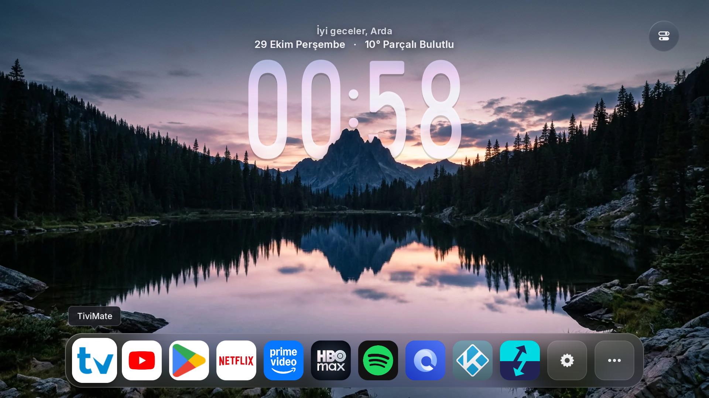 | 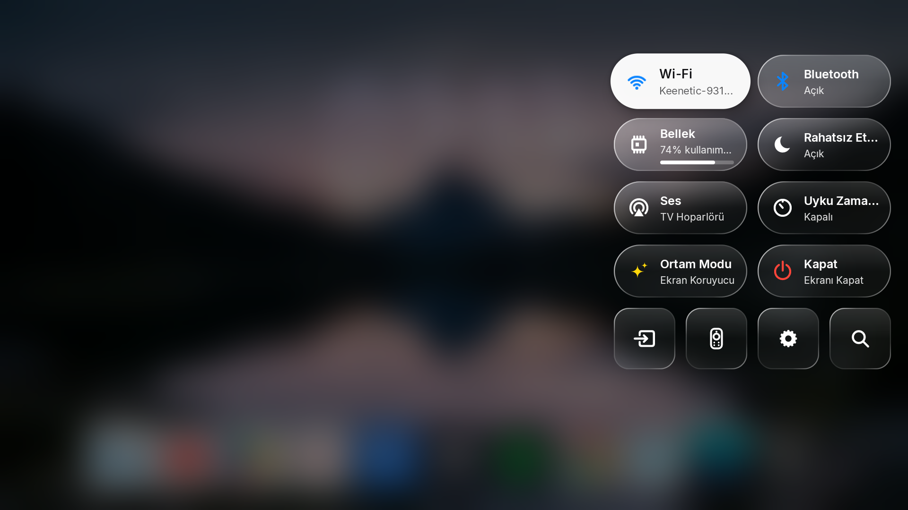 |

| Son Uygulamalar Değiştiricisi & RAM Temizleyici |
| :---: |
|  |

---

### İlk Kurulum Sihirbazı

| 1. Hoş Geldiniz & Dil Seçimi | 2. Profil & Avatar Kurulumu |
| :---: | :---: |
| 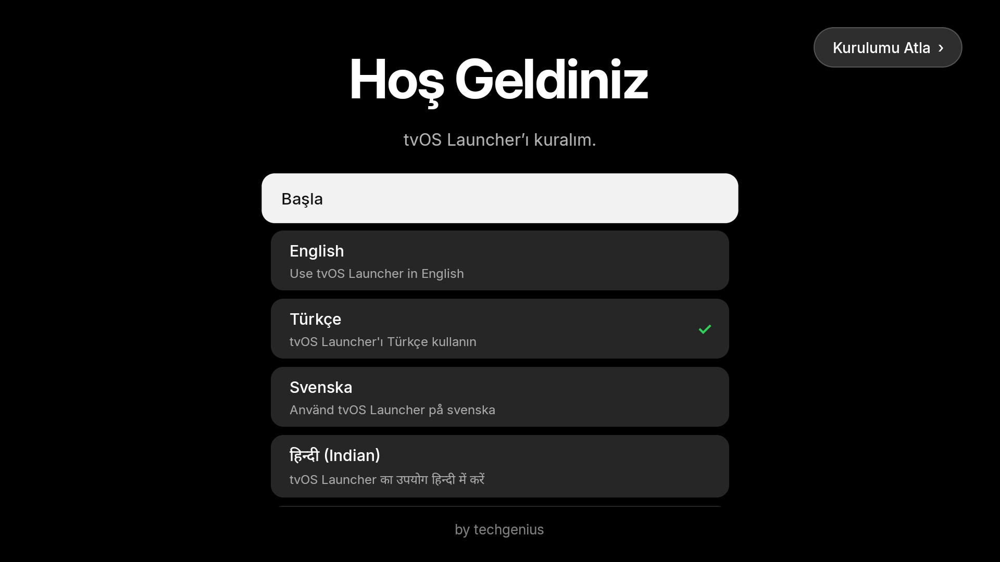 | 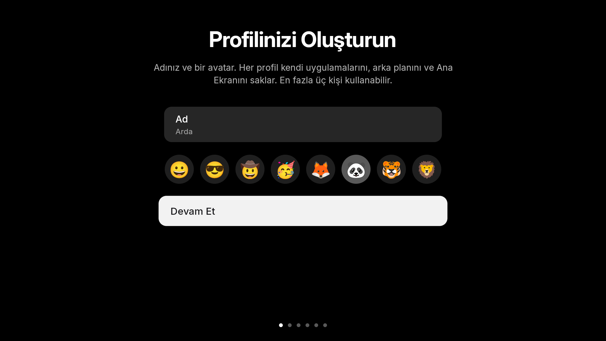 |

| 3. Görünüm Modu (`Gece Sahneleri` / `Klasik`) | 4. Hava Durumu & Konum |
| :---: | :---: |
| 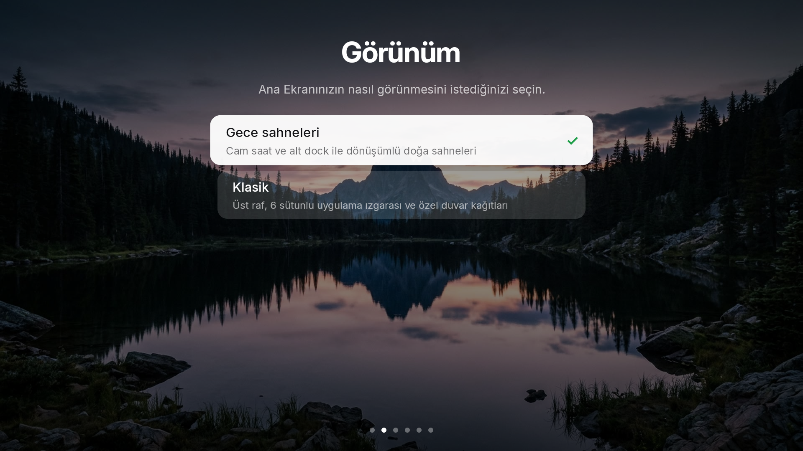 | 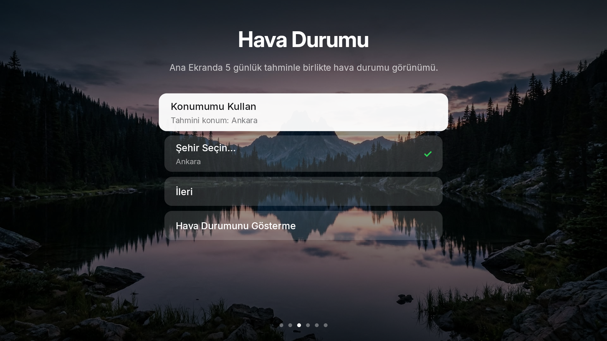 |

| 5. Kolay Kurulum (Otomatik ADB) ve Manuel İzinler | 6. Kumanda Tuş Atayıcı Kurulumu (`1x / 2x / 3x`) |
| :---: | :---: |
| 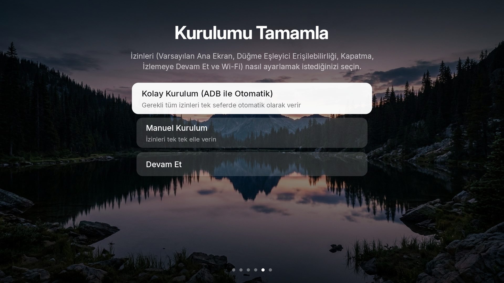 | 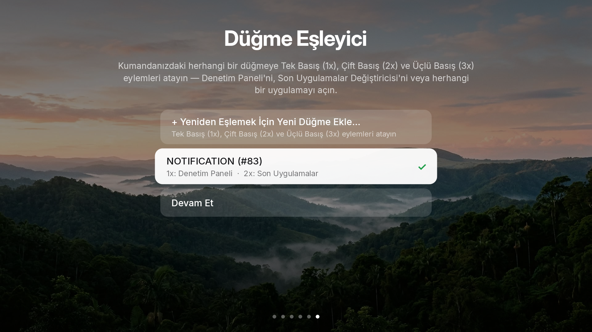 |

---

### Ana Ekran Ayarları

| Görünüm & Sahneler (`Dock Boyutu %50–%150`) | Denetim Paneli (`Hızlı Ayarlar`) |
| :---: | :---: |
| 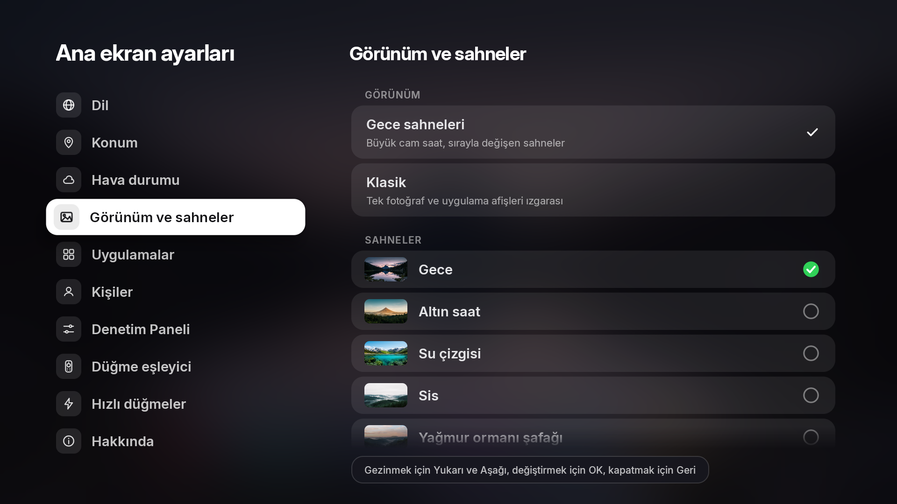 | 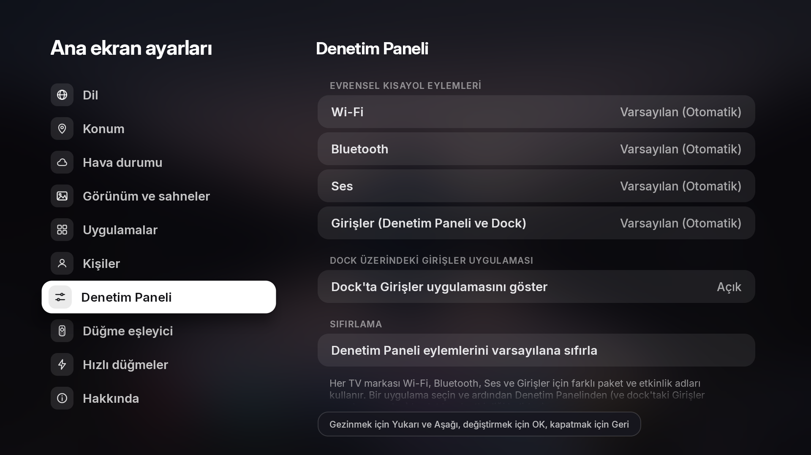 |

| Düğme Eşleyici (`1x / 2x / 3x` & Home Tuşu Düzeltmesi) | Gelişmiş, ADB Durumu & İzin Kontrolü (`5 / 5`) |
| :---: | :---: |
| 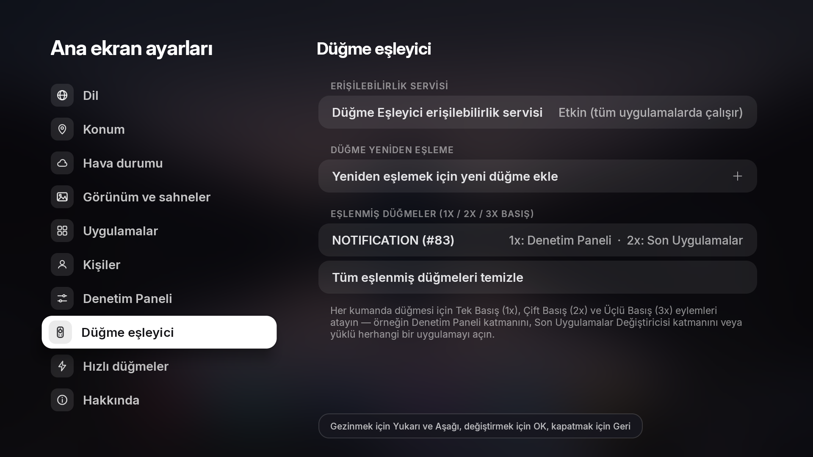 | 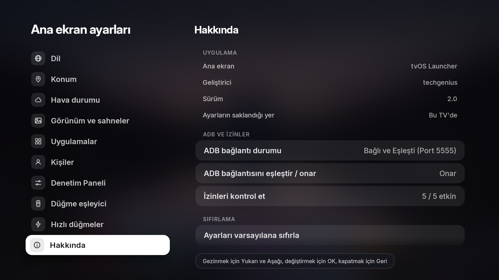 |

| CleanYourTV — Sistem Başlatıcılarını Devre Dışı Bırak | Otomatik ve Manuel GitHub Güncellemeleri |
| :---: | :---: |
| 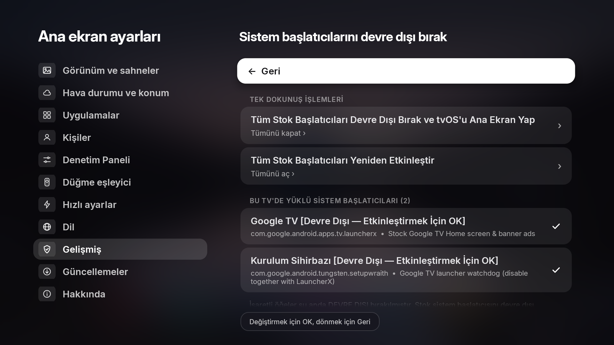 | 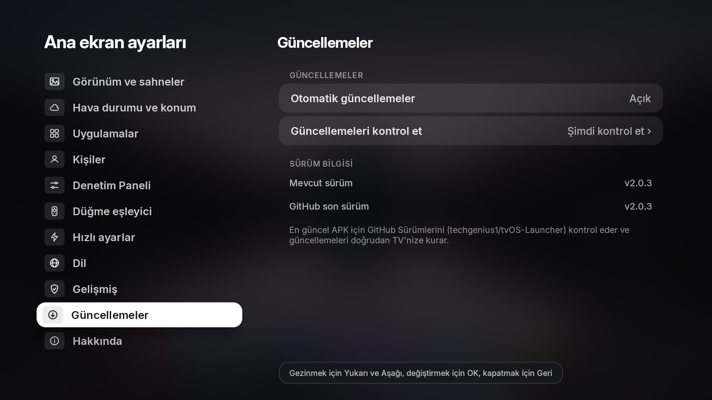 |

---

## 🚀 Hızlı Başlangıç (Derleme & Kurulum)

### Gereksinimler
- **JDK 17+** (`javac`, `jar`)
- **Android SDK** (`build-tools;34.0.0` ve `platforms;android-34`)

### Windows'ta Derleme (PowerShell)
```powershell
powershell -ExecutionPolicy Bypass -File .\build.ps1
# Çıktı APK -> build\tvos-home.apk
```

### macOS / Linux'ta Derleme
```sh
./build.sh
# Çıktı APK -> build/tvos-home.apk
```

### ADB ile Kurulum
```sh
adb connect <tv-ip>:5555
adb install -r build/tvos-home.apk
adb shell am start -n com.techgenius.tvoslauncher/.MainActivity
```

---

## 📋 Sistem Gereksinimleri

- **Android TV / Google TV 7.0+ (API 24+)**

---

## 🙌 Teşekkürler & Katkıda Bulunan Projeler

**tvOS Launcher** projesine ilham veren ve katkıda bulunan açık kaynak projelere teşekkürler:

- **[Hume Launcher](https://github.com/petrobot-admin/hume-launcher)** ([@petrobot-admin](https://github.com/petrobot-admin)) — Sıfır bağımlılıklı Android TV Java mimarisi, Klasik ana ekran düzeni ve sistem entegrasyonları için temel yapı.
- **[Couch TV](https://github.com/Seagey/couch-tv)** ([@Seagey](https://github.com/Seagey)) — Gece Sahneleri derinlikli duvar kağıtları, dev cam saat ve cam efektli Ayarlar arayüzü tasarımı.
- **[CleanYourTV](https://github.com/Gathin23/cleanyourtv)** ([@Gathin23](https://github.com/Gathin23)) — Dahili CleanYourTV (Beta) aracına güç veren topluluk tarafından hazırlanmış Android TV / Google TV debloat profilleri (`examples/`).
- **Inter Yazı Tipi** (SIL Open Font License 1.1) & **Project Nayuki QR Kod Üretici** (MIT Lisansı).
- Hava durumu verileri: **Open-Meteo**, **MET Norway** ve **wttr.in**.

---

## 📄 Lisans

**Apache License 2.0** kapsamında lisanslanmıştır — ayrıntılar için [LICENSE](LICENSE) ve [NOTICE](NOTICE) dosyalarına göz atabilirsiniz.
