# tvOS Launcher (`v2.2.5`)

> 🇬🇧 **For English documentation and setup guide:** **[README.md (English)](README.md)**  
> 📦 **En Son APK İndir (`v2.2.5`):** **[GitHub Releases](https://github.com/techgenius1/tvOS-Launcher/releases/latest)**

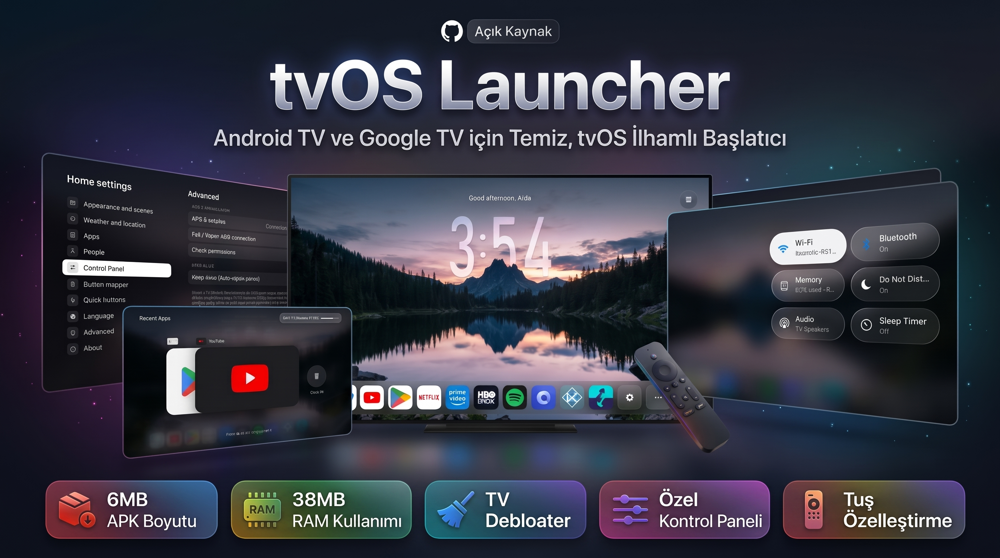

Android TV ve Google TV cihazlar için hiçbir üçüncü parti çalışma zamanı (runtime) kütüphanesi kullanılmadan **%100 saf Java** ile geliştirilmiş, hızlı ve ultra hafif **tvOS 26 & macOS** tasarımlı ana ekran başlatıcısı (**~5.7 MB APK boyutu, arka planda `%0.0` CPU kullanımı ve önbelleğe alınmış Liquid Glass ile 60 FPS akıcılık**). **1 GB RAM'li** uygun fiyatlı TV kutularında ve **Android 6.0 (API 23)** cihazlardan **Android 14+** televizyonlara kadar akıcı çalışırken; **boyutlandırılabilir ve çok satırlı macOS Liquid Glass Dock (`%50–%150`, `1–3 satır`)**, **macOS 26 tarzı Uygulama Arşivi (`Diğer Uygulamalar`) penceresi**, **Ana Ekran Arama Kısayollu Yerel Liquid Glass Evrensel Arama Penceresi**, **Özel Ön Plan Derinlik Katmanı Destekli Gece Sahneleri (Büyük Cam Saat veya Küçük Üst Saat seçeneğiyle)**, **7 Etkileşimli Ana Ekran Widget'ı** (**Namaz Vakitleri Ülke/Şehir Seçimi + Hava Durumu Eşitleme** ve **Canlı Haberler Ülke Seçimi** dahil), **Özel Duvar Kağıtları (`Tekli/Çoklu, Klasörden Karışık & Reddit Duvar Kağıtları`)**, **Dahili Kilit Ekranı / Ekran Koruyucu**, **Uygulama Simgesi Değiştirici ve Simge Düzenleyici**, **Otomatik GitHub Uygulama Güncellemeleri**, **bilgisayar gerektirmeyen dahili CleanYourTV Debloat aracı (İsteğe Bağlı GitHub Profil İndirici + Manuel Sistem Uygulaması Debloat + Sistem Başlatıcılarını Devre Dışı Bırakma)**, **Genişletilmiş Hava Durumu Panelli ve Yerel Güç Menüsü Destekli Evrensel Denetim Paneli (`Hızlı Ayarlar`)**, **TV Giriş Yöneticisi (Girişleri Gizleme ve Yeniden Adlandırma)**, **Son Uygulamalar Değiştiricisi**, **çoklu basış (`1x / 2x / 3x`) ScanCode Destekli Kumanda Tuş Atayıcı + Direct-Boot Ana Ekran Tuşu Düzeltmesi**, **Evrensel 3 Modlu Ses Tuşu Basılı Tutma Düzeltmesi (Standart, HY320 Projeksiyon, Onn TV Box)**, **Apple TV Arayüz Ses Efektleri**, **Caffeine Modu** ve **Dinamik Port Algılamalı Çift Modlu Güvenli Yerel ADB Kurulumu** özelliklerini bir araya getirir.

---

## ✨ Öne Çıkan Özellikler

- **Yerel Liquid Glass Evrensel Arama & Ana Ekran Arama Kısayolu**
  - *Diğer Uygulamalar* penceresiyle uyumlu, ortalanmış macOS 26 tarzı Liquid Glass **Arama** arayüzü; sesli dikte ve klavye desteğiyle birlikte.
  - **Film ve Dizi** sonuçlarını yalnızca TV'nizde yüklü yayın uygulamalarına ve etkin bölgenize göre filtreler; yüklü uygulamalarda hızlı arama (**Uygulamalarda Ara**) ve **Uygulama İçi Sonuçlar** sunar.
  - Ana ekranda Hava Durumu ve Denetim Paneli butonlarının yanında isteğe bağlı kapatılabilir **Arama kısayolu** (**Ayarlar → Ana Ekran Widget'ları / Hızlı ve Ana Ekran**).

- **Varsayılan Ana Ekran Widget Paneli (7 Etkileşimli ve Özelleştirilebilir Widget)**
  - Yerel Liquid Glass detay pencerelerine sahip yatay kaydırılabilir 7 widget kartı görüntüler (tümü varsayılan olarak açıktır; herhangi bir widget üzerinde **OK tuşuna basılı tutarak** doğrudan Ana Ekrandan **Taşıyabilir** veya **Devre Dışı Bırakabilirsiniz**; Ana Ekran tuşuna basıldığında yanıp sönme olmadan akıcı kalır):
    - 🕌 **Namaz Vakitleri**: Günlük namaz vakitleri (İmsak, Güneş, Öğle, İkindi, Akşam, Yatsı), sonraki vakte canlı geri sayım, 10 farklı hesaplama yöntemi ve **Ülke/Şehir seçici** (dünya çapında şehir arama, 20 popüler şehir veya ilk kurulumda/ayarlarda seçilen **Hava Durumu konumuyla otomatik eşitleme**).
    - ⚽ **Etkileşimli Futbol Maçları**: Favori takımlarınızın tüm lig ve turnuvalardaki (Şampiyonlar Ligi, Avrupa Ligi, Süper Lig, Premier Lig, LaLiga, Serie A, Bundesliga, Ligue 1 vb.) yaklaşan ve canlı maçları, her iki takımın logosu, canlı maç içi skorlar ve Sol/Sağ yön tuşlarıyla maçlar arasında gezinme.
    - 🎬 **Çok İzlenenler (Son Çıkanlar)**: JustWatch altyapısıyla en popüler yayın platformlarındaki popüler film ve diziler; varsayılan olarak arayüz diliyle eşitlenir ve istenirse birden fazla ülke seçilebilir.
    - ⛅ **Hava Durumu**: Anlık sıcaklık, hava durumu ikonu, konum adı ve bugün/yarın tahmini.
    - 🏏 **Canlı Kriket Skorları**: Uluslararası ve lig kriket maçlarının anlık skorları.
    - 📰 **Canlı Haberler**: Güncel son dakika başlıkları ve **Ülke seçici** (varsayılan olarak arayüz diliyle otomatik eşitlenir).
    - 🍿 **En İyi Film ve Diziler**: En yüksek puanlı popüler film ve dizi önerileri.
  - Hem **Gece Sahneleri** hem de **Klasik Görünüm** ile tam uyumludur.

- **Çift Görünüm Modu (`Gece Sahneleri` & `Klasik`) + Çok Satırlı Dock**
  - **Gece Sahneleri (Night Scenes)**: Dağ ve manzara katmanlarının arkasında duran dev cam saat (*iPhone Duo*, *iPhone Rounded*, *Tall Glass*) veya sol üst köşede **Küçük Saat** seçeneği, derinlikli arka plan sahneleri (*Gece*, *Altın Saat*, *Su Çizgisi*, *Sis*, *Yağmur Ormanı Şafağı*), özel duvar kağıtları için **Özel Ön Plan PNG Derinlik Katmanı** desteği, arka plan iş parçacığında yumuşak sahne geçişleri, kişisel karşılama mesajı, tarih, canlı hava durumu ve dinamik boyutlanan **macOS Liquid Glass Dock (`%50` – `%150`, `1–3 satır` seçeneği)**. Simgeler pürüzsüz squircle köşelere, beyaz köşeli simgelerde otomatik siyah odak halkasına ve her zaman en üstte görünen uygulama adı etiketlerine sahiptir.
  - **macOS 26 Uygulama Arşivi (`Diğer Uygulamalar`) & Gizli Uygulamalar**: 5 sütunlu kaydırılabilir ızgaraya sahip buzlu cam açılır pencere. Herhangi bir uygulamaya **OK basılı tutarak** yeniden adlandırabilir, simgesini değiştirebilir, taşıyabilir, *Diğer Uygulamalara Taşı* (ana dock'u küçültür) veya gizleyebilirsiniz.
  - **Klasik Görünüm (Classic)**: Apple tvOS tarzı yuvarlatılmış köşelere sahip 6 sütunlu uygulama ızgarası ve ortalanmış cam dock.
  - **Klasik Görünüm İçin Büyük Saat**: Gece Sahnelerindeki dev cam saat, tarih, karşılama mesajı ve sağ üst hava durumu kısayolunu Klasik görünüme taşır ve **Saat Hizalaması (`Sol / Orta / Sağ`)** seçeneği sunar.
  - **Dinamik ve Özel Duvar Kağıdı Saat Hizalaması**: Varsayılan gece sahnelerinde her duvar kağıdına göre otomatik değişen dinamik hizalama, özel duvar kağıtlarında ise Sol / Orta / Sağ hizalama seçeneği.

- **Gelişmiş Özel Duvar Kağıdı Motoru (`1–60 Dakika Değişim Aralığı`)**
  - **Tekli ve Çoklu Duvar Kağıdı**: Dahili depolama veya USB'den sınırsız görsel ve isteğe bağlı ön plan derinlik PNG katmanı seçebilme.
  - **Klasörden Karıştır**: Seçilen herhangi bir klasördeki tüm duvar kağıtlarını otomatik döngüde rastgele oynatma.
  - **Reddit Duvar Kağıtları**: Seçilen subreddit'lerden (örn. `wallpapers`, `EarthPorn`) yüksek çözünürlüklü duvar kağıtlarını otomatik çekme, `1, 2, 3, 5, 10, 15, 20, 25, 30 ve 60 dakika` değişim aralığı seçenekleri ve anında "Sonraki Duvar Kağıdı"na geçebilme.

- **Tüm Medya Uygulamaları İçin Evrensel İzlemeye Devam Et Desteği**
  - Yüklü medya uygulamalarıyla (YouTube, SmartTube, Netflix, Prime Video, Disney+, Apple TV+, HBO Max, Stremio, Nuvio, Lampa ve üçüncü parti TV kanalı uygulamaları vb.) Android TV `TvContract` EPG / Watch Next / Preview kanalları, `MediaSessionManager` aktif oturum takibi ve bildirim dinleyicileri üzerinden entegre çalışır.
  - **Dock ile Eşzamanlı Filtreleme**: Yalnızca dock'ta üzerinde durulan uygulamanın içeriklerini gösterir.
  - **Stremio & Nuvio Dock Açılır Pencereleri**: Dock simgeleri üzerinde yerel önbellek, QR kodlu giriş, Nuvio fork bağlama ve profil geçişi destekli pencereler.
  - **Doğrudan Derin Bağlantı (Deep Link)**: Karta tıklandığında doğrudan videoyu başlatır.

- **Bağımsız TV Girişleri (Inputs) Paneli & Giriş Yöneticisi (`Ayarlar → Denetim Paneli → Girişler`)**
  - Kumanda Tuş Atayıcı veya Denetim Panelinden açılabilen cam tasarımlı giriş paneli.
  - **Giriş Yöneticisi**: Kullanmadığınız HDMI/TV girişlerini gizleyebilir veya her girişe özel isim verebilirsiniz.

- **Caffeine Modu (`Ayarlar → Gelişmiş`)**
  - Android'in boşta kalma (idle) modunu reddeder ve Android TV'nin otomatik Ortam Modu'nun / ekran koruyucusunun devreye girmesini önleyerek TV'nizi uyanık tutar.

- **Evrensel Cam Denetim Paneli (`Hızlı Ayarlar`), Yerel Güç Menüsü & Apple TV Arayüz Sesleri**
  - Ana ekrandan veya herhangi bir uygulamanın üzerindeyken **Bulanık** veya **Şeffaf** arka plan moduyla açılabilir.
  - Denetim Panelinden tek tıkla açılıp kapatılabilen orijinal **Apple TV Arayüz Ses Efektleri** (*Gezinme*, *Tıklama*, *Geri*).
  - **Özelleştirilebilir Güç Kutucuğu**: **Ekranı Kapat**, Android'in **Yerel Güç Menüsü** (Erişilebilirlik veya ADB uzun basma ile) veya özel bir eylem arasında seçim yapabilme.
  - **Genişletilmiş Hava Durumu Paneli**: Alt kısımda yer alan 4 sütun genişliğinde panel bugünkü ve yarınki hava durumunu gösterir (tıklandığında 5 günlük detaylı hava durumu açılır).
  - **Wi-Fi**, **Bluetooth**, **RAM / Son Uygulamalar**, **Rahatsız Etmeyin**, **Ses Çıkışı**, **Uyku Zamanlayıcısı**, **Ortam Modu**, **Kapat / Ekranı Kapat**, **Girişler (HDMI)**, **Tuş Atayıcı**, **Ayarlar** ve **Arama** kısayollarını içerir.

- **Son Uygulamalar Değiştiricisi (Recent Apps Switcher) & RAM Temizleyici**
  - Atanmış kumanda tuşuyla veya Denetim Panelindeki **RAM** kutucuğundan her uygulamanın üzerinde açılır; pürüzsüz kart kapanış animasyonu, **Yukarı (DPAD UP)** tuşuyla tekil uygulama kapatma (`force-stop`), **Tümünü Kapat** butonu ve Güvenli ADB Modu bilgilendirmesi içerir.

- **Çoklu Basış Kumanda Tuş Atayıcı, ScanCode Desteği & 3 Modlu Ses Tuşu Düzeltmesi**
  - Direct-boot destekli Erişilebilirlik Servisi ile kumandadaki herhangi bir tuşa **Tek Basış (1x)**, **Çift Basış (2x)** ve **Üçlü Basış (3x)** için bağımsız görevler veya **Tuş Kodu Gönder** atayabilirsiniz.
  - **Donanım ScanCode Desteği & Bluetooth Kumanda Uyumluluğu**: Aynı Android keyCode değerini paylaşan farklı tuşları (ör. Philips TV'lerde `#602` keyCode gönderen *Kaynaklar* `scanCode 757` ve *Ayarlar* `scanCode 641` tuşlarını) birbirinden ayırır; oyun kolu (gamepad) tuşlarını ve klavye yön tuşu basılı tutma hareketlerini Bluetooth kumandaları engellemeden doğrudan geçirir.
  - **Ana Ekran Tuşu Düzeltmesi & Gecikmesiz Açılış**: Direct-boot ve `USER_UNLOCKED` desteğiyle açılışta OEM başlatıcıların araya girmesini engelleyerek tvOS Launcher'ı anında ekrana getirir.
  - **Evrensel Ses Tuşu Basılı Tutma Düzeltmesi**: Standart, HY320 Projeksiyon ve Onn TV Box modlarıyla hem Güvenli Modda hem Kalıcı ADB Modunda çalışır.

- **CleanYourTV (Beta) — Bilgisayar Gerektirmeyen Dahili Debloat Aracı & Kaldırma Yardımcısı (`Ayarlar → Gelişmiş`)**
  - **[CleanYourTV](https://github.com/Gathin23/cleanyourtv)** son sürüm paketini isteğe bağlı olarak `Download/cleanyourtv` klasörüne indirir, canlı ilerleme penceresiyle çıkartır ve TV modelinizi seçtikten sonra gereksiz diğer model dosyalarını temizleyerek depolama alanı tasarrufu sağlar.
  - **Sistem Başlatıcılarını Devre Dışı Bırakma & Manuel Debloat**: Stok başlatıcıları (*Google TV Home, Android TV Home, TCL, Philips, Xiaomi, Sony, Amlogic/Droidlogic*) güvenlik uyarılarıyla yönetme.
  - **Güvenli Kaldırma Yardımcısı (`tvOS Launcher'ı Kaldır`)**: Gelişmiş ayarlarda yer alan kaldırma seçeneği; kaldırılmadan önce debloat edilen uygulamaları ve devre dışı bırakılan başlatıcıları geri yüklemeyi teklif eder, özel izinleri temizler ve Android uygulama kaldırma ekranına yönlendirir.

- **Ayarları Yedekleme ve Geri Yükleme (`Ayarlar → Sistem / Hakkında / Hızlı ve Ana Ekran`)**
  - Tüm başlatıcı tercihleri, dock sıralaması, özel uygulama isimleri ve simgeleri tek dokunuşla `Download/tvos-launcher-settings.json` dosyasına yedeklenebilir ve geri yüklenebilir.

- **Uygulama Simgesi Değiştirici & Simge Düzenleyici (`JPG / PNG / ICO`)**
  - İstediğiniz uygulamaya basılı tutarak simgesini değiştirebilir; dahili simge düzenleyici ile renk, boyut ve konumunu özelleştirebilirsiniz.

- **Otomatik ve Manuel GitHub Güncellemeleri (`Ayarlar → Güncellemeler`)**
  - Güncellemeleri `Download/tvOSLauncherUpdates` klasörüne indirir (aynı sürümü tekrar indirmez), Kalıcı ADB Modunda arka planda otomatik olarak (`pm install -r`), Güvenli Modda ise paket yükleyici ile kurar ve güncelleme sonrası ilk açılışta kurulum dosyalarını otomatik temizler.

- **Dinamik Port Algılamalı Çift Modlu Güvenli Yerel ADB Mimarisi**
  - Tek bir RSA anahtarı kullanarak TV kutunuzun kullandığı yerel ADB portunu (`5555`, `5070`, `adb.tcp.port` vb.) otomatik bulur ve bağlanır.
  - **Güvenli Mod (Varsayılan & Önerilen)**: İzinleri tek seferde verip ağ ADB portunu hemen kapatır.
  - **Kalıcı ADB Modu**: Çalışma zamanında debloat, Son Uygulamalar yönetimi ve sessiz otomatik güncellemeler için portu açık tutar.

- **17 Dil Desteği (İbranice ve Arapça İçin Tam Sağdan Sola Arayüz Desteği)**
  - **Türkçe, İngilizce, Azerbaycan dili (Azərbaycan dili), İsveççe, Korece (한국어), İbranice (עברית), Almanca, Fransızca, İspanyolca, İtalyanca, Rusça, Portekizce, Brezilya Portekizcesi (Português do Brasil), Arapça, Hintçe, Japonca ve Çince** dillerinde tam yerelleştirilmiş arayüz.

- **Çoklu Kullanıcı Profilleri & Canlı Hava Durumu**
  - 3'e kadar bağımsız kullanıcı profili ve API anahtarı gerektirmeyen 5 günlük hava durumu tahmini.

- **Ultra Hafif ve Hızlı (Android 6.0 – Android 14+)**
  - Saf Android SDK Java — Gradle yok, Kotlin yok, AndroidX yükü yok. Önbelleğe alınmış Liquid Glass yüzeyleri, yerinde widget güncellemeleri, yanıp sönmeyen Ana Ekran geçişi ve **Android 6.0 (API 23)** ile **Android 14+** arası tam uyumluluk.

---

## 📸 Ekran Görüntüleri

### Ana Ekran, Denetim Paneli ve Son Uygulamalar Değiştiricisi

| Gece Sahneleri Ana Ekranı & macOS Cam Dock | Cam Denetim Paneli (Control Panel) |
| :---: | :---: |
| 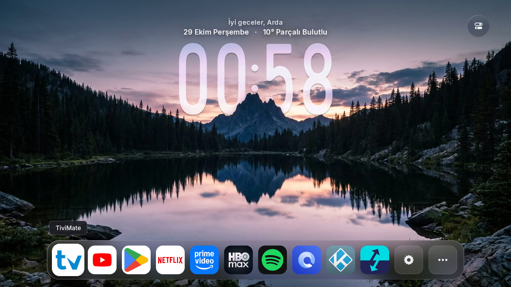 | 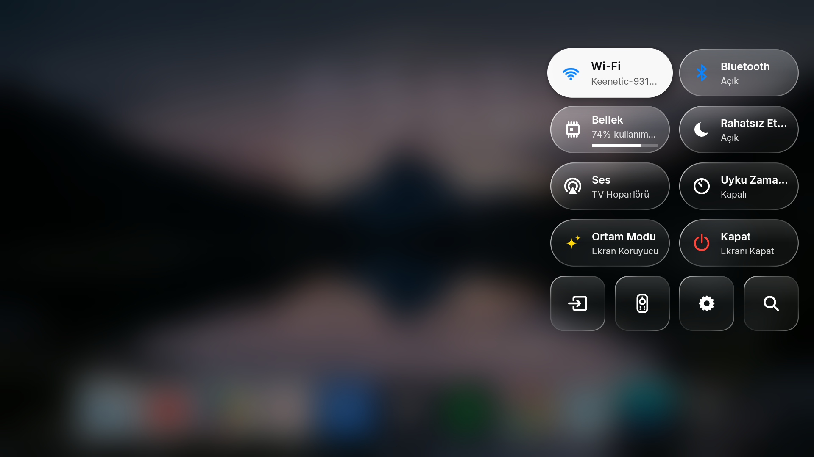 |

| Son Uygulamalar Değiştiricisi & RAM Temizleyici |
| :---: |
|  |

---

### İlk Kurulum Sihirbazı

| 1. Hoş Geldiniz & Dil Seçimi | 2. Profil & Avatar Kurulumu |
| :---: | :---: |
| 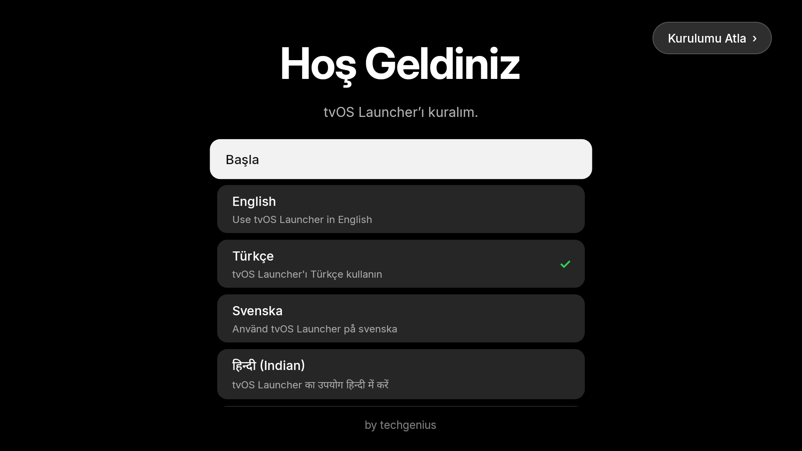 | 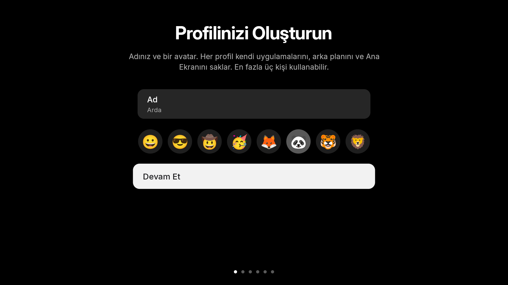 |

| 3. Görünüm Modu (`Gece Sahneleri` / `Klasik`) | 4. Hava Durumu & Konum |
| :---: | :---: |
| 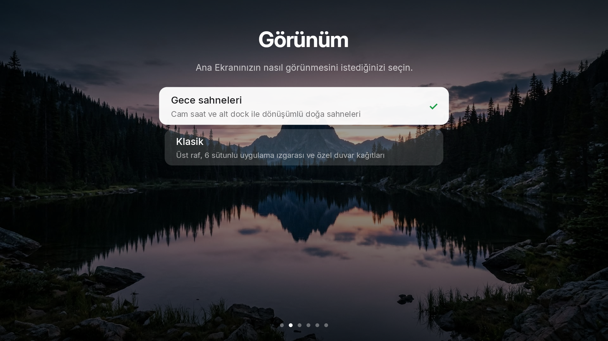 | 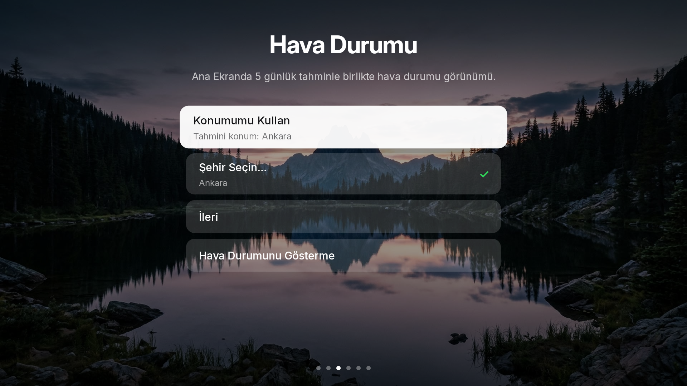 |

| 5. Kolay Kurulum (Otomatik ADB) ve Manuel İzinler | 6. Kumanda Tuş Atayıcı Kurulumu (`1x / 2x / 3x`) |
| :---: | :---: |
| 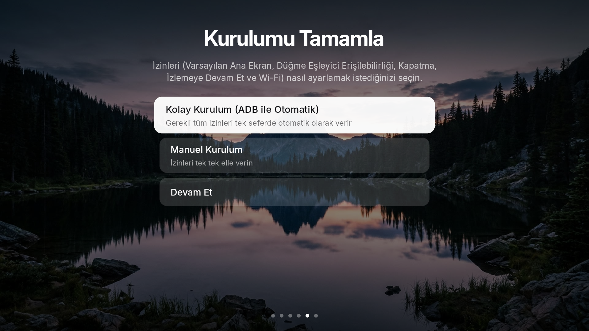 | 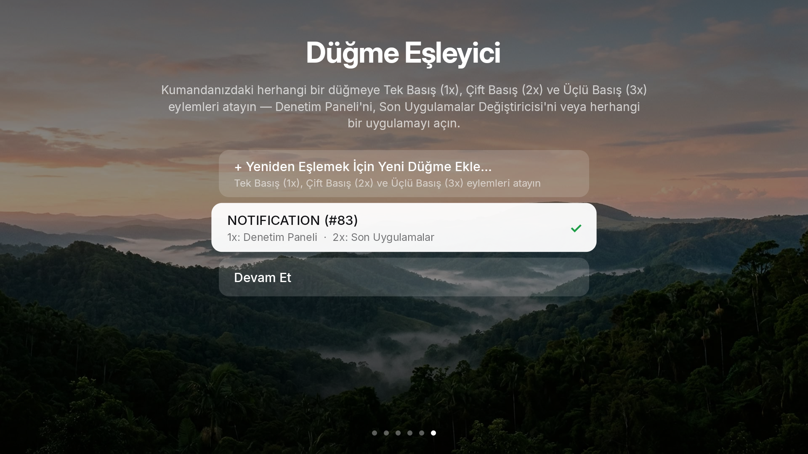 |

---

### Ana Ekran Ayarları

| Görünüm & Sahneler (`Dock Boyutu %50–%150`) | Denetim Paneli (`Hızlı Ayarlar`) |
| :---: | :---: |
| 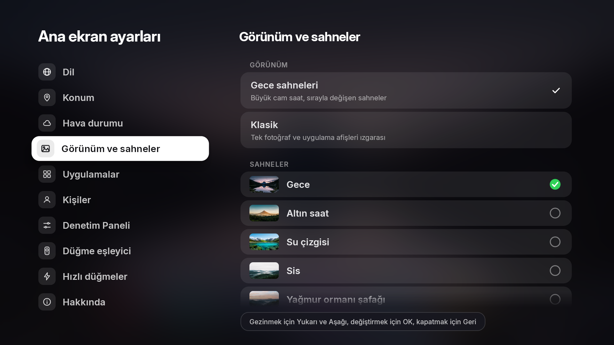 | 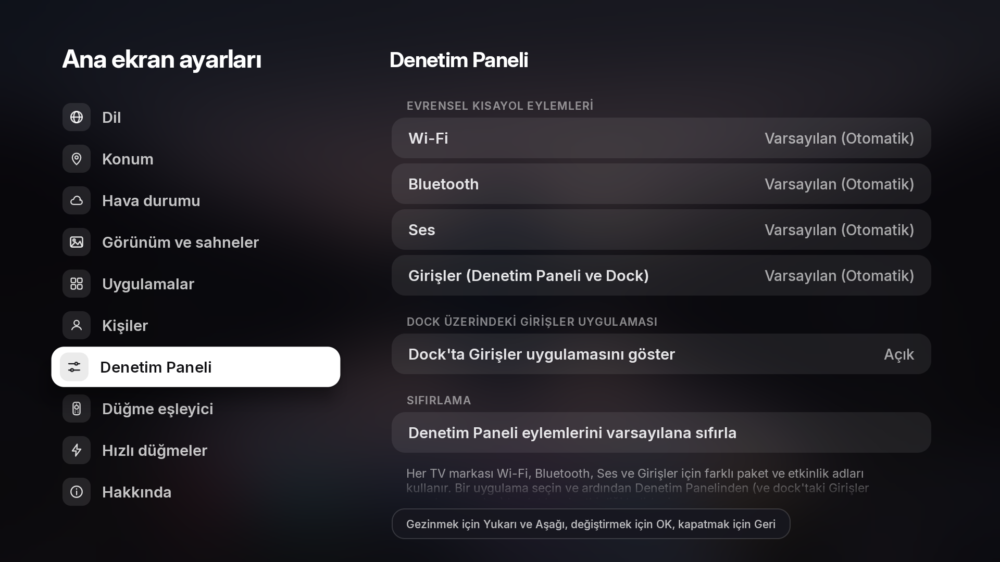 |

| Düğme Eşleyici (`1x / 2x / 3x` & Home Tuşu Düzeltmesi) | Gelişmiş, ADB Durumu & İzin Kontrolü (`5 / 5`) |
| :---: | :---: |
| 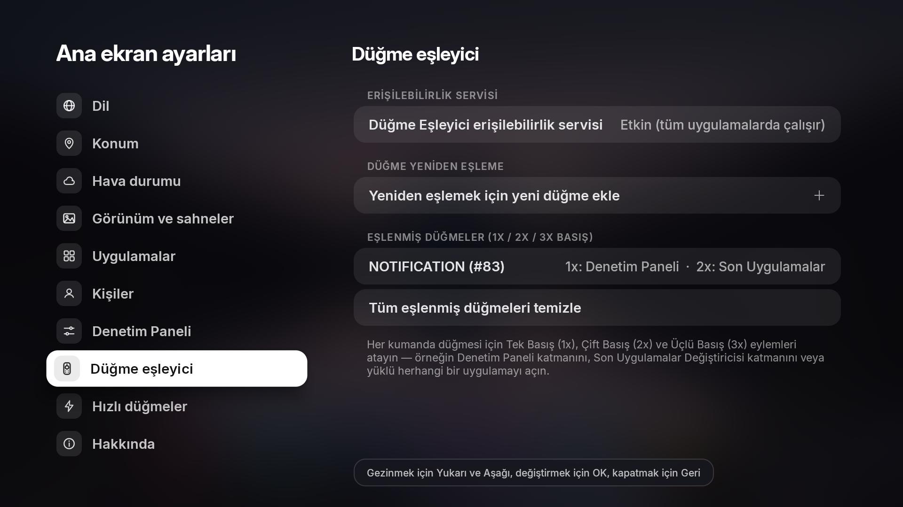 | 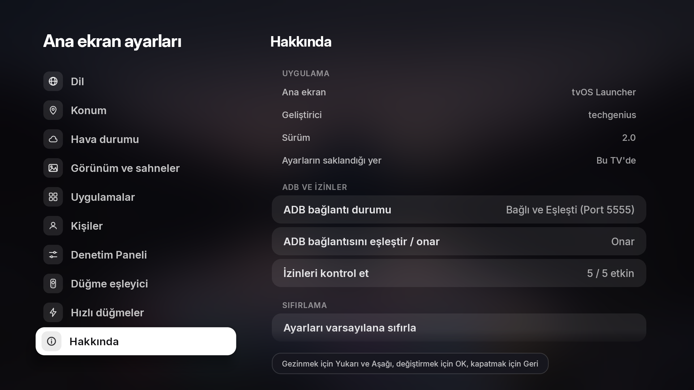 |

| CleanYourTV — Sistem Başlatıcılarını Devre Dışı Bırak | Otomatik ve Manuel GitHub Güncellemeleri |
| :---: | :---: |
| 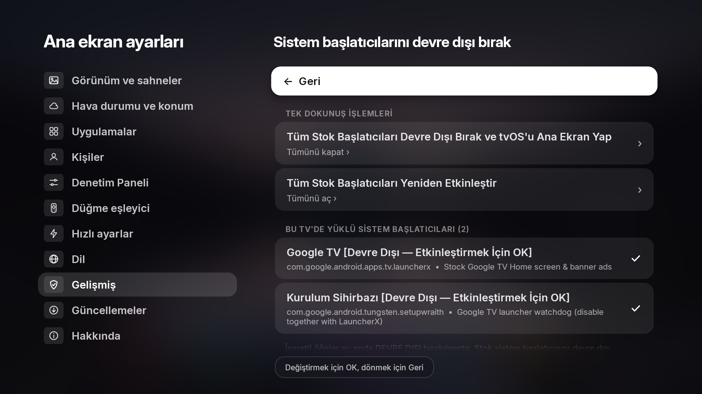 | 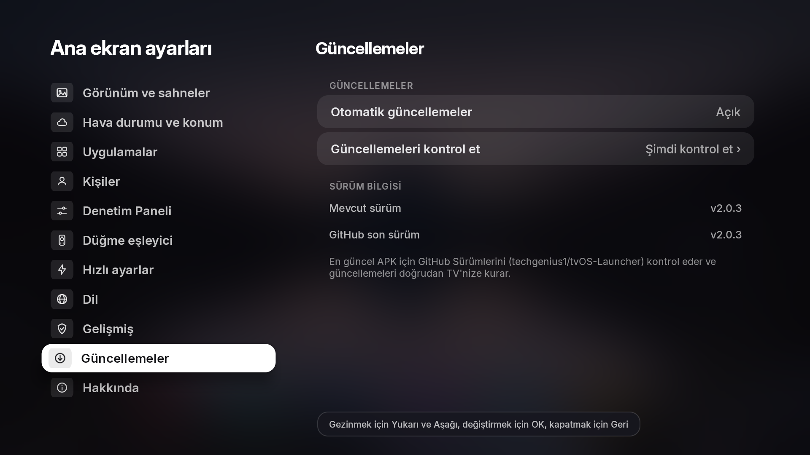 |

---

## 🚀 Hızlı Başlangıç (Derleme & Kurulum)

### Gereksinimler
- **JDK 17+** (`javac`, `jar`)
- **Android SDK** (`build-tools;34.0.0` ve `platforms;android-34`)

### Windows'ta Derleme (PowerShell)
```powershell
powershell -ExecutionPolicy Bypass -File .\build.ps1
# Çıktı APK -> build\tvos-home.apk
```

### macOS / Linux'ta Derleme
```sh
./build.sh
# Çıktı APK -> build/tvos-home.apk
```

### ADB ile Kurulum
```sh
adb connect <tv-ip>:5555
adb install -r build/tvos-home.apk
adb shell am start -n com.techgenius.tvoslauncher/.MainActivity
```

---

## 📋 Sistem Gereksinimleri

- **Android TV / Google TV 6.0+ (API 23+)**

---

## 🙌 Teşekkürler & Katkıda Bulunan Projeler

**tvOS Launcher** projesine ilham veren ve katkıda bulunan açık kaynak projelere teşekkürler:

- **[Hume Launcher](https://github.com/petrobot-admin/hume-launcher)** ([@petrobot-admin](https://github.com/petrobot-admin)) — Sıfır bağımlılıklı Android TV Java mimarisi, Klasik ana ekran düzeni ve sistem entegrasyonları için temel yapı.
- **[Couch TV](https://github.com/Seagey/couch-tv)** ([@Seagey](https://github.com/Seagey)) — Gece Sahneleri derinlikli duvar kağıtları, dev cam saat ve cam efektli Ayarlar arayüzü tasarımı.
- **[CleanYourTV](https://github.com/Gathin23/cleanyourtv)** ([@Gathin23](https://github.com/Gathin23)) — Dahili CleanYourTV (Beta) aracına güç veren topluluk tarafından hazırlanmış Android TV / Google TV debloat profilleri (`examples/`).
- **Inter Yazı Tipi** (SIL Open Font License 1.1) & **Project Nayuki QR Kod Üretici** (MIT Lisansı).
- Hava durumu verileri: **Open-Meteo**, **MET Norway** ve **wttr.in**.

---

## 📄 Lisans

**Apache License 2.0** kapsamında lisanslanmıştır — ayrıntılar için [LICENSE](LICENSE) ve [NOTICE](NOTICE) dosyalarına göz atabilirsiniz.
