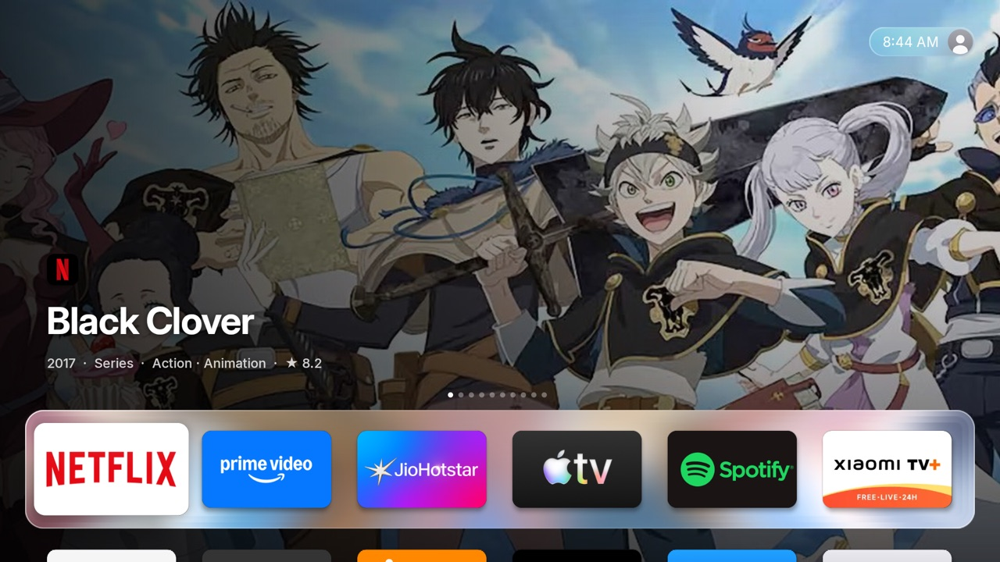

# tvOS Launcher documentation

tvOS Launcher (`com.techgenius.tvoslauncher`) replaces the Android TV home screen with one modelled on
Apple tvOS 26. Every element was measured against Apple's own tvOS 26 screenshots and the Human
Interface Guidelines, then tuned to run at 60 fps on a low-end Mali-450 GPU.

| | |
|---|---|
|  |  |
| Home: suggestions behind the glass dock | Top shelf focused: dock slides away |
|  |  |
| Below the dock: launcher background | Options menu (hold OK on an app) |

## Contents

- **[Getting started](getting-started.md)** — install the tools, build, run on a TV or the
  emulator, developer shortcuts, troubleshooting.
- **[Features](features.md)** — everything tvOS Launcher does: setup, Home, carousel, weather, Control
  Center, profiles, inputs, search, screensaver, AirPlay guard, settings, permissions.
- **[Install and set up](install.md)** — make it the home screen, one-time permissions, undo.
- **[Presentation mode](presentation.md)** — sending content from a browser, the TV player,
  start on boot, and the web API.
- **[Architecture](architecture.md)** — code map, build, design decisions and performance notes.
- **[Contributing](../CONTRIBUTING.md)** — workflow, code style, design/performance/permission
  rules, testing and pull requests.

## At a glance

| Area | What it does |
|---|---|
| Dock & grid | Frosted Liquid Glass dock; 5:3 cards, 6 per row; 1.2× focus lift; tvOS zoom-to-open |
| Carousel | Continue Watching first, then Indian news and rotating recommendations (JustWatch, TMDB or Stremio); full screen when idle |
| Search | Apps, settings and inputs instantly; movies and shows on every service in India with Open / Get; Hindi keyboard, dictation; hold Back to open |
| Profiles | Up to 3, unique emoji avatars; separate layout, background and history; picker on wake |
| Control Center | Sleep, Wi-Fi, Do Not Disturb, audio, sleep timer, Bluetooth, accessibility, settings, search |
| Presentation | Browser upload of images/videos/webpages, looping full-screen playback, start on boot |
| Settings | A page per section, opened from the gear in Control Center; first-time setup pages |
