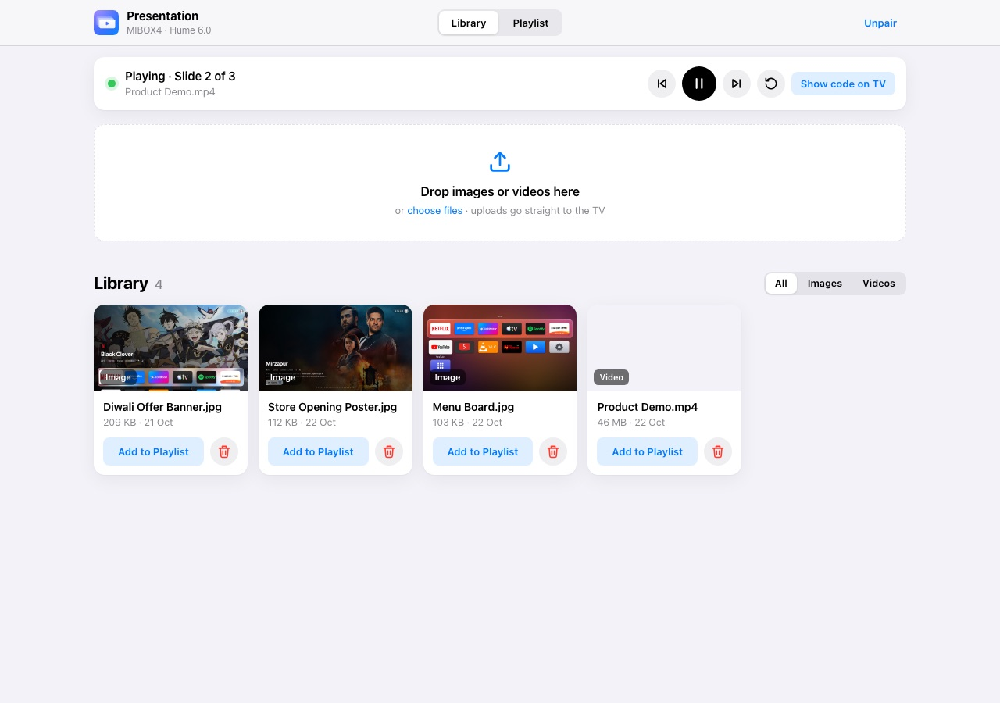
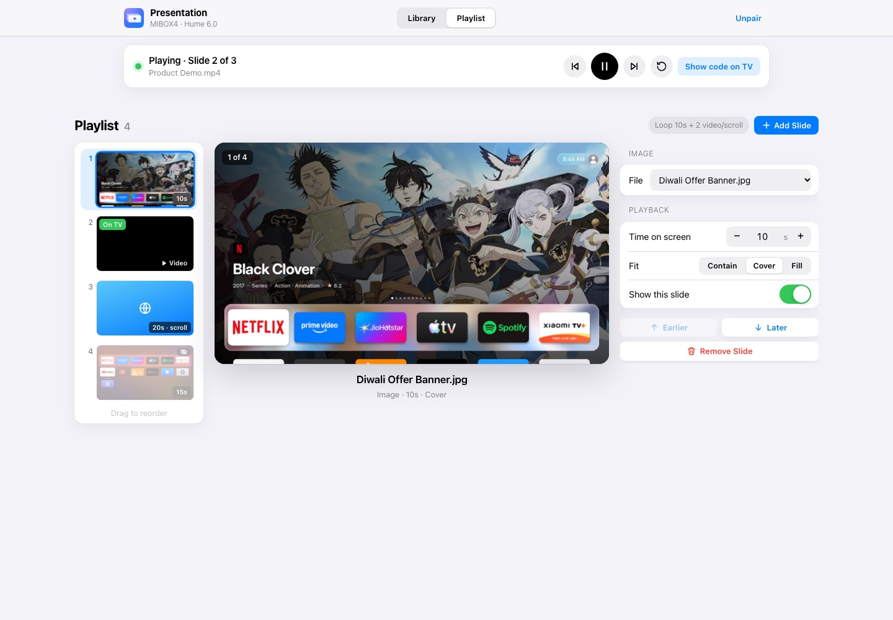
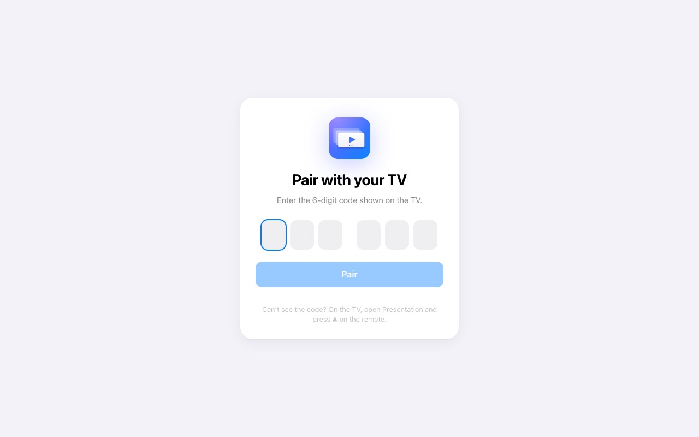
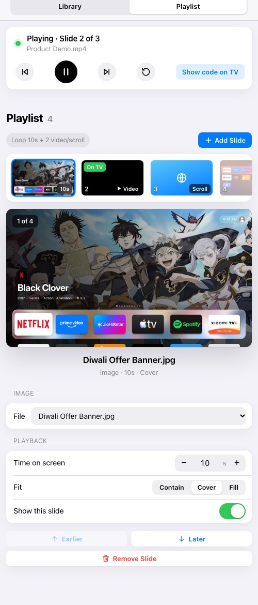
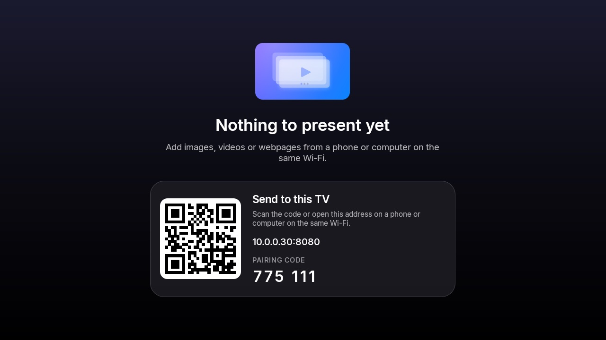

# Presentation mode

Presentation turns the TV into a signage screen you control from any browser on the same network.
Upload images and videos, add webpages, arrange them in a playlist, and the TV loops through them
full screen. It is a built-in feature of tvOS Launcher, ported from **PB Marketer TV**
(`pb-marketer-tv`) with the same playback logic and web API.

**Removed from the original** (by request): the admin/upload lock PIN, the debug telemetry panel
and the APK self-updater. **Kept:** browser pairing with a 6-digit code shown on the TV.

| | |
|---|---|
|  |  |
| Library: drag & drop uploads, thumbnails | Playlist: slide navigator, live preview, settings |
|  |  |
| Pairing with the TV's code | On a phone |

## Turn it on

Settings → **Presentation**:

| Setting | What it does |
|---|---|
| Presentation mode | Starts the web server on port 8080 and adds a **Presentation** tile to Home |
| Start on boot | Opens the presentation full screen as soon as the TV starts |
| Keep screen awake | Stops the TV sleeping or starting the screensaver while presenting |
| Address & pairing code | Shows the address, QR code and pairing code |
| Start presentation now | Opens the presentation full screen |

The address, QR code and pairing code always show for a few seconds when a presentation starts.

## Send content from a browser

1. On a phone or computer on the same Wi-Fi, open the address (for example
   `http://192.168.1.13:8080`) or scan the QR code.
2. Enter the **pairing code** shown on the TV (once per browser; the code changes when the TV
   restarts).
3. **Library**: drag images or videos onto the drop area (several at once); each shows its own
   progress bar. Filter by All / Images / Videos; delete with confirmation.
4. **Playlist** works like a slide editor: thumbnails of every slide on the left (a strip across
   the top on phones), a large preview of the selected slide in the middle, and its settings on the
   right.
   - **Add Slide** → *From Library…* or *Webpage…*.
   - Drag thumbnails to reorder (or use *Earlier* / *Later*, or Alt+↑/↓). Use ↑/↓ to move between
     slides.
   - Settings: file or address, time on screen, fit (Contain / Cover / Fill, shown live in the
     preview), sound for videos, auto-scroll speed and pause for webpages, and *Show this slide*.
   - The slide the TV is showing is marked **On TV**; hidden slides are dimmed.
5. **Save to TV** — the save bar appears whenever there are unsaved changes (with *Revert*).
6. The **Now Playing** bar shows what the TV is showing and has previous / play-pause / next /
   start over, plus *Show code on TV*.

The page follows the device's light or dark mode and works on phones.

## On the TV

| Remote key | Action |
|---|---|
| ◀ / ▶ | Previous / next slide |
| OK | Pause / play |
| ▲ / ▼ / Info | Show the address, QR and pairing code |
| Back, Back | Exit to Home (press twice) |

Playback rules (unchanged from the original):

- **Images** stay for their duration (default 10 s).
- **Videos** play to the end (muted by default), then advance.
- **Webpages** load at a 1920-px-wide desktop viewport scaled to the screen; with auto-scroll they
  scroll at the set speed, pausing every ~85% of a screen, then advance; without it they stay for
  their duration (default 20 s). Older WebViews (before Chrome 99) get CSS `@layer` rules unwrapped
  so modern sites render correctly.
- A slide that fails shows a message and is skipped after 5 seconds.
- With no slides, the TV shows one centred screen: the Presentation icon, "Nothing to present yet", and the QR code, address and pairing code.

## Web API

All calls except `/api/info` and `/api/pair` need `Authorization: Bearer <token>` (or `?token=`
for media file URLs). JSON in and out.

| Method & path | Description |
|---|---|
| `GET /api/info` | Name, device, port, admin URLs, version, `pairingRequired` |
| `POST /api/pair` `{pin}` | Exchange the TV's 6-digit code for `{token}` |
| `GET /api/media` | `{media: [...]}` newest first |
| `POST /api/media` | Upload (multipart field `file`, optional `mimeType`/`originalName`; or raw body with `X-File-Name`/`X-File-Type`) |
| `GET /api/media/{id}/file` | The stored file (used for thumbnails) |
| `DELETE /api/media/{id}` | Delete a file and any slides using it |
| `GET /api/playlist` | `{playlist}` — the single "Default" playlist |
| `PUT /api/playlist` `{name, slides}` | Replace the slides (validated) |
| `GET /api/playback/status` | `{playback: {available, state, slideIndex, slideCount, mediaName, url, error, ...}}` |
| `POST /api/playback/control` `{command}` | `play`, `pause`, `next`, `previous`, `restart`, `showConnectionInfo` |

Aliases kept for compatibility: `GET/POST /api/playlists`, `GET/PUT /api/playlists/{id}`,
`POST /api/playlists/{id}/activate`.

Slide fields: `id, type (image|video|webpage), durationSec, mediaId, url, fitMode
(contain|cover|fill), muted, loop, webpageAutoScroll, webpageScrollSpeedPxPerSec (5–1000),
webpageScrollPauseSec (0–300), enabled, order`.

## Storage

Same layout as the original app, inside tvOS Launcher's private storage: `signage.db` (tables
`media`, `playlists`) and uploaded files in `files/media/<uuid>.<ext>`. Uploads are streamed to
disk, so large videos don't use much memory.
